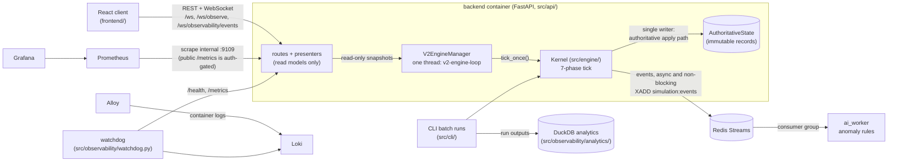

# System overview

A one-page map of how the system fits together. It is D10 of the DevOps baseline ADR (`devops_baseline_adr.md`).
Every claim was checked against the code on `main` (2026-10-13; ops table re-checked 2026-10-21). For depth, follow the links. This page summarises them and does not replace them.

## What it is

A **deterministic, tick-based RPG world simulation**. Entities with needs, goals and strategies act in a generated world. A FastAPI backend runs the
simulation live and serves read-only views of it to a React client, while telemetry flows out of the loop to analysis workers and the monitoring stack.

## Components and how they talk

## Where determinism lives

- **The kernel's 7-phase tick** (`src/engine/phases.py`, `TickPhase`; `docs/engine/kernel.md`): Init → Scheduling → Collection → Resolution →
  Cleanup → Advancement → Persistence.
  - Decisions are made in **Collection**, as proposals that read state.
  - State changes happen only in **Resolution**, through the authoritative apply path (`docs/engine/authoritative_mutation_pipeline_contract.md`).
  - **Persistence** hashes the state, so a replay with the same seed reproduces it.
- **One writer.** The live engine runs ticks serially on one thread (`src/api/engine_manager.py`). The API never mutates world state. That is
  enforced by `tests/architecture/test_api_read_model_guard.py`, which forbids `src/api/routes`, `src/api/ws` and `server.py` from importing raw state types.
- **Telemetry is out of the loop.** The hot path may not block on I/O or heavy analysis
  (`docs/architecture/observability_hot_path_safety_contract.md`). Events go to Redis asynchronously and are analysed by `ai_worker`.

## What is deliberately not distributed

- **The engine is one process and one writer.** That is a choice, not a gap: determinism and replay depend on it
  (`docs/architecture/kernel_concurrency_design_philosophy.md`). Scaling is per run (many seeds in parallel), not per tick.
- **No message broker beyond Redis Streams.** There is no Kafka or RabbitMQ in the running system, and no relational database: run data is
  analytical and append-only.

## Ops capabilities and their evidence level

Levels are those of the DevOps baseline ADR (D7). A capability is listed at the highest level it has **actually reached**, never the planned one.

| capability | where | evidence level (2026-10-21) |
|---|---|---|
| Containerised stack (14 services: 4 default, 10 in the observability profile) | `compose.yaml`, `docker/` | running locally |
| Health and metrics endpoints | `src/api/server.py` (`/health`, `/metrics`) | running locally |
| Metrics, dashboards and logs | Prometheus, Grafana, Loki, Alloy | running locally |
| CI: path-gated test lanes, type and code-health gates | `.github/workflows/test.yml` | running in CI |
| Backend image build check | `test.yml` (not required, not pushed) | running in CI |
| Optional observability profile with memory caps | ADR D1, slice S1 | running locally |
| Published images with an SBOM, a vulnerability report and keyless signing | `.github/workflows/publish-images.yml` | running in CI |
| Load test with a measured throughput figure | ADR D9; `tools/loadtest/`, `docs/runbooks/records/2026-10-18-api-load-test.md` | recorded locally |
| Alerts, SLOs, runbook and a recorded drill | ADR D5; Grafana-managed rules (`docker/grafana/provisioning/alerting/`) to ntfy, `docs/runbooks/`, drills in `docs/runbooks/records/` | running locally, drills recorded |
| Request tracing (API layer) | ADR D4; Tempo is in the observability profile | in progress: Tempo runs, but `src/` emits no spans yet |
| Terraform written and validated | ADR D6; `infra/terraform/`, `.github/workflows/iac.yml` | validated in CI, never applied |
| Cloud deployment | not selected ("2b") | none |

Update this table as each slice lands.

## Further reading

- `docs/engine/kernel.md`: the tick loop, task persistence and concurrency.
- `docs/core/state.md`: immutability and authoritative versus derived state.
- `docs/audits/D23_architecture_resilience.md` §B: the code-confirmed system map this page follows.
- `docs/engine/contracts/infrastructure_overview.md`: a broader component directory. Its diagram is partly out of date, so trust this page and D23 where they differ.
