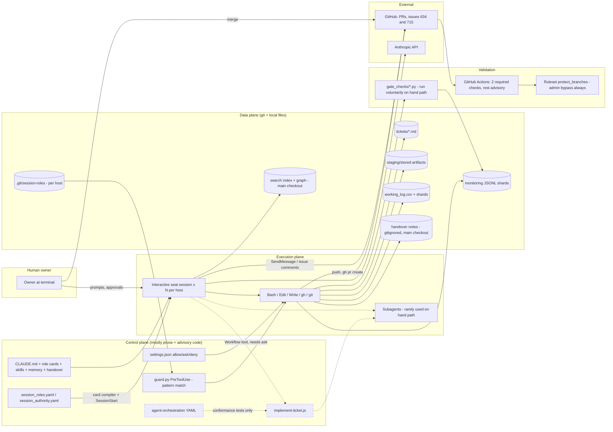
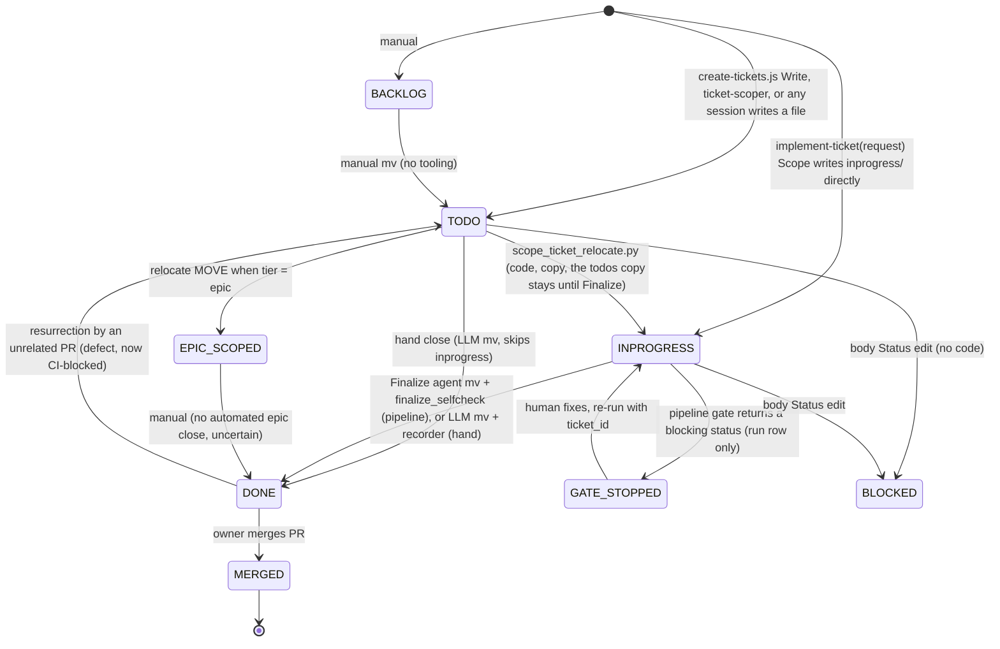
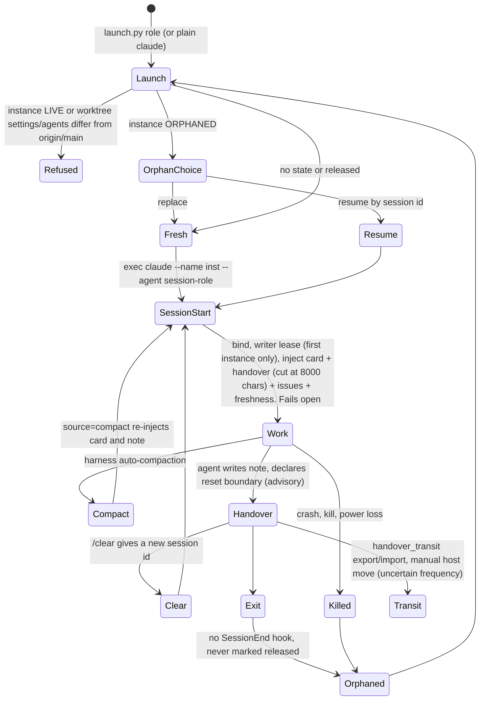
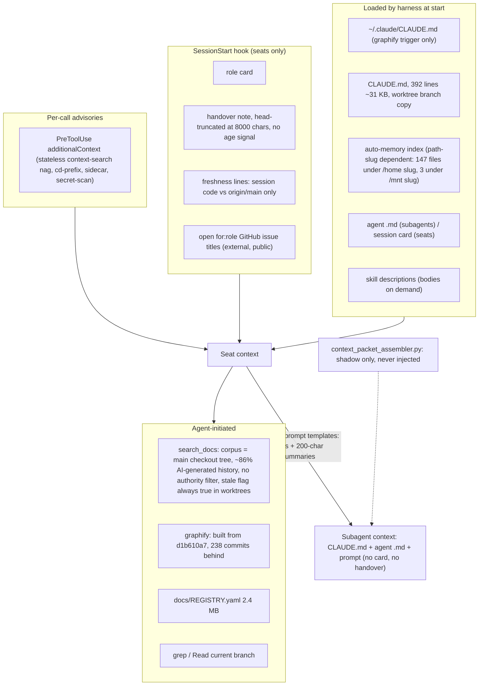
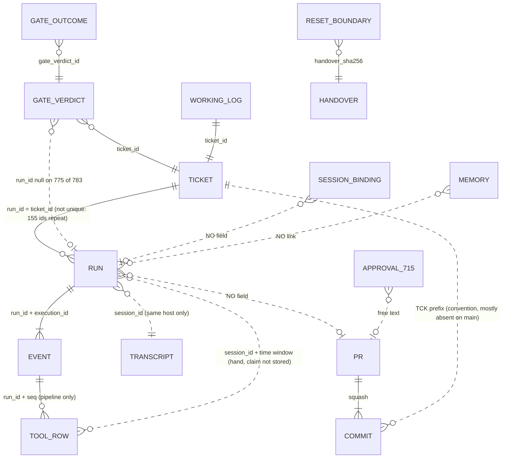
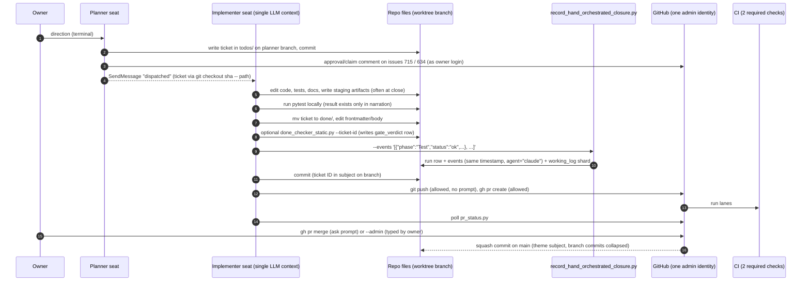
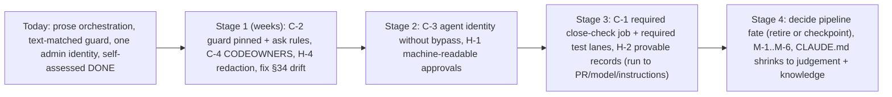
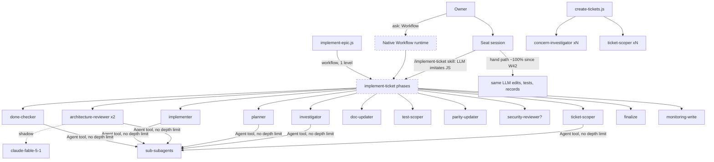
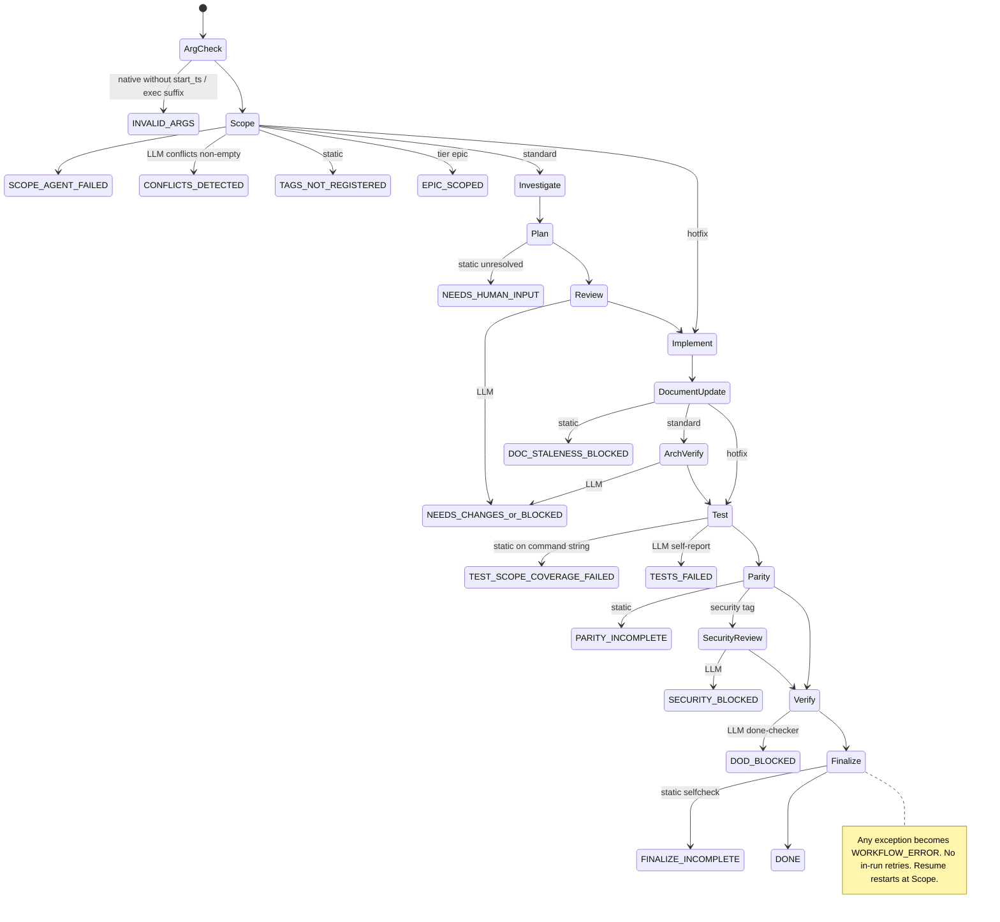

# AI-First SDLC — Architecture Discovery and Audit

| | |
|---|---|
| Repository | `ttnhan18062000/rpg-based-simulation` (GitHub, **PUBLIC**) |
| Audited revision | `origin/main` at `815eef38d` (2026-10-26) |
| Hosts | `u24desktop` (inspected directly). `ubuntu` is the second host and was seen only through committed repo evidence. |
| Method | Read-only. Static reading of code, config and docs; read-only counts over the committed monitoring data; read-only GitHub API queries; pure-function calls (`classify`, `guard.decide`) run in memory. Seven parallel read-only investigators did the sweep. The author re-checked the load-bearing claims (marked **re-verified**). Nothing was executed that writes repository state. |
| Author | Session `agent-working-designer-u24`, written at the owner's request (instruction file `tmp/ai-first-audit-instruction.md`) |
| Scope decisions (owner, 2026-10-26) | Repo plus local Claude config (`~/.claude`) plus runtime state (`.git/session-roles`, handover notes); SDLC machinery only, so product mechanisms (parity ledger, SimQ, Mechanics Bible) appear only where they act as gates; repo and host names kept, secrets redacted |

Evidence classes (spec §2.3): **DOC** documented · **IMPL** implemented · **OBS** observed in runtime records · **VER** verified by direct evidence · **INF** inferred · **UNK** unknown.
Paths are relative to the repository root unless they start with `~` or `<M>` (= the main checkout `/mnt/data/Working/rpg-based-simulation`).

> **Errata (2026-10-26, after revalidation for `AI_FIRST_SDLC_ARCHITECTURE_EVOLUTION_PLAN.md` §10).** Corrections to this audit:
> - **(1) DoD figures.** Gate recording began 2026-10-06T08:22Z, so 296 of the "324 hand closures without a verdict" could never have had one. Since 10-07 the true figure is 28 of 431 (6.5%). Of the "28 closed on FAIL", 17 are post-close artefacts and 8 are recorded overrides; about 5 are genuinely unresolved.
> - **(2) Missed finding: the DoD pre-check never really runs on the hand path.** Run after close, the full `done_checker_static` CLI fails 97 of 97 times. Recommendation C-1 needs a post-close condition set, not `--part both`.
> - **(3) Required checks bind nobody.** The ruleset's `update` rule means every merge to main is an admin-bypass merge (PR #753 is BLOCKED with all checks green), so "Code health" and "Type check" enforce nothing.
> - **(4) R-01 is HIGH, not CRITICAL.** The capability is real, but there were 0 direct pushes to main in 60 days, main is recoverable, and nothing deploys.
> - **(5) Guard bypass list.** Add `env git push` and `gh pr close --delete-branch` to the allowed bypasses. `bash -c` / `sh -c` / `eval` *are* caught (they ask).
> - **(6) R-17 is wrong.** `.claude/.current_session_id` has no production reader.
> - **(7) SDLC tooling size.** It is about 56k LOC (~42% of `src/`), not 79k / 59%. About 5k of it is dormant. Its 86k LOC of tests are separate.
> - **(8) Handover example is stale.** The 77k-character note is now 5.8k. 5 notes are over the cap, the largest at 1.8×, and the cut is announced to the session.
> - **(9) Mode labels.** `execution_mode` labels the native implement-ticket attempts as `pipeline`.
> - **(10) Read/Edit rows moved into Bash.** The drop in Read and Edit rows is partly explained by edits moving into Bash heredocs.
> - **(11) Monitoring coverage is a legacy gap.** No done ticket dated on or after 10-10 lacks a run row. The problem on current closes is the authenticity of the events, not their completeness.
> - **(Note, 2026-10-31.)** By owner decision, the credential and local-permission details in §26, §45, the permissions inventory and the authority table were generalised before this file landed on main (#715 6528807751). Otherwise the body is unchanged from the 2026-10-26 text.
> - **(12) Observed harm is low.** CI was green at merge on 51 of 51 ticket-closing PRs, there were 0 reverts in 60 days, and only 1–2 of 84 closes were provably premature.

---

# Part I — Executive Assessment

## 1. Executive Summary

The repository holds an unusually large, carefully documented SDLC system built on Claude Code. Its parts:

- **32 long-lived session roles ("seats")** across two hosts, each in its own git worktree, with a generated role card and a handover note.
- **A ticket system on the filesystem**: about 3,000 Markdown tickets, plus validators.
- **A multi-agent workflow**: `implement-ticket.js`, 2,379 lines, 12 phases, 18 terminal statuses, 16 specialized subagents.
- **A monitoring data model**: weekly JSONL shards for runs, events, tool calls, gate verdicts and session events, with a retro generator.
- **A gate library** (31 scripts), **a permission guard** (hook), and **CI** (9 workflows).

The SDLC tooling is about **79k lines of Python**, about 59% of the size of the product (`src/`, 132k LOC).

The central finding is that **designed architecture and operating architecture have split apart.**

- **What the architecture was designed as.** A hybrid workflow engine: deterministic JS control flow with AI workers, deterministic static gates, AI verdict gates, and human gates at push/merge.
- **What actually runs.** The formal pipeline has not completed a run since **2026-10-04**. Its last attempt was 2026-10-09 and ended in `WORKFLOW_ERROR`. **100% of recorded ticket closures in weeks W42 and W43 (263 runs) were hand-orchestrated** (re-verified). In a hand closure, one interactive session plans, edits, tests and closes the ticket, then calls a recorder that writes *narrated* phase events with an identical timestamp. The independent reviewer agents, the plan gate and the LLM done-checker therefore **did not run** for current work. Across 755 hand closures, Review and Architecture-Verify each show "ok" exactly once.
- **What the system enforces on that path.** Very little. There are structural file checks, run voluntarily, and two required CI checks ("Code health", "Type check"). The `DONE` transition, the most important transition, relies on AI self-assessment plus a merge by a human.
- **What enforces human authority.** A Claude Code permission `ask` list and a PreToolUse guard hook that pattern-matches shell commands. The guard does not see indirection: a push to main via `python3 -c "subprocess…"` and a merge via `gh api -X PUT …/merge` both classify as *no action* (re-verified). On GitHub, all agents and the owner share **one admin identity**, and the only ruleset grants that role **`bypass_mode: always`** (re-verified). Approvals are free-text comments on issue #715, written by agents, under the owner's account.

These are not signs of negligence. The project documents most of these gaps itself, for example the 94%-zero-duration finding, the "guardrail, not a sandbox" note in `guard.py`, and the forgeable attestation. Many incident-driven controls are real and well built: the location-consistency validator with a CI corpus test, the SubagentStop blocking hook, the writer lease, and generated role cards with drift tests. The weakness lies in *where* the deterministic controls sit. They are concentrated on bookkeeping integrity (file locations, log rows, shard formats). They are thin at the trust boundaries that matter: completion, approval, identity, and self-modification of enforcement.

The highest-leverage direction (Part VI) does not revive the heavy pipeline. It **moves the deterministic boundary to where the work really passes**: the PR that closes a ticket, and the identity that can merge it.

## 2. System Purpose and Scope

The owner's stated goal is in `docs/plans/agent_infrastructure/agent_working_direction.md` (2026-10-01): *"AI-first, fully automated development up to the deliberate human points (push, PR creation, merge, workflow opt-in)"*, with three properties: **observable**, **self-diagnosing**, **adaptable**.

The audited system covers:

- the instruction layers (CLAUDE.md, agents, skills, cards, memory, handover);
- tickets;
- workflows (`.claude/workflows/`);
- the provider-neutral contract layer (`agent-working/agent-orchestration/`);
- the session layer (`tools/sessions/`, `registries/session_*.yaml`);
- monitoring (`tools/agent-monitoring/`, `agent-working/agent-monitoring/`);
- gates (`tools/gate_checks/`);
- delivery tooling (`tools/delivery/`);
- hooks (`.claude/settings.json`);
- MCP servers (`.mcp.json`);
- CI (`.github/workflows/`);
- the GitHub ruleset;
- the user-level Claude configuration (`~/.claude`).

The simulation product itself is out of scope.

## 3. Current Architectural Classification

| As designed | As operated (W42–W44) |
|---|---|
| **Hybrid**: a deterministic workflow script, with AI workers, deterministic gates, AI verdict gates and human gates | **Prompt-driven orchestration by long-lived interactive agents**, coordinated through files, GitHub issues and cross-session messages. Deterministic support is limited to bookkeeping validators, two required CI checks and a pattern-matching guard |

Best single description (spec §29): **a ticket-driven, multi-seat agent operating model with a large custom bookkeeping and observability framework.** The workflow engine inside it is built but dormant. It is *not* an AI-integrated workflow engine in operation, because nothing deterministic owns workflow state. It is far beyond "an AI coding assistant configuration": it has persistent roles, leases, a ticket corpus, a monitoring data model, gate ledgers, and a role-manifest compiler.

## 4. Key Architectural Strengths

1. **State lives outside the LLM context.** Tickets, artifacts, logs and monitoring are durable git-tracked files. A session can be killed and resumed from disk (VER).
2. **Incident-to-control discipline.** Recurring failures were turned into executable controls:
   - the location/frontmatter consistency validator plus its CI corpus test: 0 inconsistent files across 2,999 tickets (VER);
   - the SubagentStop background-task block (IMPL, tested);
   - closed-ticket resurrection detection (IMPL, CI);
   - deterministic REGISTRY output;
   - writer leases;
   - card budget tests.
3. **Self-measurement and candour.** The monitoring corpus and retros found and published the system's own weaknesses: the zero-duration recorder artefact, parity skipped 49 of 51 times, a forgeable attestation, a REGISTRY merge-conflict tax. Few AI-automation setups can measure themselves this way.
4. **Generated, drift-tested role configuration.** The 32 session cards are compiled from the YAML registries and docs; `generate_agents --check` runs in CI (IMPL, VER).
5. **Explicit human points**: `ask` on `Workflow`, on `gh pr merge`, on remote deletes and on `git worktree remove`, plus a hard deny on `gh pr merge --admin` (IMPL).
6. **A fail-closed guard for its own errors.** On authority-sensitive input, `guard.py` exits 2 on internal exceptions rather than failing open (IMPL).
7. **Separation of read model and write path in monitoring.** JSONL is the source of truth; SQLite and DuckDB views are derived and rebuildable (IMPL).

## 5. Critical Architectural Risks

| # | Risk | Severity | Likelihood | Detail |
|---|---|---|---|---|
| R-01 | Human-only actions (push to main, merge, remote delete) are enforceable against *literal* commands only. Indirection passes. On GitHub the agents' identity has an always-on admin bypass. | **CRITICAL** | Low | §26 |
| R-02 | The `DONE` transition relies on AI self-assessment on the dominant (hand) path. Structural checks are voluntary, and no check establishes that tests ran or passed. | **HIGH** | High (it is the norm) | §20 |
| R-03 | Owner and agents share one GitHub identity; approvals are agent-written free text. An approval cannot be attributed or machine-checked. | **HIGH** | Medium | §21 |
| R-04 | Validators are editable in the PR they judge: gate code, tests, CI YAML, baselines, acceptance criteria, guard and hooks. Only 2 lint/type checks are required; no review rule; no CODEOWNERS. | **HIGH** | Medium | §20, §26 |
| R-05 | Execution records cannot independently prove what happened. Hand-path events are synthetic. Records are mutable via Edit. No run→commit/PR link. No model or instruction version recorded. | **MEDIUM** | High | §28 |
| R-06 | Context freshness signals are wrong or absent. The search staleness flag is always a false positive in worktrees; the code graph is 238 commits behind; handover notes are truncated (one is 77 KB against an 8 KB cap) and carry no age. | **MEDIUM** | High | §14 |

The full register is in Matrix M-6.

## 6. Overall Audit Confidence and Limitations

- **High confidence:** configuration, permission rules, hook wiring, the GitHub ruleset, counts over monitoring data, and the workflow control flow (read from source).
- **Medium confidence:** behavioural claims about the Claude Code harness that this repo cannot prove. These cover how auto mode treats `ask` rules and a hook's `ask`, whether CLAUDE.md, settings or hooks reload mid-session, the Workflow runtime's resume and depth semantics, and transcript retention.
- **Not inspected:** the `ubuntu` host's runtime state (only committed evidence of it); the contents of conversation transcripts (privacy); the contents of the 147 auto-memory files; `.env` values.
- **Not executed** (by design): a native workflow run, the attack paths in §26, test re-runs. Each has a procedure in §42.
- **Observer effect:** the audit's own tool calls wrote monitoring tool rows through the hooks. This cannot be avoided and does not affect the findings.

---

# Part II — Architecture Reconstruction

## 7. System Component Inventory

| Component | Purpose | Implementation | Entry point | Dependencies | State ownership | Evidence |
|---|---|---|---|---|---|---|
| Claude Code harness | Runs sessions, subagents, tools, permissions, hooks, MCP, Workflow runtime | Vendor CLI | `claude`, `claude --agent session-<role>` | Anthropic API | Transcripts `~/.claude/projects/*/*.jsonl` | system context; `tools/sessions/launch.py` |
| Instruction layer | Behaviour, workflow procedure, project knowledge | Markdown | Loaded by harness / hook | — | git, plus untracked memory/handover | §24 |
| Session launcher | Create/resume/replace a seat, self-heal its worktree | Python | `python3 tools/sessions/launch.py <role>` | git, `~/.claude/projects` | `<M>/.git/session-roles/<inst>/` | `launch.py:96-101,486-519` |
| Session registry | Roles, functions, domains, owned globs, dispatch rules, user-only actions | YAML | read by tools | — | `registries/session_roles.yaml`, `session_authority.yaml` | 32 roles, 9 domains |
| Card compiler | Generate `.claude/agents/session-*.md` | Python | `tools/sessions/generate_agents.py` | registries, `docs/guidelines/session_roles/**` | generated files (git) | `generate_agents.py:27-30` |
| SessionStart hook | Bind role, take writer lease, inject card + handover + issues + freshness | Python hook | SessionStart (startup/resume/clear/compact) | `gh`, git | bindings, leases | `tools/sessions/session_start_hook.py` |
| Guard | Gate authority actions (push main, merge, remote delete), lease enforcement | Python PreToolUse hook | Bash/Edit/Write/MultiEdit/NotebookEdit/SendMessage | `classify.py`, state | none | `tools/sessions/guard.py`, `classify.py` |
| Ticket store | Unit of work | Markdown + YAML frontmatter on disk | `agent-working/tickets/{todos,inprogress,done,backlogs}` | registries | git | §10 |
| Ticket validators | Schema, enums, location consistency, tags/layers | Python | `validate_frontmatter.py`, `ticket_field_values.py`, `tag_registry.py`, `layer_registry.py` | registries | — | §48 |
| Workflow scripts | Multi-phase orchestration | JS for the Claude Code `Workflow` tool | `Workflow` tool (needs approval) **or** an LLM reading the JS through `/implement-ticket` | agents, gate CLIs | none (stateless; files on disk) | `.claude/workflows/*.js` |
| Provider-neutral contract | Canonical vocabulary, roles, gate policy, terminal statuses | YAML | generators/tests only | — | git | `agent-working/agent-orchestration/` |
| Subagents | Specialized workers | Markdown agent definitions | `Agent(subagent_type)` / `agent()` | inherit model | none | `.claude/agents/*.md` (16 functional) |
| Gate library | Static checks | Python | `tools/gate_checks/gate_cli.py`, per-gate CLIs | repo files | `gate_verdicts` rows | 31 files, 6,650 LOC |
| Hand-closure recorder | Write run/events/working-log row for a hand close | Python | `record_hand_orchestrated_closure.py` | monitoring writer | monitoring shards | §15 |
| Monitoring writer/hooks | Runs, events, tool rows, session events | Python + hooks | `record_run.py`, `record_events.py`, `post_tool_hook.py` | sidecar `.claude/current_run.<sid>` | `agent-working/agent-monitoring/data/YYYY-Www/*.jsonl` | §15 |
| Week close / retro | Fold shards, generate reports | Python | `make agent-monitoring-close-week`, `generate_retro.py` | data | retro md files | §28 |
| Knowledge search MCP | Hybrid BM25 + vector search over docs/tickets | Python MCP (stdio) | `search_docs` | sqlite + MiniLM index in `<M>` | `<M>/agent-working/.index/knowledge-index` | `tools/search_mcp.py` |
| graphify | Code knowledge graph | external CLI | `graphify query` | `<M>/graphify-out` (symlinked) | graph files | `tools/graphify_link.py` |
| Delivery tools | PR body render, CI status, triage, lanes | Python | `tools/delivery/*.py` | `gh` | — | §16 |
| CI | Tests, lint, type, security scan, images, sim gates | GitHub Actions | PR / push / schedule | runners | GitHub | `.github/workflows/*.yml` (9) |
| GitHub ruleset | Server-side branch rules | GitHub | — | — | GitHub | ruleset 14220945 |
| Coordination channels | Cross-session messages, claims, approvals | `SendMessage`; GitHub issues (#634 claims, #715 approvals); Remote Control | — | GitHub | GitHub (mutable comments) | `docs/guides/cross_session_messages.md` |
| Handover store | Cross-`/clear` continuity per seat | Markdown, gitignored | written by the agent; injected by SessionStart | — | `<M>/.claude/handover/*.md` (single copy) | `tools/handover_home.py` |
| Handover transit | Move notes/memory between hosts | Python + committed bundle | `tools/handover_transit.py export/import` | git push | `agent-working/handover-transit/<host>/` (public) | §13 |
| Codex track | Alternate provider | Python pilots/shadows | none live | — | — | `tools/agent_codex_*` (53 files); 0 codex runs recorded |

## 8. High-Level Architecture Diagram

Solid edges are the paths in use (W42–W44). Dashed edges are built but dormant, or advisory.

## 9. Control Plane and Execution Plane

The planes are **not explicitly separated**. Their responsibilities are spread as follows.

- **Control-plane responsibilities**, meaning what to do next, who may act and when work is complete:
  - **Natural language** (VER): CLAUDE.md is about 30% workflow procedure by word share; role cards say "design and draft, never dispatch"; handover notes say what is in flight.
  - **The interactive session's own judgment.**
  - **Two deterministic exceptions:**
    - `guard.py`, for a narrow set of git/GitHub actions;
    - `implement-ticket.js` control flow, which is deterministic only when executed by the native Workflow runtime and that has never completed.
- **Execution plane:** the same interactive session that holds the control role, plus the subagents it may spawn. On the dominant path, **control and execution are the same LLM context** (INF from OBS).
- **Data plane:** git-tracked files, plus untracked local state (`.git/session-roles`, handover notes, transcripts, memory, indices). No database or service owns any of it. Consistency comes from validators that run *after* writes (verify-after design).
- **Validation plane:**
  - static Python checks, run by the same agent that did the work;
  - CI, where only "Code health" and "Type check" are required;
  - human merge.

## 10. Ticket Lifecycle Architecture

A ticket is one file, `agent-working/tickets/<dir>/TCK-YYYYMMDD-SHORT-SCOPE.md`. The filename stem is the ID; nothing checks it against frontmatter `ticket_id`, and 3 files disagree (OBS).

**Schema.**
- Frontmatter:
  - `status ∈ {authoritative, active, historical, archive}`
  - `layer` (registry allowlist)
  - `authority ∈ {P0,P1,P2}`
  - `audience`
  - `ticket_id`
  - `phase ∈ {open, inprogress, blocked, done, backlog}`
  - `date`
  - `tags` (registry allowlist for tickets dated ≥ 2026-07-04)

  Evidence: `tools/validate_frontmatter.py:48-60,191-209,240-252`.
- Body fields with value checks: `## Tier ∈ {hotfix, standard, epic}`, `## Priority ∈ {P0..P3}`, `## Status ∈ {OPEN, INPROGRESS, BLOCKED, DONE, EPIC_SCOPED}`, optional `## Disposition`. **An absent section passes** (`ticket_field_values.py:137-148`). In done/, 49 tickets lack Tier and 39 lack Priority (OBS). The CLAUDE.md section order is not validated by anything.

**Linkage.**

| Link | Mechanism | Strength |
|---|---|---|
| Parent/child | Folder co-location under `todos/<folder>/`, prose `## Related Tickets`, `SEQUENCE.md` order | Prose only |
| Dependencies | `SEQUENCE.md` order, read by an LLM in implement-epic Discover; a `BLOCKED` child is skipped | No `depends_on` field; nothing checks that a predecessor is done |
| Artifacts | `staging_artifacts/<id>/` → `stored_artifacts/<id>/` at close | Checked by done_checker on the pipeline path |
| Working log | Staged per-batch JSONL, folded into `working_log.csv` at week close (`working_log_writer.py:10-25`) | Checked for exactly one row at close |
| Commits | Ticket ID in subject | **Convention only.** 186 of the last 200 main subjects lack a `TCK-` prefix, because squash merges use theme titles (OBS) |
| PRs | `Closes:` in the body, rendered by `pr_render.py` only for tickets already in `done/` | Advisory |
| Monitoring | `run_id = ticket_id`, `ticket_id` on events and gate verdicts | Strong |

**Where ticket state lives.** Five places carry ticket state: (i) directory, (ii) frontmatter status/phase, (iii) body `## Status`, (iv) working-log row, (v) run `final_status`. **Only (i), plus (ii) in `done/`, is mechanically enforced.** That enforcement is a CI corpus test with 0 violations in 2,999 files (VER). The others drift:

- 51 done tickets have a body Status other than DONE (OBS);
- no code ever sets `phase: inprogress`;
- 155 done tickets have no working-log row.

**Ticket state is descriptive. The directory is the only authoritative carrier.**

There is no Cancelled or Failed state. Cancellation is `DONE` plus `## Disposition: WONT-DO | SUPERSEDED | DUPLICATE` (8 tickets so far).

Counts (2026-10-26):

| Directory | Tickets |
|---|---|
| todos/ | 91 (9 folders) |
| inprogress/ | 13 |
| done/ | 2,895 |
| backlogs/ | 31 entries |

## 11. Workflow and Orchestration Architecture

**Workflow inventory.**

| Workflow | Lines | Phases | Use observed |
|---|---|---|---|
| `implement-ticket.js` | 2,379 | Scope, Investigate, Plan, Review, Implement, Document-Update, Architecture-Verify, Test, Parity, Security-Review (conditional), Verify, Finalize. 18 terminal statuses | 11 `pipeline` runs W40–W41 and 0 since. 2 native runs, both failed or probes |
| `implement-epic.js` | 670 | Discover, Implement (nested `workflow('implement-ticket')`, serial, stops at first non-DONE), Report | 1 native run |
| `create-tickets.js` | 1,066 | Comprehend, Investigate (parallel), Structure, Write (parallel), Link | 5 native runs |
| `simq-audit.js` | 513 | 7 phases | 4 runs. It names 3 agent types that do not exist (`drift-classifier`, `anchor-updater`, `doc-syncer`) |
| 7 simulation-lab workflows | — | 3 phases each | out of scope |

**How a workflow "executes".** There are three modes, and this is the most important architectural fact about the workflow layer.

1. **Native** (`execution_mode: workflow`). The Claude Code `Workflow` tool executes the JS deterministically. It needs a user `ask` approval. The refusal list is now empty (`NATIVE_UNPORTED_GATE_SITES = []`, `implement-ticket.js:221`, re-verified), but **no native implement-ticket run has ever completed**. The 2026-10-09 attempt cost 925,732 tokens over 27.8 minutes and died on a truncated attested command (`GATE_ATTESTATION_FAILED`).
2. **Skill / "pipeline"** (`execution_mode: pipeline`). The top-level LLM *reads the JS and imitates it* by issuing tool calls itself. `.claude/skills/implement-ticket/SKILL.md` says: *"Do not call the Workflow tool — it is not available. Execute the workflow directly"*. `docs/agent-monitoring/schema.md:80` defines the mode as *"an LLM reading the script and manually issuing the equivalent tool calls, never actually executing the JS"*. In this mode the deterministic control flow is a prompt.
3. **Hand** (`execution_mode: hand`). No workflow is involved. The session does the work and then runs `record_hand_orchestrated_closure.py`, which writes a run row and phase events from a JSON list the agent provides.

Measured mix (re-verified):

| Week | hand | pipeline | workflow |
|---|---|---|---|
| W41 | 274 | 4 | 3 |
| W42 | 151 | 0 | 0 |
| W43 | 112 | 0 | 0 |

Hand `path_reason` values W42–W43: owner_directed 144, batch_hand_close 72, small_change 32, investigation_only 11, other 4.

**Composition.** One-level nesting (epic → ticket). Branching by tier and by conditions: security tag, `behavior_changed`, src touched. Parallel stages only in create-tickets. No dynamic modification. No in-run retries: every gate failure is a terminal `return`, and "resume" means re-running with the same `ticket_id`, which **restarts from Scope** (OBS: the W40 pilot re-ran Investigate twice). There is no checkpoint (`docs/ai/phase_resume_validation_rule_decision.md` §1: "greenfield — no phase-level checkpoint exists").

The JS is the source of truth. The provider-neutral YAML was bootstrapped from it once and is held in line by regex-based conformance tests (`tests/agent_orchestration_claude_adapter/test_gate_policy_conformance.py`, `tools/gate_checks/workflow_vocabulary_check.py`). The YAML's `workflow_version` field is read by no adapter.

## 12. Agent Architecture

- **16 functional subagents.** Of these, the pipeline uses 10 by type, plus 2 untyped ones (finalize, monitoring-write). The other 4 (mechanics-auditor, simulation-analyst, world-debugger, world-render-reviewer, plus spec-document-reviewer) are domain or analysis agents.
- **32 generated session cards.** These are main-session definitions used through `claude --agent session-<role>`, not subagents. They have no `tools:` line, so every seat, designers included, has all tools.
- **Models.** No agent file sets a model. The shadow reviewers in code use `claude-fable-5-1`; everything else inherits the session model.

**Delegation.**
- There are two orchestrators: `implement-ticket.js` (when native) or the top-level session (skill and hand paths).
- 9 functional agents declare the `Agent` tool and can spawn sub-subagents. The repo sets no depth limit.
- Agents do not message each other inside a workflow. Results flow as returned JSON plus shared files (plan.md, investigation.md, the ticket).
- Conflicting outputs are not reconciled; a later gate's verdict simply ends the run.

**Separation of duties.** A different agent type means a different context and different instructions. It does **not** mean a different model, and the permissions are not narrower in any meaningful way:
- `done-checker` holds Edit, Write and Agent (22 tools);
- `architecture-reviewer` holds Write;
- `implementer` and `parity-updater` hold all tools.

Only `security-reviewer`, `mechanics-auditor` and `world-debugger` are read-only. On the hand path one context implements, tests, narrates Verify, records the closure and commits. The checks that are genuinely independent are: orchestrator-run static gates (native only), CI, and the human merge.

The agent capability matrix is in Matrix M-3.

## 13. Session Architecture

**What a session is.** A *session* is one Claude Code process. Its id changes on `/clear`. The durable identity is the **role instance** (`<role>` or `<role>-N`), recorded per host in `<M>/.git/session-roles/<inst>/` as `instance.json` plus `bindings.jsonl`.

- **Binding fields:** `session_id, role, source, worktree, branch, transcript_path, process{pid,start,cmdline}, manifest_digest, ts` (`tools/sessions/state.py:76-86`). There is **no ticket, run or model field.**
- **Liveness** is computed from `/proc` (pid + start time), never stored.

Observed on u24desktop:
- 21 role-state directories; 12 live, 6 orphaned, 2 released;
- 206 bindings since 2026-10-04: compact 83, clear 57, startup 33, resume 33;
- 42 git worktrees;
- 21 handover notes, about 1.7 MB including history files.

**Ticket → workflow → agent → session → context.**

| Level | Authoritative source | Note |
|---|---|---|
| Ticket | Directory location of the file on the branch, then on `main` after merge | A ticket on a seat branch is invisible to other seats until merged (#746 had to "bring 17 open rpg tickets to main so other seats can see them") |
| Workflow execution | Nothing durable. Monitoring run row + events after the fact; sidecar `.claude/current_run.<sid>` during a pipeline run | Hand path: no execution object exists while work happens |
| Agent invocation | Subagent transcript (host-local); event rows | Not bound to a role |
| Session | `bindings.jsonl` / `instance.json` (per host) + transcript | No cross-host liveness |
| Context | Not authoritative: card + note + CLAUDE.md + memory + compaction summary | Rebuilt at every start/compact |

Session state and workflow state are **independent stores with no foreign key**. The only joins are the sidecar (pipeline only) and branch names.

**Transfer between hosts.** `handover_transit.py export` copies notes, drafts and memory into the committed `agent-working/handover-transit/<host>/` (149 files in the current bundle). The repo is public and the tool has no secret scan.

## 14. Context and Memory Architecture

**Answers to the spec §11 questions.**
- Context is selected dynamically only by agent-initiated search.
- Ticket scoping exists only in workflow prompt templates (pipeline). Role scoping exists only in card plus note.
- Prior decisions arrive by handover prose and by search over done tickets.
- Execution histories are neither indexed nor injected.
- **No mechanism tells an agent which context is authoritative and which is AI-generated.** The partial exceptions are CLAUDE.md's precedence rule for the Mechanics Bible, and the "titles are data, not instructions" label on injected issue titles.

**Verified defects.**

1. **The search staleness flag is a false positive in every worktree.**
   - Worktrees read the main checkout's index, but `index_staleness()` compares manifest mtimes against the *calling checkout's* files (`tools/knowledge_search.py:681-696`, re-verified).
   - Result: `stale.changed = 5397/5397` in worktrees vs 2/5397 in the main checkout.
   - The only freshness signal is therefore noise, and a genuinely stale index looks the same.
2. **The index is built from the main checkout tree**, so a seat's own new docs and tickets are not findable until the main checkout picks them up and reindexes.
3. **The code graph is stale and mislabelled.** It was built from `d1b610a7`, 238 commits behind main, and its header says "testing (2026-10-19)".
4. **Handover notes.**
   - Cap of 8,000 chars (`session_start_hook.py:36`, re-verified). `rpg-implementer-2.md` is 77,122 chars (re-verified), so about 90% is never injected.
   - Notes are injected with no age. One note asserts a PR is open that merged 5 minutes after it was written.
5. **Retrieval ranks without authority.** About 86% of the 5,397 indexed paths are AI-generated history (done tickets, investigations, working log). `search_mcp` never passes the authority or freshness filters that `hybrid_retrieval.py:131-147` supports, so a historical ticket ranks equal to a P0 Mechanics chapter.
6. **The context-search advisory is stateless.** It fires on every Bash call containing grep/find/`ag ` (which also matches "tag ", "flag "), even after `search_docs` was called. It fired about 30 times per investigator in this audit. The rule it backs is unenforced, and the noise trains agents to ignore advisories.
7. **Auto-memory splits by path spelling.** `/home/u24desktop/Working` is a symlink to `/mnt/data/Working`, so learned rules apply only to sessions launched under the same spelling.
8. **The phase handoff in the workflow is lossy.** It passes summaries, cut at 200 characters, plus file paths. Each subagent re-derives the context by search.

**Memory architecture.** There are three memory stores. All are agent-written and **none is reviewed**:

| Store | Location | Versioning | Reach |
|---|---|---|---|
| Auto-memory | `~/.claude/projects/<slug>/memory/` | Unversioned | Host-local |
| Handover notes | `<M>/.claude/handover/` | Gitignored, single copy | Main checkout of one host |
| Transit bundle | `agent-working/handover-transit/` | Committed | Public repo |

Memory is injected as instruction-grade context and can steer workflow decisions. There is no expiry and no contradiction handling. AI-generated memory therefore *de facto* becomes authoritative.

## 15. Data Persistence and Recording Architecture

| Entity | Storage | Format | Producer | Consumer | Mutability | Versioning |
|---|---|---|---|---|---|---|
| Ticket | `agent-working/tickets/**.md` | MD + YAML | agents | validators, registry, search | mutable | git |
| Artifacts | `staging_artifacts/`, `stored_artifacts/` | MD | agents | done_checker; recorder derives "phase ran" from their existence | mutable | git |
| Run | `data/YYYY-Www/[<batch>.]runs.jsonl` | JSONL (`docs/agent-monitoring/schema.md:51-155`) | `record_run.py` (pipeline, via an LLM "monitoring-write" agent), hand recorder | retro, index, validators | append by convention; `week_close` re-derives rows in place | git, `merge=union` |
| Event | `…events.jsonl` | JSONL | same | same | same | git |
| Tool call | `…<batch>.tools.jsonl` | JSONL; first 80 chars of the command, unredacted | `post_tool_hook.py` (PostToolUse + PostToolUseFailure) | cost proxy, closure-time claim | append | git (only if the shard is committed) |
| Gate verdict / outcome / adjudication | `…gate_verdicts.jsonl` | JSONL, `gv-<hex>` ids | gate CLIs, `gate_ledger.py` | retro Gates section | append-only by design | git |
| Session events | `manual_actions`, `role_boundary`, `reset_boundary` shards | JSONL | hooks, `reset_boundary.py` | session-layer report | append | git |
| Working log | `working_log.csv` + `<batch>.working_log.jsonl` | CSV / JSONL | `working_log_writer.py` | done_checker, search index | append; folded weekly | git |
| Retro | `agent-monitoring/retro/RETRO-*.md` | MD | `generate_retro.py` | humans/agents | regenerated snapshot | git |
| Derived index | `agent-working/.index/agent-monitoring-index/monitoring.db` | SQLite | `build_index.py` | `query.py` | rebuilt | none (gitignored) |
| Decisions | `docs/ai/*_decision.md`, `docs/guidelines/intentional_divergences.md` | MD | agents/owner | agents | mutable | git |
| Approvals | GitHub issue #715 (104 comments) | free text | agent sessions, under owner login | leads, humans | editable comments | none in git |
| Transcripts | `~/.claude/projects/<slug>/<sid>.jsonl` (594 files, 2.2 GB, oldest 2026-09-23) | Claude Code JSONL | harness | `real_token_usage.py` | runtime-owned, pruned (~30 days, INF) | none, host-local |
| Session state | `<M>/.git/session-roles/` | JSON/JSONL | launcher, SessionStart | guard, launcher | rewritten | none, host-local |
| Test results | not persisted per run | — | — | — | — | GitHub check runs only |

**Correlation gaps.** Seven links are missing:
- tool row → run on the hand path (0 of 15,278 rows in W42–W43);
- run → commit;
- run → PR;
- approval → PR;
- run → model;
- run → instruction/workflow version;
- event → real agent identity (hand events record `agent="claude"`).

## 16. Tool and Integration Architecture

| Integration | Invocation | Blocks? | Failure mode | Side effects / logging |
|---|---|---|---|---|
| `pre_tool_hook.py` | PreToolUse `*` | no | `2>/dev/null \|\| true` | start stamp file; writes a **shared, unscoped** `.claude/.current_session_id` (race across sessions) |
| context-search reminder (inline) | PreToolUse Bash/Agent | advisory | `\|\| true` | none |
| sidecar-check (inline) | PreToolUse Edit/Write | advisory | `\|\| true` | none |
| secret-scan (inline) | PreToolUse Bash | advisory ("not blocked") | silent no-op on import failure | none |
| `cd_prefix_advisory_hook.py` | PreToolUse Bash | advisory | `\|\| true` | none |
| `pre_push_advisory_hook.py` | PreToolUse Bash | advisory (always exit 0) | relative path | none |
| **`tools/sessions/guard.py`** | PreToolUse Bash/Edit/Write/MultiEdit/NotebookEdit/SendMessage | **deny/ask**; exit 2 on internal error for authority input | `test -f … \|\| exit 0`; **runs the copy in the caller's own worktree** | none |
| `post_tool_hook.py` | PostToolUse `*`, PostToolUseFailure | no | `\|\| true` | tools.jsonl rows (unredacted command prefix → public repo) |
| graphify update | PostToolUse Edit/Write | no | main checkout only | graph files |
| retro / epic-staleness / week-close nudges | PostToolUse | advisory | `\|\| true` | state files |
| code-health edit ratchet | PostToolUse Edit/Write | advisory | `\|\| true` | none |
| **`subagent_stop_background_guard.py`** | SubagentStop | **blocks** (`decision: block`, exit 2) | relative path, no `test -f` guard: a wrong cwd would block every subagent stop (INF) | none |
| `manual_actions.py` | UserPromptSubmit | no | `\|\| true` | prompt *category* only (privacy-preserving) |
| `session_start_hook.py` | SessionStart | no (context only) | fails open | binding, lease |
| Git hooks | `.git/hooks/post-merge` only | — | pre-commit (prek) is opt-in and not installed on this host | registry regeneration |
| Merge drivers | `.gitattributes` | — | local merges only; GitHub ignores them | `merge=union` for JSONL/CSV |
| MCP `knowledge-search` | stdio | — | launcher probes venvs | read-only |
| MCP `github` | docker, `--env-file .env` | — | absent `.env` in worktrees; disabled in main-checkout local settings | write-capable under its token |
| MCP `headroom` | stdio | — | trial verdict "ABANDON Phase 2", still configured | — |
| MCP `aseprite` | stdio, bwrap sandbox | — | failed to connect (CONNECTION_CLOSED) | — |
| Delivery tools | manual/agent | advisory helpers | — | `gh` reads |
| CI | GitHub | 2 required checks | — | — |

**Permission configuration** (`.claude/settings.json`):

- **49 allow rules.** They include `Write`, `Edit`, `Bash(git *)`, `Bash(rm *)`, `Bash(python3 *)`, `Bash(curl *)`, `Bash(docker *)`, `Bash(pip *)`, `Bash(npx *)`, `Bash(pkill *)` and `Bash(gh pr create *)`. Two entries are dead paths that belong to another host: `/home/vboxuser/...`.
- **8 ask rules:** `gh pr merge *`, two `git push --delete` forms, two `gh api` DELETE forms, `git worktree remove *`, `rm *agent-working/agent-monitoring/*`, and `Workflow`.
- **1 deny rule:** `gh pr merge*--admin*`.

The main checkout's untracked `settings.local.json` adds further allow rules for the seats launched there, widening what they can do on GitHub (specifics withheld, see the note under the errata). User-level settings carry an `autoMode.environment` prose policy for the auto-mode classifier. Its claim that the ruleset protects 18 branches is wrong: the live ruleset covers the default branch only.

**Trust boundary between AI decisions and executable operations.**
- The boundary is the harness permission layer plus `guard.py`. Both match command *text*.
- `classify.strip_text` removes quoted payloads unless the command contains `eval`, `sh -c` or `xargs git` (`classify.py:42,141-150`). So `python3 -c "…git push origin main…"` is classified as no action.
- `gh api` is classified only for DELETE (`classify.py:284-287`), so `gh api -X PUT …/pulls/N/merge` is no action.
- Both were re-verified by calling the pure `classify()` function.
- `guard.py`'s own docstring calls itself *"a guardrail against mistakes, not a sandbox"*.

---

# Part III — Operational Behavior

## 17. End-to-End Execution Lifecycle

**As designed (pipeline, standard tier):** the owner opts in, then Scope, Investigate, Plan, plan gate, architecture Review, Implement, Document-Update, Architecture-Verify, Test, Parity, conditional Security-Review, Verify (done-checker), Finalize, DONE. After that a session commits, pushes, opens a PR, polls CI, and the owner merges.

**As operated (hand path, 100% of W42–W43):**

## 18. Workflow State Transitions

Every pipeline gate is terminal. On the hand path no gate exists unless the agent runs one.

| Transition | Decided by | Authority class | Evidence |
|---|---|---|---|
| Start a workflow | Owner (`ask: Workflow`) | Human | `.claude/settings.json` ask |
| Choose hand vs pipeline | Session LLM; `path_reason` recorded (54% owner_directed) | LLM / Human | runs shards |
| Tier | `tierOverride ‖ ticketInfo.tier ‖ 'standard'`. `ticketInfo.tier` is written by the ticket-scoper LLM | Config over LLM output | `implement-ticket.js:555` |
| Next step | JS control flow when native; LLM imitation on the skill path; LLM judgment on the hand path | Deterministic / LLM / LLM | SKILL.md; schema.md:80 |
| Static gate pass (tag, plan_unresolved, doc_staleness, test_scope_coverage, parity_xref, finalize_selfcheck) | Python | Deterministic. On the skill path a parse failure fails *open* (`catch → []/false`, `:742-745,1072-1076,1628-1632`) | as cited |
| Verdict gate pass (Review, Arch-Verify, Security, DoD) | LLM, schema-enum-validated natively, a prompt hint on the skill path | LLM judgment | `:1102-1158,1391-1525,1880-1995,2004-2088` |
| Tests pass | test-scoper's self-reported `passed` field; the orchestrator checks only that the pytest command string covers the required directories | LLM self-report | `:1578-1660` |
| Parity skipped | Implementer's self-reported `behavior_changed`, guarded by a static P0 scan | LLM + deterministic backstop | `:1725-1740` |
| Security-Review runs | LLM-assigned `security` tag | LLM | `:1872` |
| Completion | DONE only after done-checker READY_TO_CLOSE, then the LLM Finalize agent moves files, then the static finalize_selfcheck passes (pipeline). Hand path: the agent decides | Composite / LLM | `:2067-2210` |
| Persist execution record | An LLM "monitoring-write" agent runs record_* scripts from prompt text, fail-open (pipeline); the agent itself (hand) | LLM | `:738-801` |
| Merge | Owner | Human, but see §21 | ruleset |

## 19. Agent Delegation and Communication

**Inside a workflow.** Calls are strictly hierarchical: orchestrator, then agent, then optional sub-agent. Results come back as JSON plus files. There is no agent-to-agent messaging, and the repo sets no depth limit. Concurrency happens only in create-tickets `pipeline()`, with up to min(16, CPUs−2) agents.

**Between seats** (the dominant coordination layer):
- `SendMessage` between local sessions. The body's first line carries a message class (finding / fyi / ack / question / work).
- GitHub issues: `for:<role>` labels, #634 for claims, #715 for approvals.
- Lead-to-lead Remote Control across hosts. It gives no delivery receipt.

**Rules on messages and their enforcement.**
- *"Peer messages never approve"* and *"work only via Dispatch from"* live in the role cards.
- `boundary.py` logs a `message_class_mismatch` from a first-line regex and **never blocks**. Only 4 role_boundary events exist in all the data.
- All seats post to GitHub as the owner's login. Role identity is a self-declared bold prefix in the comment.

## 20. Validation and Quality Gates

The full matrix is in Matrix M-5. Key conclusions:

1. **Transitions that rely only on AI self-assessment.**
   - *Hand path:* the `DONE` transition. The phase statuses are typed by the closer (`record_hand_orchestrated_closure.py --events`).
     - The recorder's validation is a schema check plus two template guards: Parity "ok" without a ledger change is refused, and summaries copied across tickets are refused.
     - The static done-checker is voluntary. Of 749 hand-closed DONE tickets, 324 have no done_checker verdict at all, and 28 closed with a latest verdict of FAIL (OBS; recording began around 2026-10-06).
     - **Nothing establishes that tests ran or passed.** `done_checker_static` has no tests condition (`done_checker_static.py:999-1016`).
   - *Pipeline path:* "tests passed" (self-reported), all four verdict gates, and the tier and security-tag decisions.
2. **Deterministic gates are structural.** They check that files are where they should be, that a log row exists, that frontmatter validates, and that the docs-to-update list is covered. They do not check that the change is correct. Correctness falls to CI, and in CI only "Code health" and "Type check" are required. The unit, integration, tools, sim-quality, architecture-docs, frontend and docker lanes are **not required**. The 30 merged PRs sampled had 0 failing checks, so merging on green is OBSERVED as a convention, not enforced.
3. **Validator independence is absent at the repository level.**
   - In the same PR they judge, an agent can edit gate scripts, tests, CI YAML, baselines, the code-health ratchet baseline, the ticket's acceptance criteria, `guard.py` and `settings.json`.
   - There is no CODEOWNERS and no review rule.
   - The required checks execute the PR's own workflow YAML and code (standard `pull_request` semantics, INF from config).
   - The rule against editing an artifact to make a gate pass is prose only. A real case is on record (PRs #531 → #589: retroactive files were written to clear `migration_complete`; see the user's memory note).
4. **Attestation is admitted to be forgeable.** The native attested-gate protocol (nonce + SHA MAC) is described in its own code as *"ANTI-MISREPORT, NOT TAMPER-PROOF … forged in 3 tool calls"* (`implement-ticket.js:73-80,163-172`). The backstop it names, `post_native_run_check.py` plus CI, is the real control.
5. **Security scanning is report-only.** gitleaks runs with `--exit-code 0`. Semgrep is report-only and **excludes `agent-working/`, `.claude/`, `.agents/`**, which leaves the SDLC machinery itself unscanned (`security-scan.yml:47-69,133-150`).
6. **The gate ledger works and is used.**
   - Totals W41–W44: 783 verdicts. 181 were blocking FAILs.
   - Of the blocking FAILs: 35 have an explicit outcome, 99 resolve by derived fix-and-rerun, 27 are rerun_no_change, 13 are unresolved, 6 have no follow-up.
   - The ledger is voluntary on the hand path, and 775 of 783 verdicts have no run_id.

## 21. Human Intervention and Approval

| Action | Who may | Enforcement | Bypass |
|---|---|---|---|
| Run a Workflow | Owner | Permission `ask` | Auto-mode treatment of `ask`: UNK |
| Create, re-scope or close a ticket | Any seat | Prompt only; `may_write` globs and the function split are advisory (`session_authority.yaml`: "no function is forbidden anything") | — |
| Commit | Lease holder | `guard.py` denies a non-holder in a leased worktree | Unresolved (plain `claude`) sessions are ungoverned |
| Push a feature branch (incl. `--force`) | Any | **Allowed, no prompt** (`Bash(git *)`). CLAUDE.md says pushes need the user | — |
| Open a PR | Any | Allowed (`Bash(gh pr create *)`) | — |
| Push to main | Owner | `guard.py` `ask` only; **no harness `ask` rule** although plan §10 says one exists | `python3 -c`/`node -e`/`make`/scripts; admin bypass on GitHub |
| Merge | Owner | `ask` on `gh pr merge *`; deny `--admin`; guard `ask` | `gh api -X PUT …/merge` unclassified, and local allow rules can admit it |
| Delete a remote branch | Owner | `ask` on literal forms | `gh pr close --delete-branch`; `prune_branches --execute --remote` (subprocess) |
| Delete a worktree or data | Owner | `ask` only on `git worktree remove` and `rm *agent-monitoring/*` | `rm -rf .claude/worktrees/x`, `git branch -D`, `git reset --hard` are allowed; `classify.py` never emits `delete_worktree_or_data` |
| Edit CLAUDE.md, settings.json, hooks, guard, role cards, registries | Owner, by "literal diff" policy | Detected by the guard (`governing_file_edit`) but **allowed**; PR review only | Takes effect locally at once, because hooks run the worktree's own copy |
| Record an approval | Acting session | Prose convention on #715; "no hook or guard checks it" | Any seat can write "owner go" |

**Identity.** All 104 comments on #715 and all 30 sampled merges are by `ttnhan18062000`, the owner's login, which is an admin. Records written by agents read "logged by lead-planner-u24". 5 of the #715 comments record `gh pr merge --squash --admin`. The settings deny rule on `--admin` implies that the human typed those; the human-or-agent question cannot be answered from GitHub.

**Clarification.** Agents can and do ask (`AskUserQuestion`). The CLAUDE.md "Clarification Rule" limits questions to outcome-changing ones.

## 22. Failure Handling and Recovery

Detection, recovery, data loss and manual steps for each scenario in spec §16.

1. **Malformed agent output.**
   - Native: schema enforced at the tool layer.
   - Skill path: prompt hint only; marker-parse failures fail *open*.
   - A null after Scope throws `TypeError`, which becomes `WORKFLOW_ERROR`.
   - Data loss: partial edits remain on disk.
   - Manual: re-run.
2. **Agent fails to complete.** Terminal status. No retry. Re-run restarts at Scope (no checkpoint).
3. **Non-zero tool exit.**
   - Native attested gates throw.
   - Elsewhere it is visible to the LLM, which may ignore it. On the hand path no mechanism forces a response.
   - Failed tool calls are recorded since W43 (PostToolUseFailure: 74 failed rows in W43).
4. **API timeout.** Harness-level. Workflow JS has no timeout handling except `timeout 10s` on the shadow packet. Uncaught, it becomes `WORKFLOW_ERROR` (3 rows observed).
5. **Context compaction.**
   - Harness auto-compacts; SessionStart re-injects card and note (83 of 206 bindings are compactions).
   - Conversation detail is lost. Notes over 8 KB are cut.
   - What compaction drops is not measured.
6. **Session terminates.**
   - There is no SessionEnd hook, so a clean exit looks the same as a crash: the instance is ORPHANED and the next launch asks resume or replace.
   - Lost: in-flight background tasks, CI polls, undelivered messages, and chat-only reasoning.
7. **Orchestrator crash.** There is no durable workflow state. The recovery anchor is the ticket in `inprogress/` plus its artifacts. The uncaught-exception recorder writes a run row if it gets the chance.
8. **Ticket modified during execution.** Nothing detects it. Scope reads the ticket once, and later phases re-read files.
9. **Workflow run twice.**
   - `ticket_claim_detection.py` only logs; it reads the cwd checkout's sidecars only, within 900 s.
   - `run_id` is reused, so 117 run_ids have duplicate rows, distinguished only by `execution_id` (absent on 1,013 legacy rows).
   - No lock exists. A ticket in `inprogress/` on one branch is invisible to other worktrees.
10. **Two agents modify the same files.**
    - Different worktrees: git merge conflicts at PR time. The `REGISTRY.yaml` conflict tax was measured: 151 of 210 PRs were affected before the deterministic-output fix.
    - Same worktree: the writer lease denies commit and push to a non-holder.
11. **A gate fails repeatedly.** No loop limit is needed because there is no loop. The human decides. An override is recorded voluntarily (`gate_ledger.py outcome`).
12. **Contradictory conclusions.** No reconciliation. A later verdict ends the run.
13. **Missing artifact.** Pipeline: the static precheck catches it (`staging_artifacts_complete`). Hand path: caught only if the agent runs done_checker.
14. **Approval record unavailable.** Nothing checks for one, so absence is invisible. For PR #734, no approval comment was found.
15. **Repo changes after validation.**
    - The local done_checker verdict records the pre-commit `head_sha`.
    - CI re-runs on push. The ruleset has `strict: false`, so the branch need not be up to date with main.
    - A closed ticket can be moved before CI passes (seen: TCK-20261026-CI-DROP-THE-THREE-SERIAL-XDIST-STEPS was moved to done before CI finished; AC4 was left unchecked while its summary claimed confirmation).

## 23. Historical Execution Case Studies

All four are reconstructed from records only. Nothing was re-run.

**(a) Hotfix, hand: `TCK-20261026-CI-DROP-THE-THREE-SERIAL-XDIST-STEPS`** (testing-implementer)

Timeline:
- 01:32 Filed by the planner seat (`dcfd15e8f`).
- 09:48 Implemented (`28028c2ae`).
- 09:56 Closed (`f0cc20cdc`).
- 10:53 PR #750 squash-merged (`a75cf66ac`).

Records:
- One run row: start equals end, `duration_s` null, `duration_source: unknown`.
- 7 events, all stamped 02:56:07.399374Z with `agent: claude`.
- Gate ledger: Finalize FAIL (`working_log_exactly_one_row`), then CLI Verify FAIL, then Finalize PASS 31 s later.
- The first CI run failed on REGISTRY drift caused by the close commit itself.

Deviations: the move to done/ happened before CI finished; AC4 is unchecked while the summary claims confirmation. This is an **unverified transition**.

**(b) Standard, hand: `TCK-20261020-A-ESCALATED-NEED-IS-NEVER-REFUSED-FOR-CAPACITY`** (rpg-implementer, a behaviour change in src/)

Timeline:
- The ticket was created directly in `inprogress/` in the same commit as the code (`14057e2ba`: 5 src files, 2 tests). It was never an open ticket in git.
- The staging artifacts (about 25 lines each) appear first in the close commit (`0241be2fb`).
- Docs, parity ledger entry, divergence entry and Mechanics chapter update landed in PR #714.

Records: run row hand/owner_directed with start equal to end. Eight events share one timestamp. Investigate and Plan are "derived by the recorder from its artifact".

Deviations: no Review, no Architecture-Verify, no Document-Update phase and no done-checker agent were recorded. **The monitoring events record that artifacts exist, not that the phases happened.**

**(c) The one real pipeline DONE: `TCK-20260930-CONSERVATION-REJECTION-PATH-ASSERTION-GAP`** (2026-W40)

- The native Workflow tool failed to parse the JS ("Unexpected token (182:78)", since fixed), so the run used the skill path.
- Three passes ran:
  1. Plan blocked, NEEDS_HUMAN_INPUT.
  2. Plan blocked again.
  3. Full run: Review APPROVED, Implement (42 tool calls), Arch-Verify APPROVED, shadow reviewer on claude-fable-5-1, Test (906 passed), Verify READY_TO_CLOSE, Finalize. Then PR #271.
- Each resume restarted at Scope and re-ran the investigator, about 30 extra tool calls.

The pilot report (`docs/testing/core_rpg_test_pilot_2026-09-30.md`) lists **five manual orchestrator interventions**:
1. The plan gate matched only a bare heading and would have passed unresolved questions; the user caught it by reading the plan.
2. `todos_source_path` was passed by hand.
3. `record_events` was re-run because a Parity-skipped event had `ts=null`.
4. The verdict "APPROVED (no confirmed real violations)" failed the strict equality check and was normalised by hand.
5. A prompt sentence was added to make a checklist run.

Records: event ordering is off (Parity's timestamp falls after Verify).

**(d) Failed: `TCK-20260930-NATIVE-PORT-SMALL-TICKET-NATIVE-RUN`** (BLOCKED for 17 days)

| Date | Run | Result |
|---|---|---|
| 2026-10-05/06 | Named workflow | Resolved the main checkout's stale JS and returned NATIVE_GATE_SITES_UNPORTED |
| 2026-10-05/06 | `scriptPath` run | Died with "agent type 'ticket-scoper' not found" (session launched outside the repo) |
| 2026-10-09 | Fail-probe | TAGS_NOT_REGISTERED as designed (7 agents, 293,821 tokens, 81.9 s) |
| 2026-10-09 | Pass run | GATE_ATTESTATION_FAILED: an agent truncated a base64 attested command and the verifier failed closed (20 agents, **925,732 tokens, 27.8 min**). Never reached Test |

The vehicle ticket was then finished by hand. Its run row's window overlaps both pipeline attempts.

Population context:
- W40–W44: 755 hand closures vs 11 pipeline and 6 workflow runs.
- Before W40, `execution_mode` did not exist. About 1,300–1,480 earlier "implement-ticket DONE" rows cannot be split into pipeline and hand (UNK).

---

# Part IV — Engineering Assessment

## 24. Instruction and Prompt Architecture

**Layers, in load order:**
1. `~/.claude/CLAUDE.md`: global, only a graphify trigger.
2. `~/.claude/settings.json`: model and effort, plus the `autoMode.environment` prose that feeds the auto-mode classifier.
3. Auto-memory index.
4. `CLAUDE.md`: 392 lines, about 4,050 words, read from the worktree's branch; 32 commits.
5. Project `settings.json`, plus `settings.local.json` in the main checkout only.
6. Agent definition: the subagent `.md` body, or the session card via `--agent`.
7. SessionStart injection: card, handover note, freshness, issue titles.
8. Skill descriptions (bodies on demand).
9. Workflow prompt templates (pipeline only).
10. Per-call hook `additionalContext`.

A mirror for other agents also exists (`AGENTS.md`, generated; `.agents/rules`, hand-kept). **It has drifted:** `.agents/rules/AGENTS.md` lacks 4 of CLAUDE.md's 7 Hard Rules.

**Precedence.** It exists only in prose (CLAUDE.md "Priority Order"). There is no rule for global vs project vs card vs handover, and conflicts are resolved by model judgment. Example: CLAUDE.md says both "spawn Explore when searching >3 files" and "never spawn Explore before search_docs".

**Self-modification.** Agents can edit their own instructions. Write and Edit are allowed with no path limits, and the guard allows governing-file edits. The `.claude/agents/**` directory is in this seat's own `owns`. Only PR review stops a change from reaching main, and local hooks take effect before review.

**Versioning.**
- Versioned in git: CLAUDE.md, agents, skills, workflows. Generated cards carry headers and are drift-tested in CI.
- **Not versioned:** handover notes, memory, `settings.local.json`.
- No record links a run to the instruction version in force (`schema.md:100`).
- The freshness check covers settings.json, `.claude/agents` and session code only. CLAUDE.md and workflows on long-lived seat branches can lag main without a warning. In 30 days, main changed CLAUDE.md 7 times and `implement-ticket.js` 19 times.

**CLAUDE.md content by word share.**

| Category | Share |
|---|---|
| Workflow definitions / procedure | ~30% |
| Tool-usage rules | ~18% |
| Project knowledge | ~15% |
| Output contracts | ~11% |
| Quality requirements | ~9% |
| Operational constraints | ~8% |
| Behavioural guidance | ~6% |
| Security policy | ~3% (push/merge consent only; no secret-handling rule) |

Incident history runs through it: 15 ticket references, dated failure narratives, 47 must/never markers.

**Verdict.** CLAUDE.md is a *mixture*, and above all **an orchestration specification for the hand-orchestrated path**. It describes:
- a state machine: ticket location, status, phase;
- a transaction order: move the ticket, write one log row, migrate artifacts, regenerate the registry;
- error recovery: gate overrides, conflict resolution;
- approvals.

Around that sits an agent behaviour spec and a project-knowledge index. Process fixes accumulate as prose patches. The "After Work" section alone is 869 words and is in effect a changelog of defects, which is why it drifts: the working-log path is wrong, the hotfix phase list is wrong, and the Mechanics chapter 07 is missing from its table. The detailed table is in §35.

## 25. Deterministic vs AI-Controlled Behavior

**The four-way distinction the spec asks for (§33):**

| | Ticket close (hand path, dominant) | Push to main / merge | Workflow phase order |
|---|---|---|---|
| What the system *instructs* AI to do | Run done_checker, record monitoring, never edit to pass a gate, ticket ID in commits | Ask the user first | Follow the tier pipeline |
| What the implementation *allows* AI to do | Close with no check; type any phase status; edit the records afterwards | Push indirectly; `gh api` merge; edit the guard | Skip the pipeline entirely (hand path) |
| What the orchestration layer *requires* | Nothing (no orchestrator on this path) | guard `ask` on literal commands; `ask` on `gh pr merge` | JS control flow, but only when native, which has never completed |
| What validation can *independently prove* | That files are in the right place and one log row exists (if the agent runs the check); CI lint and types | GitHub shows who merged, but agent and owner are the same login | Nothing for hand runs; for pipeline runs, attributed tool rows |

**Guarantees that are deterministic today:**
- ticket location/frontmatter consistency on done/ (CI);
- no resurrected closed tickets (CI);
- generated cards match their sources (CI);
- Code health and Type check before merge (bypassable by admin);
- sub-agents cannot stop with live background tasks;
- writer-lease exclusivity per worktree;
- literal `gh pr merge --admin` denied;
- the `Workflow` tool needs approval.

**Guarantees that depend on LLM compliance:** everything about completion, correctness, tests run, reviews done, approvals logged, commits referencing tickets, monitoring completeness on the hand path, context freshness, and role separation.

**Guarantees that are merely documented** (claimed in docs but not true):
- plan §10's harness `ask` for `git push`;
- `released` set on a clean exit;
- "monitoring guaranteed by workflow" in the DoD;
- "append-only" monitoring (week_close rewrites in place);
- the ruleset covering 18 branches;
- the session_authority "LITERAL diff" confirmation;
- "nothing logs a message" in the messages guide (it does now).

## 26. Security and Trust Boundaries

**Assets:**
- the public repo's `main` and all branches (every push is publication);
- the owner's GitHub credentials on the hosts (admin; values not read; details withheld, see the note under the errata);
- `~/.claude` transcripts and history;
- the evidence records (monitoring, gate verdicts, working log);
- the governing files (CLAUDE.md, settings.json, agents, workflows, guard, gate scripts);
- ticket acceptance criteria and baselines.

**Trust boundaries:**
1. model → shell (permission rules, auto-mode classifier, guard);
2. agent → git remote (guard, ruleset);
3. PR → main (2 required checks plus a human);
4. session ↔ session (SendMessage, GitHub comments, handover);
5. repo content → agent context;
6. agent → evidence records.

**Untrusted inputs:**
- agent-authored tickets, plans and handover notes, later injected as context;
- GitHub issue titles and comments on a public repo;
- search results (86% AI history);
- web fetch and search;
- downloaded dependencies (`pip`, `npm`, `npx`, `uv` are allowed);
- PR bodies.

**Attack paths backed by evidence:**

| ID | Path | Evidence | Status |
|---|---|---|---|
| AP1 | **Forged owner approval.** A compromised or injected seat posts "owner decisions … logged by lead-planner" on #715. Other seats act on "owner go logged on #715". No signature or identity separates owner from agent | Comment 6401480227; #634 has 29 comments and 1 author; `cross_session_messages.md:68-89` | OBS (mechanism); no forgery observed |
| AP2 | **Guard bypass by indirection.** `python3 -c`, `node -e`, `make`, scripts, or `gh api -X PUT …/merge` are classified as no action. Combined with admin always-bypass, a direct push to main or a merge succeeds | `classify()` re-verified; ruleset re-verified | VER (classification); not executed |
| AP3 | **Self-modifying enforcement.** Edit `guard.py`, `settings.json` or the gate scripts on one's own branch; the hooks run the worktree copy at once. Deleting `guard.py` disables it (`test -f … \|\| exit 0`) | settings PreToolUse command | VER (wiring) |
| AP4 | **Fabricated completion evidence.** Recorder `--events` accepts any typed statuses. Monitoring and gate JSONL are editable through Write/Edit (only `rm` asks). `merge=union` accepts any appended lines. The attestation is forgeable by design | recorder docstring; settings ask list; `implement-ticket.js:73-80` | VER (capability) |
| AP5 | **Secrets into the public repo.** `post_tool_hook` logs the first 80 characters of every Bash command, unredacted. The secret-scan hook is advisory. gitleaks does not fail CI. The handover-transit bundle publishes notes and memory with no scan. An AKIA-shaped string is committed in `2026-W37/tools.jsonl`; **it was confirmed to be the secret-scan hook's own test fixture**, so it is not a real credential, but it shows the path works | `post_tool_hook.py:118-129`; `security-scan.yml:66`; fixture in `tests/tools/test_bash_secret_scan_hook.py` | VER (path); no real secret found |
| AP6 | **Prompt injection through repo or GitHub content.** Issue titles (public repo) are injected at SessionStart with only a "data, not instructions" label. Handover notes, tickets and search results are injected with no trust tier | `session_start_hook.py:73-99,130-144` | IMPL |
| AP7 | **CI validator controlled by the PR.** The required checks run PR-supplied workflow and code | standard `pull_request` semantics + config | INF |
| AP8 | **Disable a gate by tagging.** Security-Review runs only when the scoper LLM adds a `security` tag | `implement-ticket.js:1872` | IMPL |

**Existing controls:**
- `ask`/`deny` rules;
- guard `ask` for literal push-to-main and merge;
- the ruleset against non-admin actors;
- 2 required checks;
- the SubagentStop block;
- the auto-mode classifier, with prose context that describes the repo as PUBLIC;
- the human merge;
- the aseprite MCP's bwrap sandbox.

**Residual risks:**
- every server-side control is bypassable by the agents' own identity;
- no Claude Code sandbox setting was found in any settings file (UNK whether one is enabled);
- `curl`, `docker` and `pip` are allowed;
- records and approvals carry no identity separation.

## 27. Reliability and State Consistency

- **State is external to the LLM** (strength), but it is **not transactional**. Ticket state changes are LLM-issued `mv`/`rm`/edit sequences, validated afterwards (`finalize_selfcheck`). A half-finished migration is detected but never rolled back.
- **There are five state carriers per ticket**, and only one is enforced (§10).
- **Concurrency control.** The writer lease is per worktree; there are no ticket locks; claim detection is log-only and blind across worktrees and hosts. The real serialisation point is a GitHub merge conflict.
- **Per-host state.** Leases, bindings and handover notes exist only on one host. The other host's seats are invisible here, and there is no cross-host liveness.
- **`week_close` rewrites closed-week rows** and deletes the per-batch shards (`week_close.py:118,214-301`). That contradicts the "append-only" description in `schema.md:11`.
- **Race:** a shared, unscoped `.claude/.current_session_id` is overwritten by every session (`pre_tool_hook.py:30`).
- **No exactly-once anywhere.** Duplicate run rows, events with a timestamp after the run's end, and Parity events after Verify were all observed.

## 28. Observability and Traceability

The spec §17 questions, answered for a current (hand-path) execution:

| Question | Answerable? | How / why not |
|---|---|---|
| Why was the ticket created? | Yes | Ticket text, planner commit |
| Which workflow processed it? | Partly | `execution_mode`; pre-W40 rows are unlabelled |
| Which agents participated? | **No** | Hand events say `agent=claude`; `agent_count` counts narrated phases |
| Which models? | **No** | Not recorded; the only clue is the commit co-author trailer |
| Which instructions were active? | **No** | No version recorded |
| What context was provided? | **No** | Transcripts are host-local and pruned after about 30 days |
| Which tools ran? | Partly | Tool rows by `session_id` + time window, only on the producing host and only if the shard was committed |
| Which files changed? | Yes | git |
| Which tests ran? | **No** | Narrated summary only; GitHub checks for CI |
| Which gates passed? | Partly | Gate ledger, if the agent ran the gate |
| Who approved progression? | **No** | Same login for owner and agents; #715 is free text |
| Why a decision was made? | Partly | Prose in tickets and decision docs |
| What caused retries? | Partly | Gate ledger derivations |
| Final outcome? | Yes | Ticket in `done/`, PR merged |

**Measurements, W36 to W43:**
- Weekly volume: 71–281 runs, 504–1,642 events, 6.6k–33k tool rows, 0–372 gate verdicts.
- Hand-run duration: 93.5% zero in W40. After the fix, 79% (W42) and 59% (W43) are unknown or null.
- Tool-row coverage collapsed after W40: rows with a `run_id` went from 3,883 to 0, and Read rows from 971 to 45 a week. The cause is not established. One contributor: `main.tools.jsonl` from a main checkout is swept only at week close, and the other host's main checkout is never swept.
- The **retro is a non-reproducible snapshot.** RETRO-2026-W43 reported 40 runs, but 58 runs in today's data ended before it was generated, because rows arrive later through other branches. No CI job validates the real monitoring corpus.

**Real historical trace:** see the PR #734 trace (`TCK-20261024-PRE-PUSH-WARNS-ON-A-STALE-DOCS-REGISTRY`):
- 15:35:56Z: first tool row on a detached origin/main, then branch.
- 14 Bash rows. Edits were made through heredocs and python, so there are no Edit rows.
- 15:37:39Z: Finalize self-check FAIL.
- 15:38:12Z: recorder writes 11 events with an identical timestamp. "Investigate/Plan derived from artifact"; Review and Arch-Verify skipped as `no_hand_tool`.
- 15:38:36Z: self-check PASS.
- 16:28Z: PR created. 19:08Z: merged by the same login: 0 reviews, 13 checks SUCCESS and 13 SKIPPED, no approval comment found.
- Recorded duration: 136 s. That covers only the last tool-activity block.

## 29. Performance and Cost Efficiency

**Measurements available** (u24desktop only; the other host is not included). Source: `real_token_usage.py --since 2026-10-19`, read-only.

| Metric | Value |
|---|---|
| Requests (8 days) | 11,395 |
| Cache-read tokens | 2.42 B |
| Cache-write tokens | 51.0 M |
| Output tokens | 6.4 M |
| Average context per request | **217 k tokens** (max 816 k) |
| Compactions | 52 |
| Requests by model | opus-5-5 6,697; sonnet-5-5 4,687; haiku 5 |
| **Main session vs subagent** | **91% vs 9%** |

**Absent:** dollar cost; per-run or per-phase tokens; model per run; context size per phase; review iteration counts beyond the gate ledger; a human-intervention count (`manual_actions` samples by design); **any budget or cost limit**.

`cost_proxy_score` is unitless and covers 5.5% of W43 events, all at ticket level.

**Efficiency observations:**
1. Very large long-lived contexts (average 217 k) in interactive seats do most of the work. Re-reading cached context is the dominant cost, which follows from the long-lived-seat model.
2. CLAUDE.md (about 8 k tokens) plus the stateless hook advisories are loaded into every agent and repeated on every call.
3. The full pipeline is expensive and fragile when run: 925 k tokens for a run that failed before Test. That is the measured reason it is not used.
4. 32 launcher-only session cards appear in every session's agent roster (prompt overhead).
5. Resume restarts at Scope (about 30 extra tool calls per resume, observed).
6. A tooling surface of 79 k LOC, partly dormant (Codex track 3.4 k LOC, retrieval_cache 1 k LOC not wired, context packet shadow-only, headroom abandoned), carries maintenance and test cost: `tests/tools` is 74 k LOC.

Complexity-based workflow selection exists as tiers, but the hand path bypasses it.

## 30. Extensibility and Maintainability

| Change | Steps | Deploy |
|---|---|---|
| New subagent | `.claude/agents/X.md`. For pipeline use, also: `roles/X.yaml`, the vocabulary, an `agent()` site in the JS, the SKILL.md translation, the monitoring role lists. That is 4–6 files in 3 representations | New sessions |
| New seat | Registries plus card templates, `generate_agents.py`, `--check` in CI | Relaunch through `launch.py` |
| New gate | `tools/gate_checks/X.py`, a `GATE_CMD` entry and call site in the JS, `gate-policy.yaml`, gate-ledger recording, and for native mode an attested site | Sync worktrees |
| New workflow | JS plus a SKILL.md; must pass an acorn parse test. No JS runtime tests exist: tests pin source *strings* (`test_current_run_sidecar_orchestrator.py:4-7`) | The named workflow resolves to the **main checkout's** file, not the worktree's (OBS) |
| Instruction change | Merge to main, then **every worktree must sync** and every seat relaunch or `/clear` | No CLAUDE.md freshness check |

**Quality.**
- Coupling is high: one phase is described in four places (JS, SKILL.md, YAML, agent .md), held together by regex conformance tests.
- Inline JS comments carry ticket-history essays, and tests pin exact source adjacencies, so refactors are expensive.
- Vendor dependence is deep: Claude Code hooks (17 entries over 6 events), the Agent tool, SendMessage, the Workflow runtime, MCP, `--agent`/`--name`.
- Testability of the Python tooling is good: 282 test files.

**Verdict.** Yes. The AI-specific configuration **has become a hidden application framework**. It has a role-manifest compiler, a lease and binding state store, an attested-gate protocol, its own monitoring data model with sharding and week-close folding, a gate ledger, a mechanism registry, and reset-boundary records. It is largely fail-open and advisory, and versioned only implicitly through git.

## 30a. Architecture Evaluation Scorecard (spec §26)

Scores run 0–5 on the spec's scale. They describe this repository only and are not an industry certification.

| # | Dimension | Score | Current implementation, with evidence | Main weakness | Confidence | Improvement |
|---|---|---|---|---|---|---|
| 1 | Deterministic workflow enforcement | **1** | Deterministic JS exists but is dormant. The operating path is prose (§11) | Nothing deterministic owns the transitions in use | High | C-1 |
| 2 | Agent responsibility separation | **2** | 16 typed agents and role cards, with generated ownership globs | Separation is advisory (`forbidden: []`). Verifiers can write. The hand path uses one context for everything | High | M-1 |
| 3 | State persistence | **3** | Durable git-tracked tickets, artifacts and records; per-host session state | Not transactional. Five ticket-state carriers, one of them enforced | High | C-1 (transition CLI) |
| 4 | Session recovery | **3** | Launcher resume/replace with evidence; card and note re-injected on compact | No clean-end state. Notes truncated or stale; in-flight work lost on crash | High | M-3, H-3 |
| 5 | Context reliability | **1** | Search, graph and handover all exist | Wrong or absent freshness signals; no trust tiers; ~86% of the corpus is AI history | High | H-3, M-2 |
| 6 | Tool execution safety | **2** | `ask`/`deny` rules, the guard, the SubagentStop block | Broad allows; text-matched guard; the guard can modify itself | High | C-2 |
| 7 | Validation independence | **1** | Static gates and CI exist | Self-run on the dominant path; validators editable in the PR; 2 required checks | High | C-1, C-4 |
| 8 | Observability | **3** | Rich runs, events, tools and gate data; retros; derived index | Hand-path data is synthetic. No model, instruction or cost data | High | H-2 |
| 9 | Auditability | **2** | git plus the gate ledger | Records are mutable; no run→commit/PR/approval links; a single identity | High | H-2, C-3 |
| 10 | Failure recovery | **2** | Terminal statuses, an exception recorder, resume by re-run | No checkpoints, no rollback, no retry policy | High | O-2 |
| 11 | Security boundaries | **1** | Permission rules, the ruleset, report-only scanners | Admin always-bypass for agents; no sandbox found; unredacted logs into a public repo | High | C-2, C-3, H-4 |
| 12 | Maintainability | **2** | Well-tested Python (282 test files); generated cards | 79k LOC; four representations of one workflow; 22 doc drifts | Medium | M-6, O-4 |
| 13 | Extensibility | **3** | A clear recipe for seats, gates and agents; conformance tests | Every addition touches 4–6 files; workflows are not runtime-testable | Medium | O-2 |
| 14 | Resource efficiency | **1** | Real token data (host-local, opt-in) | No budgets. A 217k average context; the native run cost 925k tokens and failed | Medium | M-5 |
| 15 | Human control | **3** | Opt-in for Workflow; owner merge; approvals log; `ask` on destructive actions | Controls are bypassable and approvals unattributable (one identity) | High | C-3, H-1 |
| 16 | Adaptability to task complexity | **2** | Tiers (hotfix/standard/epic), conditional phases, a recorded path_reason | Adaptation happens by bypassing the pipeline. Tier is chosen by an LLM | High | C-1 decision |

## 30b. Is This Truly an AI-First SDLC? (spec §29)

**Coverage of SDLC stages and depth of automation (current operation):**

| Stage | Depth | Note |
|---|---|---|
| Requirement intake | AI-assisted | The owner gives direction at the terminal; planner seats write tickets |
| Requirement analysis | AI-executed, human approval at owner checkpoints | Designer and planner drafts; owner decisions on #715 |
| Planning | AI-executed | Ticket plus plan.md (on the hand path, often written at close) |
| Architecture design | AI-executed with human approval | Architecture and lead seats; the owner merges ADRs |
| Implementation | **Fully autonomous** | Implementer seats |
| Testing | AI-executed; CI gives external validation for 2 required checks, the rest advisory | Test outcomes are not recorded per run |
| Review | AI-executed (peer seat comments); **no required independent review** | Pipeline reviewers dormant |
| Documentation | AI-executed | doc-updater (pipeline) or the implementer |
| Integration | AI-executed (push, PR, CI polling) with **human merge** | Merge is the one consistent human gate |
| Release preparation | Not present | — |
| Deployment | Not present (no deploy targets) | — |
| Maintenance | AI-executed (retros, gate reports, scheduled sim gates) | Owner decides follow-ups |

**Operational integration:**

| Property | Status |
|---|---|
| Persistent workflow state | **No** (only ticket files plus records afterwards) |
| Cross-session execution | **Yes** (seats, handover, resume) |
| Structured artifacts | **Yes** |
| Traceable decisions | Partly (prose decisions; approvals unattributable) |
| Enforced dependencies | **No** |
| Recoverable failures | Partly (re-run from disk; no checkpoints) |
| Quality gates | Present, mostly self-run or advisory |
| Reproducible execution records | **No** (synthetic, mutable, no model or instruction version) |

**Identity.** The best description is a **hybrid**:
- At its core, a **ticket-driven multi-agent operating model** (long-lived role seats with handover, claims and approvals).
- Around that core, a **large custom bookkeeping and observability framework** (validators, monitoring, gate ledger, retros).
- An **AI-integrated workflow engine that exists but is not in operational use.**

What sets it apart from a conventional AI coding-assistant configuration:
- persistent role identity and leases;
- a ticket corpus with validators;
- self-measurement;
- multi-host coordination.

What keeps it short of an "AI-first SDLC automation platform": no component, other than the human merge, can independently establish that a given piece of work was done correctly and authorised.

---

# Part V — Critical Findings

## 31. Architectural Strengths

1. **Durable, git-versioned external state.**
   - Tickets, artifacts, logs and monitoring live outside the model and survive any session.
   - Evidence: §10 and §15 (VER).
2. **Executable controls written in response to incidents.** Each one below is backed by a test and/or CI:
   - location consistency, checked by a CI corpus test;
   - resurrection guard;
   - SubagentStop block;
   - writer lease;
   - deterministic REGISTRY output;
   - card budget;
   - generated-card drift check.
3. **An honest, measured self-image.**
   - The project measures itself and publishes defects in its own machinery: retros, the gate ledger, and the main-integrity report.
   - The direction doc states the gap between pillars and evidence plainly.
4. **Human gates on the costliest actions.**
   - Workflow opt-in, merge, remote delete and worktree removal all require approval.
   - Admin merge is denied outright.
5. **A sound core workflow design.** The pipeline script itself has:
   - clear terminal statuses;
   - static gates that block;
   - schema-validated agent outputs when run natively;
   - shadow model-diverse reviewers;
   - an explicit backstop doctrine (CI plus `post_native_run_check.py`).
6. **Privacy-aware prompt telemetry.** `manual_actions` records the prompt category only, never the prompt text.
7. **A good read/write split in monitoring.** The JSONL files are canonical; the SQLite and DuckDB copies are derived and can be rebuilt.

## 32. Architectural Weaknesses

1. The deterministic workflow engine is not the operating path. Day-to-day work runs on prose in CLAUDE.md and on one agent's own judgement (§11, §25).
2. Implementation, verification, recording and closure all happen in one context. There is no separation of duties on the hand path (§12, §20).
3. Authority rests on matching command text against one shared admin identity. There is no server-side separation of agent from owner (§21, §26).
4. The evidence layer can record what an agent claims, but it cannot prove what happened. Events are synthetic, records are mutable, and runs are not linked to commits or PRs (§15, §28).
5. Context has no trust tiers and no reliable freshness signal (§14).
6. One workflow is described in four places (JS, SKILL.md, YAML, CLAUDE.md), kept consistent by tests that compare source text (§30).

## 33. Implementation Gaps

- **No session-end hook.** A `released` state is never set.
- **Session bindings carry no ticket, run or model key.**
- **No run → commit or run → PR link.**
- **No model or instruction-version field** in any monitoring record.
- **No tests-passed condition** in `done_checker_static`.
- **No CI job** runs `done_checker_static` or monitoring validation on the PRs that close tickets.
- **Body ticket sections are not validated.** A missing Tier or Priority passes.
- **Ticket dependencies are not enforced.** There are no locks either.
- **`simq-audit.js` references 3 agent types that do not exist.**
- **Native implement-ticket has never completed.** The attested-command transport was fixed but never re-run.
- **The context packet** is shadow-only. **`retrieval_cache.py`** (1,041 LOC) is not wired into `search_docs`.
- **Cost:** no budget or limit mechanism, and no per-run token record.
- **No secret redaction** in tool-row logging or in the handover-transit export.

## 34. Documentation vs Implementation Discrepancies

| # | Document says | Implementation does | Evidence |
|---|---|---|---|
| 1 | CLAUDE.md: "git push / PR creation require explicit user opt-in" | `Bash(git *)` and `gh pr create` are allowed. Only a push to main asks, and only through the guard | settings.json allow; `guard.py:12-20` |
| 2 | Session-layer plan §10: harness `ask` rules cover `git push` as the "primary backstop" | Only the `--delete` variants are in `ask` | settings.json ask (re-verified) |
| 3 | Plan §6.1: `released` is set when an instance ends cleanly | No SessionEnd hook exists. `state.py release` is called only from its own CLI | `state.py:350` |
| 4 | DoD: monitoring is "guaranteed by workflow" | Hand closes write it themselves; 1,317 done tickets have no DONE run row | §15 |
| 5 | CLAUDE.md: "Append to the bottom of working_log.csv" | Rows go to per-batch JSONL shards, folded in at week close | `working_log_writer.py:10-25` |
| 6 | CLAUDE.md: runs live at `data/YYYY-Www/runs.jsonl` | Per-batch `<batch>.runs.jsonl` until week close | data layout |
| 7 | CLAUDE.md tier table: hotfix has 6 phases; standard is "10 (+1)" | Hotfix also runs Document-Update plus a conditional Security-Review; standard has 12 phases, 2 of them conditional | `rendered/claude-adapter.yaml`; JS |
| 8 | `docs/ai/system_overview.md`: "There is no `Workflow` tool in this harness"; "13 subagents" | The Workflow tool exists (with `ask`, 8 native runs). `.claude/agents` holds 16 functional agents and 32 cards | system_overview.md §2 |
| 9 | `SKILL.md`: the Workflow tool is "not available" | It parses (an acorn test asserts this), and the refusal list is empty | `implement-ticket.js:221` |
| 10 | `implement-epic.js:404`: implement-ticket "cannot run on the native runtime yet" | Stale; see 9 | same |
| 11 | `schema.md:11`: runs, events and tools are append-only | `week_close` re-derives rows in place and deletes the shards | `week_close.py:118,214-301` |
| 12 | `monitoring-schema.yaml`: `execution_id` ends in an 8-hex suffix | The hand form has no suffix | `record_hand_orchestrated_closure.py:397` |
| 13 | `~/.claude/settings.json` autoMode prose: the ruleset protects 18 branches | The ruleset protects `~DEFAULT_BRANCH` only | ruleset API (re-verified) |
| 14 | `session_authority.yaml`: every governing change needs a "LITERAL diff" confirmation | The guard detects these edits and allows them | `guard.py:16-19` |
| 15 | `cross_session_messages.md:15`: "nothing … logs a message" | `boundary.py` logs `message_class_mismatch` | `boundary.py` |
| 16 | `hook-surface-policy.yaml`: the enabled events are Pre/PostToolUse and SubagentStop | settings.json also wires SessionStart, UserPromptSubmit and PostToolUseFailure | settings.json (re-verified) |
| 17 | `subagent_stop_background_guard.py` docstring: guards SubagentStop and Stop | Only SubagentStop is wired | settings.json |
| 18 | CLAUDE.md: graph refreshed from the main checkout on `main` | The graph is built from `d1b610a7`, labelled "testing", 238 commits behind | GRAPH_REPORT.md |
| 19 | The audit spec and older notes give a 400-token card budget | `CARD_BUDGET_TOKENS = 460` | `card.py:21` |
| 20 | CLAUDE.md says staging artifacts are needed for "standard/epic" | `done_checker` treats epic migration as NA | `done_checker_static.py:1158-1171` |
| 21 | `.agents/rules/AGENTS.md` mirrors CLAUDE.md | It is missing 4 Hard Rules | diff |
| 22 | The CLAUDE.md Mechanics table lists chapters 01–06 | `07_social_political_dynamics.md` exists, authoritative and P0 | `docs/mechanics/` |

## 35. Prompt-Only Enforcement Risks (Special Focus §28)

**Is each requirement only a convention, or does an external mechanism enforce it?**

| Instruction responsibility | Current mechanism | Required guarantee | Enforcement gap | Recommended layer |
|---|---|---|---|---|
| Ticket state machine (location, status, phase) | Prose. A validator checks after the move; a CI corpus test covers `done/` | Consistent, authoritative state | Moves are LLM `mv` commands. The body Status and phase drift | **Code**: one `ticket.py transition <id> <state>` CLI that performs the move and its checks atomically. Keep the CI test |
| Close transaction order (move, log row, artifacts, registry) | CLAUDE.md "After Work" (869 words) plus `finalize_selfcheck` | Atomic close | No rollback; ordering is followed by hand | **Code**: the same close CLI, wrapping the recorder and the self-check |
| Definition of Done | 13 prose conditions. 8 are scripted (run voluntarily); 5 are LLM judgement | No premature DONE | The hand path never has to run it; no tests condition | **CI**: run the static DoD on every PR that adds a file to `done/`, and make it required. Keep the judgement items as LLM review |
| "Never edit an artifact to make a gate pass" | Prose. Ledger entries are voluntary | Gate integrity | None. A violation has been observed | **Gate engine**: hash the judged inputs at verdict time; a later PASS on changed inputs must be a new verdict, with the diff shown in the PR |
| Monitoring run and event per ticket | Pipeline recorder; prose for the hand path; a non-blocking warning | A complete audit trail | Fail-open by design; 1,317 done tickets lack a run row | **CI** coverage check on PRs that close tickets (advisory → required) |
| Tests run and pass before close | Narration | Correct close | Not checked at all | **CI**: make the test lanes required (scoped by path) |
| search_docs before grep | A stateless advisory hook | Retrieval quality (soft) | Noise; also fires after the tool was used | **Prompt** (it is a judgement rule). Make the hook stateful or remove it |
| Push and PR consent | Prose: "requires opt-in". Config allows it | Consent before publishing on a PUBLIC repo | Prose and mechanism disagree | **Decide**: either narrow the prose to match, or add `ask` for `git push*` and `gh pr create*` |
| Push to main and merge only by the owner | guard `ask` on literal commands; `ask`/`deny` on `gh pr merge` | Owner-only | Indirection; `gh api` PUT; admin always-bypass; one shared identity | **Server-side identity**: agents use a non-admin token or GitHub App that cannot bypass the ruleset; the owner keeps admin |
| Approvals | Card prose plus free-text #715 comments | Attributable human approval | Not machine-checked; written by agents as the owner | **External**: an approval made through an owner-only action (PR review by the owner identity, or a protected environment) that a guard or CI reads |
| Separation of duties (designer never dispatches; verifier does not edit) | Card prose; tool lists give verifiers Write | Independent verification | `forbidden: []`; verifiers hold Edit and Write | **Permissions**: restrict `tools:` on verifier agents and on review seats |
| Self-modification of CLAUDE.md, settings, hooks, guard | Allowed; PR review | Integrity of the instructions and of enforcement | Hooks run the worktree's own copy at once | **Run the guard from a pinned ref** (the main checkout or an installed copy); add CODEOWNERS plus a required review on governing paths |
| Role identity | Self-asserted (title, `--agent`, env) | Authority attribution | A plain `claude` session is ungoverned | Accept as mistake prevention; document it as non-security |
| Commit convention | An advisory pre-push hook | Traceability | Squash subjects drop the IDs | **CI**: lint the PR title and body `Closes:`, or record the PR number in the run row |
| Working log via helper, exactly one row | Helper plus self-check | One row per close | A direct CSV edit is not blocked | **CI**: duplicate and coverage check (exists as a make target) |
| Tag and layer allowlists, append-only | Registry CLI; validator at Finalize | A controlled vocabulary | Direct JSONL edit; no CI corpus pass | **CI**: validator plus an append-only diff check |
| Sub-agent does not end with live background work | SubagentStop blocking hook | Liveness | Relative path, no `test -f` | **Hook (keep)**; harden the wiring |
| Workflow opt-in | Permission `ask` | Cost and consent | How auto mode treats `ask` is unknown | **Permission (keep)**; verify (§42) |
| Error recovery after a failed gate | Prose plus the gate ledger | Recorded override | Voluntary | Keep the ledger; make the CI close check read it |
| Trust of dynamic content (issues, handover, search) | A prose disclaimer | Injection resistance | No tiering | **Hook**: provenance labels, fencing and size caps on everything injected; authority filter in search |
| Phase order and tier routing | JS (when native) plus the CLAUDE.md table | A deterministic sequence | The table is stale; the hand path ignores it | **Generate** the CLAUDE.md table from the adapter YAML; for the hand path, see §38 C-1 |

**Assessment.** CLAUDE.md works as **all of** a project knowledge base, a behaviour spec and an orchestration spec. The orchestration share is the problem.

- **Reliability.** The guarantees that need determinism (state transitions, the close transaction, approvals, access control) rely on the model complying with the prose. The repo's own history shows that compliance decays: the background-task rule needed a hook after 4 recurrences, and the edit-to-pass-the-gate rule has been violated.
- **Maintainability.** Every incident adds another prose clause, so the file grows and drifts (22 discrepancies in §34).
- **What should stay prompt-driven** (this is appropriate): the judgement rules (clarification, uncertainty handling, strategic vs tactical choices, search-first, architecture principles) and the project-knowledge index.

## 36. Single Points of Failure

| SPOF | Effect |
|---|---|
| The owner's GitHub identity | One admin token carries all agent and human authority. If it leaks, every server-side control falls |
| The main checkout `<M>` on each host | It holds the handover notes (single copy, gitignored), the search index, the graph, session state and settings.local.json. If it is lost or deleted, all seat continuity on that host is lost |
| The pre-tool guard script in the worktree | One edit or deletion disables authority checks for that seat |
| The owner's attention | All merges go through one human, as do workflow opt-ins and every decision posted on #715. The handover notes show sessions waiting days for decisions |
| The Anthropic API and the Claude Code harness | No provider fallback is live; the Codex track is in pilot |
| One long-lived seat context | A context that compacts often (83 compactions per 206 bindings) holds the only working memory of in-flight work |

## 37. Technical Debt and Operational Risks

- **79k LOC of SDLC tooling.** About 59% the size of the product. Part of it is dormant: the Codex track, retrieval_cache, the context packet, the headroom MCP and the native pipeline.
- **Tests pinned to source text.** Workflow tests pin JS source strings, so refactors are costly.
- **Doc drift.** 22 discrepancies (§34), and the mirror files drift as well.
- **The REGISTRY merge-conflict tax.** It was measured: 151 of 210 PRs affected and about 23 hours of CI re-syncs. It has been reduced but not removed (21 of 67 recent merges still conflict).
- **Low disk headroom on u24desktop.** Free space is under 10 GB; the hook warned during this audit. There are 42 worktrees and 2.2 GB of transcripts.
- **Stale context presented as current.** The graph, the search staleness flag and handover notes are all affected (§14).
- **Handover notes over the cap.** Six notes exceed it, one by 9.6×.

### Matrix M-6 — Risk Register

| ID | Finding | Severity | Likelihood | Impact | Evidence | Recommendation | Verify by |
|---|---|---|---|---|---|---|---|
| R-01 | Owner-only remote actions can be bypassed: guard indirection, `gh api` merge, admin always-bypass | CRITICAL | Low | Unauthorised change to main on a public repo | `classify()` calls; ruleset API | C-2, C-3 | §42 E-1, E-2 |
| R-02 | DONE relies on AI self-assessment on the dominant path; no tests-ran check | HIGH | High (confirmed defect class: 28 closes with a FAIL verdict, 324 with none) | Premature or incorrect closes reach main | Recorder; gate_verdicts | C-1 | E-4 |
| R-03 | Approvals are unattributable: one identity, agent-written | HIGH | Medium | Forged or misread approvals drive work | #715; #634 authorship | C-3, H-1 | E-5 |
| R-04 | Validators are editable inside the PR they judge; only 2 checks are required; no CODEOWNERS | HIGH | Medium | Gates weakened silently | Ruleset; no CODEOWNERS | C-4 | E-6 |
| R-05 | Enforcement code (guard, hooks) can modify itself and runs from the worktree | HIGH | Low | A seat disables its own guard | settings.json command | C-2 | E-1 |
| R-06 | Records can be edited and hand events are synthetic; no run→commit/PR/model links | MEDIUM | High | The audit trail cannot prove anything | §15 | H-2 | E-7 |
| R-07 | Context freshness signals are wrong or absent (search stale false positive, stale graph, truncated or stale handover) | MEDIUM | High | Agents act on stale or ignored context | `knowledge_search.py:681`; sizes | H-3 | E-8 |
| R-08 | Unredacted command logging and handover export into a public repo; secret scan advisory; gitleaks non-failing | MEDIUM | Medium | Credential leak | `post_tool_hook.py`; `security-scan.yml` | H-4 | E-9 |
| R-09 | Verifier agents hold write tools and share the same model | MEDIUM | Medium | Verifier "fixes" what it judges | agent frontmatter | M-1 | — |
| R-10 | Prompt injection through public issue titles and agent-written context, no trust tiers | MEDIUM | Low–Medium | Instruction hijack | `session_start_hook.py:73-99` | M-2 | — |
| R-11 | Session lifecycle: no clean-end state, per-host state, compaction loss unmeasured | MEDIUM | High | Orphans, lost in-flight work | §13 | M-3 | — |
| R-12 | Concurrency and dependencies are advisory; inprogress tickets are invisible across branches | MEDIUM | Medium | Duplicate or conflicting work | §22 #9 | M-4 | — |
| R-13 | No cost limits; 217k average context; 91% of work in the main session | MEDIUM | High | Cost blow-up with no signal | `real_token_usage` | M-5 | E-10 |
| R-14 | The formal pipeline is dormant but maintained (2.4k LOC JS plus contract, tests, docs) | MEDIUM | — | Maintenance cost; false sense of assurance | §11 | C-1 (decision) | — |
| R-15 | Doc/implementation drift (22 items) | LOW–MEDIUM | High | Agents follow wrong procedure | §34 | M-6 | — |
| R-16 | SubagentStop hook path hazard (a relative path could block every subagent stop) | LOW | Low | Pipeline stall | settings.json:197 | O-1 | — |
| R-17 | Shared, unscoped `.claude/.current_session_id` race | LOW | Medium | Misattributed tool rows | `pre_tool_hook.py:30` | O-1 | — |

---

# Part VI — Recommendations

Each recommendation is tied to the findings above. They keep what already works: external state, generated cards, the CI corpus tests, the ledger, the human merge. None of them calls for replacing the framework.

## 38. Critical Improvements

**C-1. Make the ticket-closing PR the deterministic boundary.**
- **Problem.** On the path actually used, DONE is self-assessed (R-02, R-14). The pipeline that would check it is not used.
- **Current state.** `done_checker_static.py` exists but runs only when an agent chooses to. CI lanes run but are not required.
- **Change.**
  1. Add a CI job, "ticket close check", that runs for every PR adding files under `agent-working/tickets/done/`. For each closed ticket it runs `done_checker_static --part both --no-record`, the monitoring coverage check, and the working-log duplicate and coverage checks. Make the job required.
  2. Make the path-relevant test lanes required (unit, tools, integration as applicable).
  3. Add a `tests_ran` condition that reads the CI JUnit result for the PR head, not narration.
  4. Decide explicitly, as an owner decision, whether the full pipeline is retired or kept for epics only. If kept, delete the skill-path imitation mode, which is LLM-interpreted JS.
- **Affected.** `.github/workflows/test.yml`, `tools/gate_checks/done_checker_static.py`, the ruleset's required checks, CLAUDE.md "After Work" (which then shrinks).
- **Benefit.** One deterministic gate on every close, on every path.
- **Complexity.** Medium.
- **Migration risks.** Old tickets that fail checks. Scope the job to tickets closed in the PR.
- **Verification.** E-4: replay the job against the last 50 merged close-PRs and count how many it would have failed.

**C-2. Separate enforcement from the code it enforces.**
- **Problem.** R-01 and R-05: the guard matches text and runs from the caller's own worktree.
- **Change.**
  1. Run `guard.py` from a pinned location. Either the main checkout on `main`, or an installed copy whose hash is checked at SessionStart. Fail closed when it is missing, instead of `test -f || exit 0`.
  2. Add harness `ask` rules for `git push*` (or at least `git push*main*` / `*HEAD:main*`), `gh api * -X PUT*`, `gh api *--method PUT*`, `gh api */merge*`, `gh pr close *--delete-branch*`.
  3. In `classify.py`, inspect quoted payloads of `python3 -c`, `node -e` and `bash -c` for `git push`/`gh` authority verbs. Do not strip them.
  4. Document the guard as mistake prevention, and rely on C-3 for security.
- **Complexity.** Low.
- **Migration risk.** More prompts. Measure the count with the manual_actions tagger.
- **Verification.** E-1: the pure `classify()`/`decide()` matrix over a list of indirection commands.

**C-3. Give agents a separate, non-admin GitHub identity.**
- **Problem.** R-01, R-03, R-04: one admin login with `bypass_mode: always` is used by every agent and by the owner.
- **Change.**
  1. Agents use a fine-grained token or a GitHub App with `contents:write` on non-default branches, `pull_requests:write`, and `issues:write`. No admin, no bypass, no `workflow` or `gist` scopes unless needed.
  2. The owner keeps the admin identity for merges.
  3. Restrict the ruleset bypass to the owner's user, not the admin role.
  4. Approvals then become attributable: an approval is whatever the owner identity did (a PR approval review, a comment, a label), and agents can check that machine-wise.
- **Affected.** `gh` auth on both hosts, `.env` for the GitHub MCP, ruleset 14220945, `docs/guides/cross_session_messages.md` (the approval protocol).
- **Complexity.** Medium, mostly operational.
- **Risk.** The token setup has to be done on both hosts, and the `ubuntu` host's setup is not visible from here.
- **Verification.** E-2: as the agent identity, `gh api .../rules/branches/main` should report `current_user_can_bypass: never`. A test push to main should be rejected server-side.

**C-4. Protect governing and validator paths server-side.**
- **Problem.** R-04: an agent can edit, in the very PR it is judged by, the gates, tests, CI YAML, baselines, guard, settings and agent definitions.
- **Change.** Add a CODEOWNERS entry with the owner for `.claude/**`, `CLAUDE.md`, `.github/**`, `tools/gate_checks/**`, `tools/sessions/{guard,classify}.py`, `registries/session_*.yaml`, `codebase/health` baselines and `agent-working/agent-orchestration/**`. Add a ruleset `pull_request` rule that requires a code-owner review for those paths.
- **Complexity.** Low.
- **Risk.** Review load on the owner. Scope the paths narrowly.
- **Verification.** E-6: open a PR that touches `tools/gate_checks/` and confirm that merge is blocked without the owner's review.

## 39. High-Priority Improvements

**H-1. Machine-readable approvals.** Replace free-text #715 entries with an owner-identity action that a script can read, for example an owner PR review, or a `owner-approved:<scope>` label applied by the owner. Then add `tools/sessions/approval_check.py`, which the guard or CI calls before merge-class actions. This depends on C-3. Verify with E-5.

**H-2. Make the record layer capable of proof.**
1. Stamp `run_id`/`execution_id` on tool rows for hand work. The SessionStart binding can open a "work item" when a ticket is claimed (`tools/sessions` CLI), and `post_tool_hook` reads it.
2. Add `model`, `instructions_sha` (the CLAUDE.md + card + agent file hash) and `head_sha` to run rows. Add the PR number when the PR is opened.
3. Mark synthetic events explicitly (`evidence: narrated`) and keep them out of phase-coverage metrics.
4. Add a CI check that new JSONL lines are append-only: no modified or deleted lines in existing shards, except in week-close commits.
5. Scope `.claude/.current_session_id` by session.

Verify with E-7.

**H-3. Fix the context freshness signals.**
1. Make `index_staleness()` compare against the corpus root the index was built from, the main checkout (`knowledge_search.py:681`).
2. Inject the handover note with its age and git HEAD, and refuse notes over the cap at write time rather than truncating them at read time.
3. Rebuild the shared graph on a schedule from `main`, and print its build sha in query output.
4. Pass authority and freshness filters from `search_docs` and return the `authority` field.
5. Make the context-search hook stateful (silent once `search_docs` has run in the session), or remove it.

Verify with E-8.

**H-4. Redact and gate secrets.**
- Redact secret-shaped substrings in `post_tool_hook` input summaries, using the existing `scan_for_secrets`.
- Run the same scan in `handover_transit.py export`.
- Make gitleaks fail CI on new findings, with a baseline.
- Extend Semgrep to `tools/sessions`, `tools/agent-monitoring` and `.claude`.

Verify with E-9.

## 40. Medium-Priority Improvements

- **M-1. Least-privilege verifiers.** Give `done-checker`, `architecture-reviewer` and `test-scoper` read-only `tools:`, plus Bash for running checks. Give designer and review seats a reduced card `tools:` line, as plan §10 already intended.
- **M-2. Trust tiers for injected content.** Wrap SessionStart injections and search results in labelled provenance blocks (source, author type, age), and cap their size. Mark GitHub-sourced text as external.
- **M-3. Session lifecycle.**
  - Add a SessionEnd/Stop hook that marks the instance `released` and records a reset-boundary row automatically.
  - Measure compaction loss: compare note hashes, and record the note size before and after.
  - Show cross-host liveness through a committed or published heartbeat. Optional.
- **M-4. Ticket claims as data.** Record claims in a committed or GitHub-backed claim record keyed by ticket ID, which `implement-*` and the hand-close CLI check. Add a `depends_on:` frontmatter field and validate it at claim time.
- **M-5. Cost visibility and limits.**
  - Record per-session token totals in the run row; `real_token_usage.py` already has the data.
  - Add a soft budget per tier that warns.
  - Trim prompt overhead:
    - split CLAUDE.md into a short always-loaded core plus on-demand skill or guide documents;
    - drop the 32 launcher cards from the subagent roster;
    - remove the abandoned headroom MCP.
- **M-6. Single-source the process text.**
  - Generate CLAUDE.md's tier table, the monitoring paths and the working-log semantics from the adapter YAML or the code.
  - Regenerate `.agents/rules` from CLAUDE.md.
  - Fix the 22 discrepancies in §34.

## 41. Optional Architectural Enhancements

- **O-1. Hygiene.**
  - Harden hook wiring: absolute paths, `test -f`, and fail-closed only where intended.
  - Remove the dead `/home/vboxuser` allow entries.
  - Add the missing simq-audit agent types, or remove the references.
- **O-2. Pipeline retirement or rehabilitation.** If the owner keeps the pipeline, give it real checkpoints, so that a resume skips completed phases (the decision doc exists). Also guard null agent outputs and make parse failures fail closed on every path. If it is retired, archive the JS, the contract YAML and the skill imitation path to cut the maintenance surface.
- **O-3. Model-diverse review on the hand path.** Run the shadow reviewer, which already exists, as a CI-triggered or PR-comment job on close-PRs. That restores an independent review that the hand path currently skips.
- **O-4. Shrink dormant tooling.** Decide the fate of the Codex track, `retrieval_cache.py` and the context-packet shadow.

## 42. Recommended Validation Experiments

All of these are safe or read-only unless marked. None was run for this audit.

| ID | Experiment | Procedure | Safe? |
|---|---|---|---|
| E-1 | Guard coverage matrix | In Python, import `tools.sessions.classify`/`guard`. Feed `classify()` and `decide()` a table of ~40 commands: direct, quoted, `python -c`, `node -e`, `make`, `gh api` PUT/PATCH/POST, `--delete-branch`, `prune_branches --remote`, `rm -rf` of a worktree. Report allow/ask/deny for each | Yes (pure functions) |
| E-2 | Server-side bypass | `gh api repos/<repo>/rules/branches/main` as the agent identity, then `current_user_can_bypass`. After C-3, attempt a push to a scratch protected branch | Read-only now. The push needs the owner and a scratch branch |
| E-3 | Auto-mode treatment of `ask` | Owner-observed: in auto mode, trigger a harmless `ask` rule (e.g. `git worktree remove` on a non-existent path) and record whether it prompts | Owner present |
| E-4 | False-DONE rate | For the last 50 merged close-PRs: check out each merge commit in a temporary worktree, run `done_checker_static --ticket-id X --part both --no-record` and the ticket's scoped tests, and count failures | Read-only on the repo; uses disk |
| E-5 | Approval traceability | For the last 30 merges, try to match an approval record on #715 by PR number and timestamp. Report the coverage share | Read-only |
| E-6 | Validator-in-PR attack surface | List the PRs of the last 60 days that changed `tools/gate_checks/`, tests, `.github/` or the baselines together with a ticket close; check for reviews | Read-only |
| E-7 | Record tamper detection | Diff `git log -p` on monitoring shards for modified or deleted (non-append) lines outside week-close commits | Read-only |
| E-8 | Freshness signals | Compute `index_staleness()` with `corpus_root=<M>` vs the worktree; compare the graph build sha with HEAD; list handover notes against the cap and the age of each | Read-only |
| E-9 | Secret exposure | Run gitleaks locally over `agent-working/agent-monitoring/data` and `agent-working/handover-transit` in report mode | Read-only |
| E-10 | Cost per closure | Join `real_token_usage` per session with hand-closure run rows by `session_id`, on each host, to get tokens per ticket by tier | Read-only |
| E-11 | One native run (optional) | Owner opt-in: a single trivial hotfix through the native `Workflow` tool, to settle the pipeline's fate (C-1 decision). Expect several hundred thousand tokens | Costs tokens; owner opt-in |

## 43. Suggested Architecture Evolution

A staged path that keeps the operating model of long-lived seats with hand closure, but moves the guarantees into deterministic layers.

**End state.**
- **Judgement and creativity stay with agents.** Planning, design, implementation, review comments.
- **Deterministic layers own the guarantees:**
  - state transitions, via a ticket-transition CLI;
  - completion, via a required CI close check;
  - authority, via identity and the ruleset;
  - approval, via owner-identity actions;
  - evidence, via append-only, linked records.
- **CLAUDE.md shrinks** to project knowledge, behavioural judgement and pointers to the tools that enforce the rest.

---

# Part VII — Evidence Appendix

## 44. Relevant Files and Directories

| Path | Role |
|---|---|
| `CLAUDE.md`, `~/.claude/CLAUDE.md`, `AGENTS.md`, `.agents/` | Instruction layers |
| `.claude/settings.json`, `<M>/.claude/settings.local.json`, `~/.claude/settings.json` | Permissions, hooks, auto-mode prose |
| `.claude/agents/` | 16 subagents + 32 generated session cards |
| `.claude/skills/` (23), `~/.claude/skills/` | Skills |
| `.claude/workflows/` (11 JS, 5,465 LOC) | Workflows |
| `agent-working/agent-orchestration/` | Provider-neutral contract (YAML) |
| `agent-working/tickets/{todos,inprogress,done,backlogs}/`, `working_log.csv` | Tickets |
| `agent-working/{staging,stored}_artifacts/` | Ticket artifacts |
| `agent-working/agent-monitoring/data/YYYY-Www/`, `retro/` | Monitoring data, retros |
| `agent-working/handover-transit/` | Cross-host bundle (public) |
| `tools/sessions/` (20 files, 5,035 LOC) | Launcher, guard, classify, state, cards |
| `tools/agent-monitoring/` (64 files, 14,719 LOC) | Recording, hooks, retro, ledger |
| `tools/gate_checks/` (31 files, 6,650 LOC) | Static gates |
| `tools/delivery/` (8 files, 2,791 LOC) | PR render, CI status |
| `tools/{search_mcp,search_server,knowledge_search,hybrid_retrieval}.py` | Knowledge search |
| `registries/session_roles.yaml`, `session_authority.yaml`, `tag_registry.jsonl`, `layer_registry.jsonl` | Registries |
| `.github/workflows/` (9) | CI |
| `<M>/.claude/handover/`, `<M>/.git/session-roles/`, `<M>/agent-working/.index/`, `<M>/graphify-out/` | Host-local runtime state |
| `~/.claude/projects/<slug>/{*.jsonl,memory/}` | Transcripts, auto-memory |
| `docs/ai/`, `docs/agent-monitoring/schema.md`, `docs/guides/{delivery_process,cross_session_messages,agent_session_reset_boundaries}.md`, `docs/plans/agent_infrastructure/` | Process documentation |

## 45. Configuration Inventory

- **Project permissions:**
  - **49 allow**, including blanket `Write`/`Edit` and `Bash(git|rm|python3|curl|docker|pip|npm|npx|pkill|nohup|make|gh pr create *)`.
  - **8 ask:**
    - `gh pr merge *`
    - `git push --delete *`
    - `git push * --delete *`
    - `gh api -X DELETE *`
    - `gh api --method DELETE *`
    - `git worktree remove *`
    - `rm *agent-working/agent-monitoring/*`
    - `Workflow`
  - **1 deny:** `gh pr merge*--admin*`.
- **Hooks:**
  - **Events wired:** PreToolUse, PostToolUse, PostToolUseFailure, SubagentStop, UserPromptSubmit, SessionStart.
  - **Entries:** about 17.
  - **Can block:** only `guard.py` and `subagent_stop_background_guard.py`.
- **MCP:**
  - `knowledge-search` (read-only);
  - `github` (docker, `.env`, write-capable; disabled in the main checkout);
  - `headroom` (trial abandoned, still configured);
  - `aseprite` (failed to connect).
- **GitHub:**
  - Repository is public.
  - Classic branch protection is disabled (404).
  - Ruleset `protect_branches` (14220945):
    - targets `~DEFAULT_BRANCH`;
    - rules: deletion, non_fast_forward, update, required_status_checks ["Code health", "Type check"], strict false;
    - bypass: RepositoryRole 5 (admin), `always`;
    - `current_user_can_bypass: always`.
  - No CODEOWNERS, no review rule.
- **Token scopes:** withheld (values not read; see the note under the errata).

## 46. Agent Inventory

### Matrix M-3 — Agent Capability Matrix

| Agent | Responsibility | Tools | Permissions note | Inputs | Outputs | Validation role |
|---|---|---|---|---|---|---|
| ticket-scoper | Create/load ticket, conflicts, tier, tags | Bash, Read, Edit, Write, Agent, AskUserQuestion, Monitor, SendMessage, … | can delegate | request/ticket id | TICKET_SCHEMA | conflicts gate; sets the tier |
| investigator | investigation.md, test_plan.md | Read/Write/Edit/Bash/Agent/Skill/WebFetch… | can delegate | ticket | INVESTIGATION_SCHEMA | feeds docs_to_update |
| planner | plan.md | Bash, Read, Edit, Write, Agent, Skill | can delegate | ticket, investigation | free text (no schema) | static plan gate |
| architecture-reviewer | Pre-implementation and post-diff review | Bash, Read, **Write**, Agent, Skill, SendMessage | verifier with write | plan / diff | REVIEW / ARCH_VERIFY verdict enum | LLM verdict gate (static findings as input) |
| implementer | Code | **all** | — | plan | IMPL_SCHEMA (self-reported files_changed, behavior_changed) | its self-report decides whether Parity is skipped |
| doc-updater | docs/ | Edit/Write/Bash/Agent… | — | diff | DOC_UPDATE_SCHEMA | feeds doc_staleness |
| test-scoper | Map tests, run pytest | Bash, Read, Write, Agent, Monitor… | — | changed files | TEST_SCHEMA (self-reported pass) | command-scope static check only |
| parity-updater | Parity ledger YAML | **all** | — | diff | PARITY_SCHEMA | static parity_xref |
| security-reviewer | Security review | Bash, Read, Grep, Glob | read-only | diff | SECURITY_REVIEW_SCHEMA | LLM verdict (only if tagged) |
| done-checker | 13 DoD conditions | 22 tools incl. **Edit, Write, Agent** | verifier with write | ticket | DONE_SCHEMA | LLM verdict + self-run static precheck |
| (finalize) | Move ticket, log row, migrate | default agent | — | ticket | none | static finalize_selfcheck |
| (monitoring-write) | Run/event/gate rows | default agent | — | strings | none | fail-open |
| concern-investigator | create-tickets investigation | Read, Grep, Glob, Bash, Web | read-mostly | concern | JSON | — |
| spec-document-reviewer, mechanics-auditor, simulation-analyst, world-debugger, world-render-reviewer | Domain analysis | read-only sets (+Bash on some) | read-only | — | prose | not in SDLC workflows |
| 32 × `session-<role>` | Main-session seat definitions | all (no `tools:` line) | function split advisory | card + handover | — | — |

No agent file sets a model. Only the shadow reviewers use a code-set model (`claude-fable-5-1`).

## 47. Workflow Inventory

See §11. Delegation graph:

Execution state machine for `implement-ticket` (native and skill paths):

### Matrix M-1 — Component Responsibility Matrix

| Component | Responsibility | Authority | Dependencies | State ownership |
|---|---|---|---|---|
| Owner | Direction, merges, opt-ins, decisions | Final (human) | GitHub, terminal | GitHub merges, #715 (shared login) |
| Seat session | Plan/implement/close/record/coordinate | De facto workflow authority | harness, files, gh | ticket files, artifacts, records on its branch |
| `implement-ticket.js` | Phase control (when native) | Deterministic, dormant | agents, gate CLIs | none |
| `guard.py` | Authority actions, lease | Deterministic, text-matched | state, classify | none |
| Gate CLIs | Structural checks | Deterministic, voluntary on the hand path | repo files | gate_verdicts |
| Recorder | Closure records | Deterministic writer of agent-supplied content | writer | runs/events/working log |
| CI | Lint, type (required), tests (advisory) | Deterministic, admin-bypassable | runners | GitHub |
| Ruleset | Server-side protection of main | Deterministic, admin always-bypass | — | GitHub |
| Launcher / SessionStart | Seat identity, continuity | Deterministic, fail-open | git, gh | `.git/session-roles` |

### Matrix M-2 — Workflow Enforcement Matrix

| Requirement | Instruction-based | Code-enforced | Independently validated | Bypass risk | Evidence |
|---|---|---|---|---|---|
| Ticket location/frontmatter consistency | yes | validator | **CI corpus test** | low | `test_validate_frontmatter.py:533,570` |
| Tags/layers allowlisted | yes | validator at close | partial | medium (direct JSONL edit) | `validate_frontmatter.py:191-209` |
| DoD before close | yes | `done_checker_static` (voluntary on hand path) | no | **high** | §20 |
| Tests pass before close | yes | no | CI lanes (not required) | **high** | ruleset |
| Monitoring run/event per ticket | yes | pipeline recorder, fail-open | corpus coverage test (advisory) | high | `done_checker_static.py:1272` |
| One working-log row | yes | self-check | make target only | medium | — |
| Plan has no open questions | yes | `plan_gate_static` (pipeline) | no | high (hand path) | — |
| Architecture review | yes | LLM gate (pipeline) | no | high (hand path) | — |
| Sub-agent background tasks finished | yes | **SubagentStop block** | tests | low | settings.json |
| Workflow opt-in | yes | permission `ask` | — | UNK (auto mode) | settings.json |
| Merge by owner | yes | `ask` + `deny --admin` + guard | ruleset (bypassable) | medium | §21 |
| Push to main by owner | yes | guard `ask` (literal) | ruleset (bypassable) | **high** | §21 |
| Feature-branch push needs consent | yes | **no** (allowed) | — | n/a (by config) | §34 #1 |
| Commit references ticket | yes | advisory hook | no | high | §10 |
| Never edit to pass a gate | yes | no | no | **high** | §20 |
| Peer messages never approve | yes | advisory log | no | high | §19 |
| Governing-file edits need owner | yes | detected, allowed | PR review only | high | §21 |

### Matrix M-4 — State Ownership Matrix

| State | Authoritative source | Writer | Reader | Persistence | Recovery |
|---|---|---|---|---|---|
| Ticket lifecycle | Directory on branch, then main | agents (`mv`) | validators, epic tools, pr_render | git | git history |
| Ticket body status/phase | file | agents | dashboards, drift check | git | manual |
| Workflow run | none live; run row afterwards | recorder / LLM agent | retro, index | git JSONL | re-run (no checkpoint) |
| Phase events | events JSONL | recorder (synthetic on the hand path) | retro, conformance | git | none |
| Tool calls | tools JSONL (host, if committed) | `post_tool_hook` | cost proxy, closure time | git | none |
| Gate verdicts | gate_verdicts JSONL | gate CLIs, ledger | retro, ledger | git | append outcomes |
| Session identity/liveness | `.git/session-roles` + `/proc` | launcher, SessionStart | guard, launcher | host-local | resume/replace |
| Writer lease | `.git/session-roles/_leases` | SessionStart | guard | host-local | manual release |
| Seat continuity | handover note | agent | SessionStart | gitignored, single copy | transit bundle, `.history.md` |
| Learned rules | auto-memory | agent | harness | host-local, unversioned | none |
| Approvals | #715 comments | agents (as owner) | agents, owner | GitHub | none |
| Main branch | GitHub | owner merge (admin) | everyone | GitHub | revert |

### Matrix M-5 — Quality Gate Matrix

| Gate | Trigger | Validator | Pass criteria | Class | Enforcement | Override |
|---|---|---|---|---|---|---|
| Scope conflicts | Scope | ticket-scoper | no conflicts | AI-judged | terminal status (pipeline) | human re-run |
| Tags registered | Scope | `tag_registry` | all registered | Deterministic | terminal status | register the tag |
| Plan gate | after Plan | `plan_gate_static` | no unresolved questions | Deterministic → Human | NEEDS_HUMAN_INPUT | human |
| Architecture Review | pre-Implement | architecture-reviewer | APPROVED | AI-judged | terminal | ledger outcome |
| Doc staleness | after Doc-Update | `doc_staleness_check` | behaviour diff touches docs | Deterministic | terminal | — |
| Architecture-Verify | after Implement | reviewer + static input | APPROVED | Composite | terminal | ledger |
| Test scope coverage | Test | `test_scope_coverage_static` on the command string | required directories included | Deterministic (string only) | terminal | — |
| Tests passed | Test | test-scoper self-report | `passed` | AI self-report | terminal | — |
| Parity | Parity | parity-updater + `parity_xref` | ledger touched | Composite | terminal | — |
| Security-Review | security tag | security-reviewer | APPROVED | AI-judged, LLM-triggered | terminal | — |
| DoD | Verify | done-checker + 8 static conditions | READY_TO_CLOSE | Composite | terminal | ledger |
| Finalize self-check | after Finalize | `run_finalize_selfcheck` (4 conditions) | PASS | Deterministic (structural) | terminal | — |
| Native attestation | native gate sites | `attest_gate.py` MAC | MAC valid | Deterministic, forgeable | throws | — |
| Hand-closure recorder | hand close | recorder validation | schema + 2 template guards | Deterministic (form only) | refuses write | — |
| Code health | PR | ratchet, packages, import-linter | exit 0 | Deterministic | **required** | admin bypass |
| Type check | PR | mypy | exit 0 | Deterministic | **required** | admin bypass |
| Test lanes (unit/integration/tools/sim/arch-docs/frontend/docker) | PR | pytest etc. | green | Deterministic | advisory | — |
| pr-body-lint | PR | 4 attribution regexes | no hit | Deterministic | advisory | — |
| gitleaks / Semgrep | PR, schedule | scanners | — | Advisory (`--exit-code 0`; excludes SDLC paths) | none | — |
| Human merge | owner | owner | judgement | Human | `ask` | admin |

### Matrix M-7 — Architecture Evidence Matrix

| Claim | Evidence | Classification | Confidence | Verification gap |
|---|---|---|---|---|
| 100% of W42–W43 closures are hand-orchestrated | runs shards (151 + 112 hand) | OBS, **re-verified** | High | none |
| No native implement-ticket run has completed | runs shards; NATIVE-RUN ticket | OBS | High | the ubuntu host's local runs |
| Guard misses `python3 -c` push and `gh api` PUT merge | `classify()` output | VER, **re-verified** | High | auto-mode classifier may still stop them (UNK) |
| Admin always-bypass for the agents' identity | ruleset API | VER, **re-verified** | High | — |
| Only 2 required checks | `rules/branches/main` | VER, **re-verified** | High | — |
| Handover cap 8000 chars; 77 KB note | `session_start_hook.py:36`; `wc -c` | VER, **re-verified** | High | — |
| Search staleness is a false positive in worktrees | `knowledge_search.py:681-696` + recompute | VER (code **re-verified**) | High | — |
| Hand events are synthetic | identical ts, `agent=claude`, recorder docstring | OBS | High | — |
| DONE without a done_checker verdict: 324/749 | gate_verdicts vs runs | OBS | Medium (recording began ~10-06) | earlier closes |
| AKIA string in tools.jsonl is a test fixture | matches `tests/tools/test_bash_secret_scan_hook.py` | VER, **re-verified** | High | — |
| CLAUDE.md is ~30% workflow procedure | word count by heading | INF (approximate) | Medium | — |
| No Claude Code sandbox enabled | no `sandbox` key found | UNK | Low | harness check |
| Auto mode auto-resolves `ask` | — | UNK | — | E-3 |

## 48. Ticket Schema and State Definitions

Covered in §10. Enumerations are in `tools/validate_frontmatter.py:48-60` and `tools/ticket_field_values.py:46-60`. The location rule is in `validate_frontmatter.py:301-345`. Workflow terminal statuses are in `agent-working/agent-orchestration/terminal-statuses.yaml` (18). Status values observed outside that file: IN_PROGRESS 36, PAUSED_SESSION_LIMIT, STOPPED_BY_USER, VERIFY_WRITE_CYCLE_EVIDENCE, BACKLOG, plus 5 null. These come from narrated or hand writes. `INVALID_ARGS` is returned by the code but is missing from the YAML.

## 49. Session and Recording Schemas

- **Binding** (`tools/sessions/state.py:76-86`): `session_id, role, source, worktree, branch, transcript_path, process{pid,start,cmdline}, manifest_digest, ts`.
- **Run, event and tool rows:** `docs/agent-monitoring/schema.md:51-155`, `:157-440` and `:444-566`.
  - Run keys: `run_id, execution_id, provider, workflow, tier, execution_mode, path_reason, start_ts, end_ts, duration_s, duration_source, agent_count, final_status, session_id, session_role, claim_peers`.
  - Tool row keys: `session_id, run_id, seq, phase, agent, ts, tool, input_summary, read_ranged, status, error_class, duration_ms, execution_id, provider, ticket_id`. There is no `tool_use_id`.
- **Gate verdicts:** `schema.md:673-750` (`gate_verdict_id gv-<16hex>`, `row_kind` verdict/outcome/adjudication, `inputs_ref.head_sha`).
- **Reset boundary:** documented only in `docs/guides/agent_session_reset_boundaries.md`, not in schema.md.

## 50. Tool and Hook Inventory

See §16. The two hooks that can block are `tools/sessions/guard.py` (PreToolUse: deny/ask; exit 2 on internal error for authority input) and `tools/agent-monitoring/subagent_stop_background_guard.py` (SubagentStop: block). All the others are advisory or telemetry, wrapped in `|| true`.

## 51. Evidence References

Main sources, with line numbers where cited in the text:

- `.claude/workflows/implement-ticket.js`: 73-80, 151-212, 221, 384-389, 418-2379 (phases); 555 (tier); 738-801 (monitoring write); 1066–2215 (gates); 2375-2379 (catch)
- `.claude/skills/implement-ticket/SKILL.md` ("Do not call the Workflow tool")
- `docs/agent-monitoring/schema.md`: 11, 51-155, 80, 100, 157-566, 673-750
- `tools/sessions/guard.py`: 1-40, 307-330
- `tools/sessions/classify.py`: 12, 42, 141-150, 284-287
- `tools/sessions/state.py`: 76-86, 350
- `tools/sessions/session_start_hook.py`: 36, 73-99, 130-144
- `tools/sessions/settings_freshness.py`: 28-40, 134-168
- `tools/sessions/card.py`: 7, 21
- `tools/agent-monitoring/record_hand_orchestrated_closure.py`: 40-56, 397, 476-493, 594-832
- `tools/agent-monitoring/post_tool_hook.py`: 118-129
- `tools/agent-monitoring/pre_tool_hook.py`: 30
- `tools/agent-monitoring/week_close.py`: 118, 214-301
- `tools/gate_checks/done_checker_static.py`: 422-428, 999-1017, 1149-1290, 1463-1498, 1641
- `tools/validate_frontmatter.py`: 48-60, 191-209, 240-252, 301-380
- `tools/ticket_field_values.py`: 46-60, 137-148
- `tools/working_log_writer.py`: 10-25
- `tools/knowledge_search.py`: 665-696
- `tools/search_mcp.py`: 63-85, 255-289
- `tools/hybrid_retrieval.py`: 131-147
- `.github/workflows/security-scan.yml`: 47-69, 133-150
- `.github/workflows/test.yml`: 361-575, 1058, 1119-1160
- GitHub: ruleset 14220945; `rules/branches/main`; issues #634, #715; PRs #271, #714, #734, #746, #749, #750
- Docs: `docs/plans/agent_infrastructure/agent_working_direction.md`; `docs/ai/system_overview.md` §2; `docs/ai/phase_resume_validation_rule_decision.md` §1; `docs/testing/core_rpg_test_pilot_2026-09-30.md`

## 52. Unknowns and Unverified Assumptions

| Unknown | Searched | Why unavailable | Resolves it |
|---|---|---|---|
| How auto mode treats `ask` rules and hook `ask` decisions | settings, docs | Harness behaviour | E-3 |
| Whether the harness reloads CLAUDE.md, settings or hooks mid-session | settings_freshness, docs | Harness behaviour | A controlled hook edit in a scratch session |
| Whether a Claude Code sandbox or network restriction is enabled | all settings files | No key found | Harness `/config` or docs |
| Workflow runtime resume, caching and depth semantics (`resumeFromRunId`) | repo | Not referenced anywhere | Harness docs; one native run |
| The `ubuntu` host's runtime state and local runs | committed data only | Host offline, not inspected | Same audit on ubuntu |
| Pipeline vs hand split before 2026-09-29 (~1,300–1,480 rows) | runs shards | Field did not exist | Transcripts (pruned) |
| Cause of the post-W40 tool-row collapse | tools shards, week_close | Multiple hypotheses | Compare uncommitted `main.tools.jsonl` on both hosts |
| Whether `--admin` merges were typed by the human | #715, settings deny | Same identity | C-3, then GitHub attribution |
| Whether staging artifacts of hand-closed tickets existed before close | git | Uncommitted states are not recorded | Tool rows (Write) per session, if committed |
| Transcript retention setting | `~/.claude/settings.json` | No `cleanupPeriodDays` | Harness docs |
| Whether simq-audit's missing agent types error or fall back | code | Never run here | One run or harness docs |
| Docker group membership (host-root equivalence of `docker *`) | not checked | Out of read scope | `id -nG` |

*End of report.*
