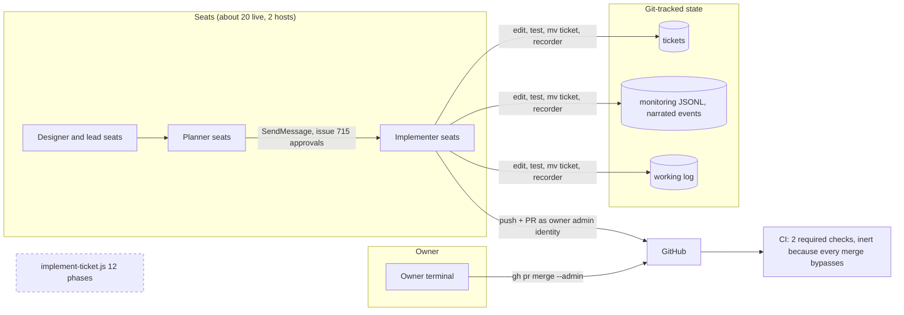
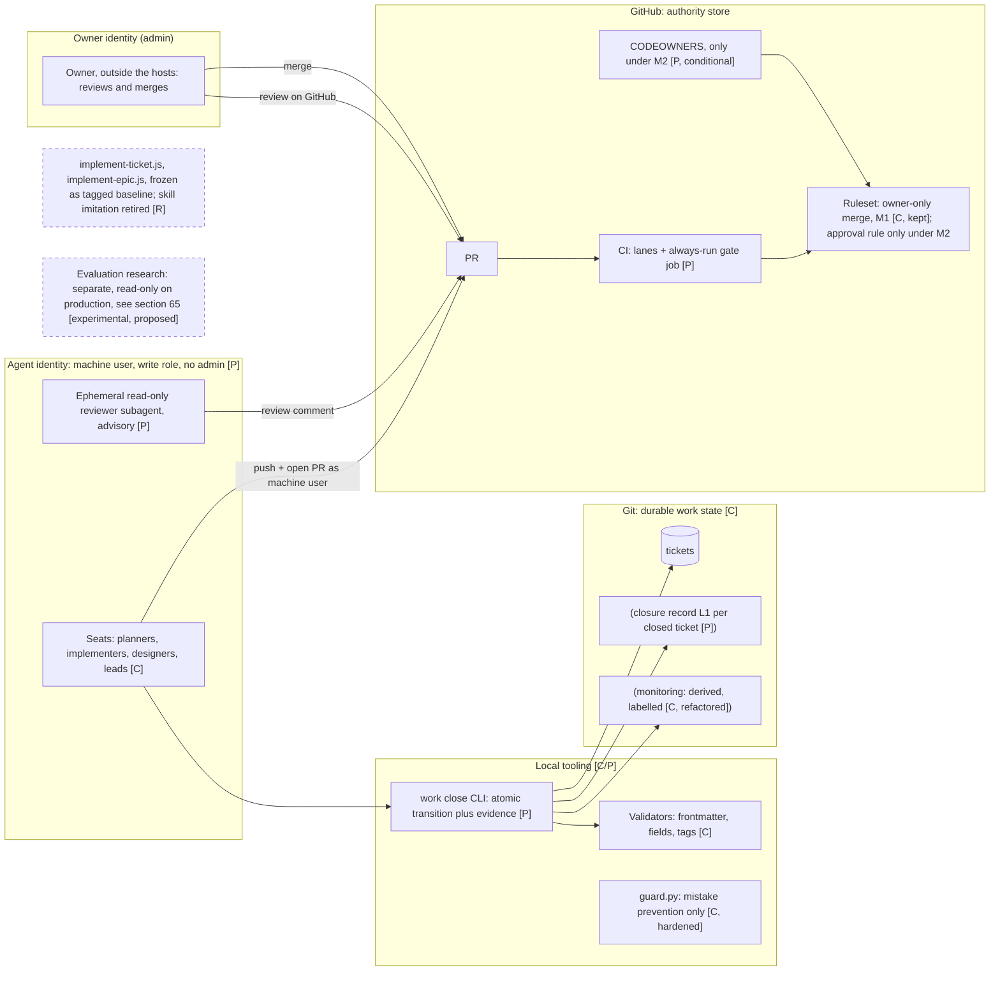
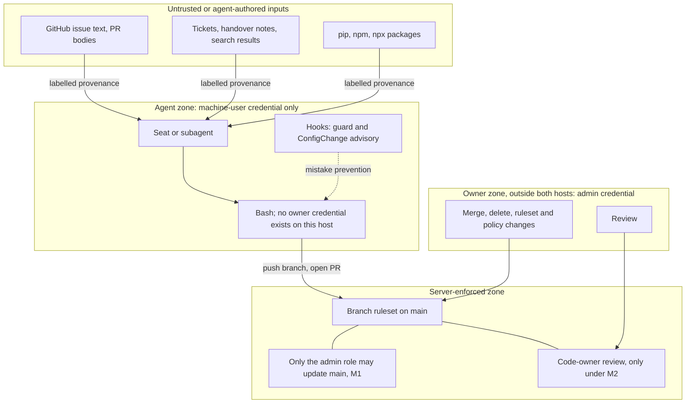
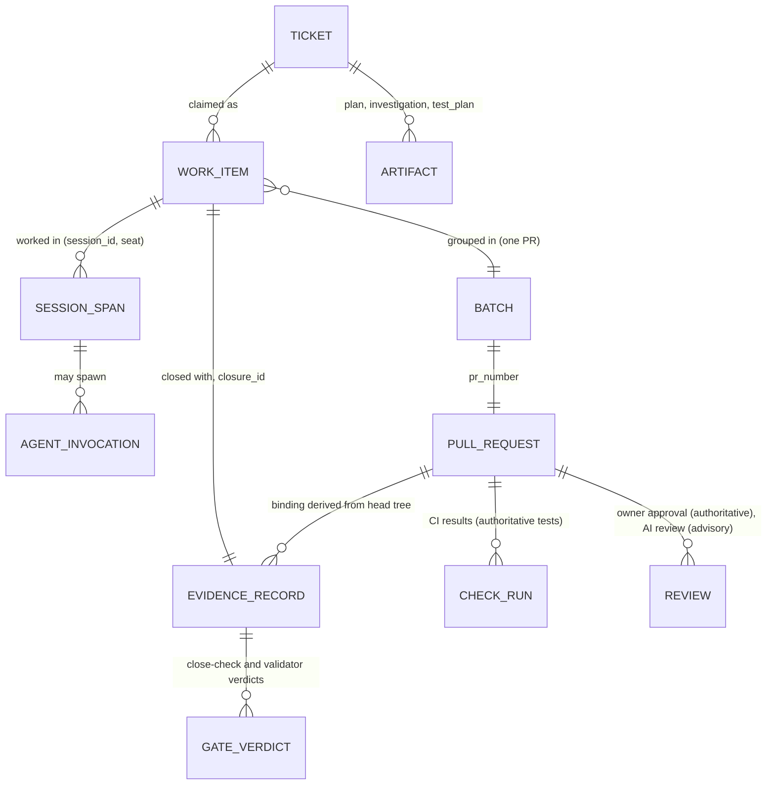
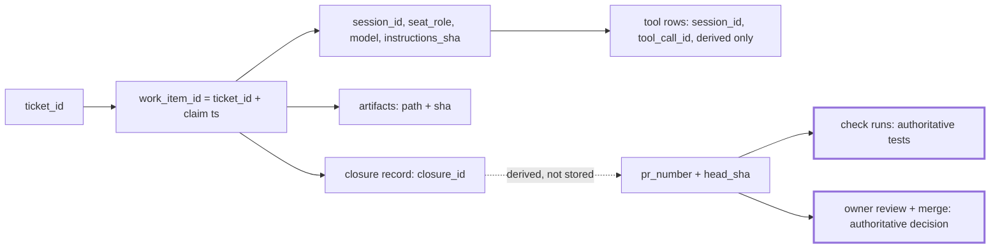
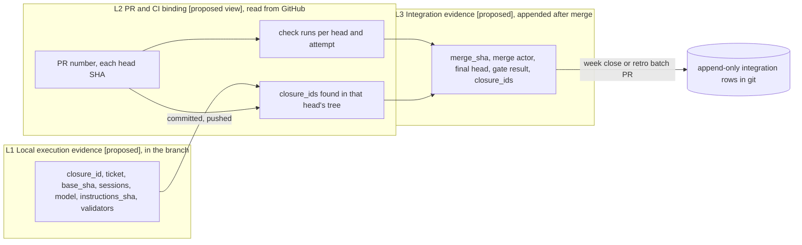
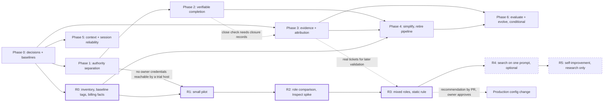
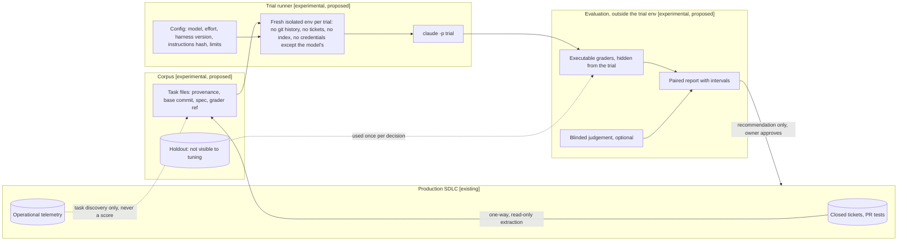

# AI-First SDLC: Architecture Evolution Plan

| | |
|---|---|
| Repository | `ttnhan18062000/rpg-based-simulation` (public, owned by a personal account) |
| Revision | `origin/main` `1f749c1aa` (2026-10-26). It is 2 product-only commits past the audit snapshot `815eef38d` (#751, #752). No SDLC code changed between them. |
| Inputs | The prior audit `tmp/AI_FIRST_SDLC_ARCHITECTURE_AUDIT.md`, now carrying an errata block; a fresh read-only revalidation; owner-intent and decision records; subsystem usage and cost measurements; 16 external references (R1–R16) |
| Author | Session `agent-working-designer-u24`, at the owner's request (instruction `tmp/ai-first-audit-instruction-2.md`) |
| Status | **Proposal for owner review, Round 2 revision (2026-10-31). Nothing has been implemented, and no tickets were created.** |
| Round 2 inputs | External review by ChatGPT (an advisor, not the owner; it did not inspect the repository); the owner's research problem `AI_WORKING_ISSUE1`; refresh at `origin/main` `ba7aa11bd` to `c5139b410`, including host ubuntu (see `AI_FIRST_SDLC_DECISION_SUMMARY.md`) |

**Evidence labels.** **[Repo]** = a repository fact verified in this pass. **[Src]** = a claim made by an external source. **[Inf]** = an architectural inference. **[Prop]** = a proposed design decision.
**Decision labels (instruction §17).** **DECIDED-OWNER**, **RECOMMENDED**, **CONDITIONAL**, **UNRESOLVED**.

**On the instruction itself.** It was written by an external advisor, and it is treated here as hypotheses (its §2). Where repository evidence contradicts it, or contradicts the prior audit, the evidence wins, and the conflict is noted in §10 and §59.

## Round 2 Review Resolution Matrix

Recommendations below are not owner decisions. Where this revision and earlier text differ, the sections named here govern.

| Finding | Verdict | Repository evidence | Plan changes | Remaining decision |
|---|---|---|---|---|
| **F1** Identity is not credential isolation | **Accepted, and stronger** | Checked on both hosts, with the same finding; details are held outside this public plan by owner condition (#715 6528807751). The finding: on the current setup, agent processes can reach the owner's credentials | §27a: three separate properties; owner credentials leave agent-reachable hosts; old tokens revoked; verification procedure. `GH_CONFIG_DIR` dropped. Also corrected: a fine-grained PAT cannot serve a machine *collaborator* | OD-2, OD-10 |
| **F2** Evidence is self-referential | **Accepted** | §24 and §30 keyed evidence on `head_sha` and `pr_number`, which do not exist at commit time. Merges are squash, so the merged SHA differs again | §29a: three layers, linked by `closure_id`; N tickets per PR; attempts appended | OD-11 |
| **F3** Claims are not exclusive | **Modified** | Valid: "unique claim" was unsupported. Frequency is low: 1 of 318 tickets had more than one run in W42–W44; one known cross-host collision (#703/#705) | §30a: advisory by default, ref creation for cross-host dispatch, detection at PR. No fencing tokens or expiry | OD-12 |
| **F4** CI trust and completion | **Modified** | Today's two required checks always run (no `if`, `needs` or path filter), and no workflow uses `pull_request_target` or `workflow_run`, so that concern doesn't apply to them. It does apply to the proposed path-scoped lanes: `test.yml` lanes skip by condition, and skipped means success [Src]. PR-controlled workflow code is real and can't be closed on a personal repo | §28a: one always-run gate job; no privileged PR execution; the residual risk is stated | OD-3, OD-13 |
| **F5** Rollback reintroduces the defect | **Accepted** | §39 Phase 1 item 11 and §42 returned agents to the owner token | §42: suspend publishing instead; owner recovery steps; resume checks | OD-14 |
| **F6** Premature retirement | **Accepted in part** | Dormancy stands (last pipeline change 10-09, replay 10-04), but `tools/agent_replay` holds a sampler and exclusion logging worth reusing, and the first plan missed the September pilot entirely | §32a: two-axis matrix; freeze as tagged baselines before archive; decision gates | OD-5, OD-6, OD-15 |
| **Research track** | **Accepted, as a separate subsystem** | Owner's own problem statement. `model` set in user settings only; no agent sets one; 11 role files, no model fields | Part IX; phases as a DAG (§38); no production dependency | OD-16 to OD-21 |
| **New in this revision, not raised by the reviewer** | — | A personal-repo collaborator can merge an approved PR [Src], so the first plan's ruleset would have broken the **decided** owner-only merge | §27a: merge model M1 versus M2 | OD-3 |

---

# Part I: Executive Decision Brief

## 1. Executive Summary

**What exists [Repo].**
- 32 registered seat roles spread over two hosts, with about 12 live on u24desktop in the last 7 days.
- About 3,000 file-based tickets.
- A 12-phase multi-agent `implement-ticket` workflow that has **not completed a ticket since 2026-10-04**. The skill path that imitates it has run 0 times since W41.
- In its place, a **hand path**: one seat edits, tests and closes the work, and a recorder writes narrated phase events. This path carried 100% of the 263 closures in W42–W43.
- Around the hand path, about 56k lines of agent-SDLC Python. Roughly 9k lines of Python and 5.5k lines of JS of that are dormant.

**How well it actually works [Repo, revalidated].** Better than the prior audit implied.
- CI was green at merge on **51 of 51** ticket-closing PRs.
- There were **0 reverts** in 60 days.
- **1–2 of 84** sampled closes were provably premature.
- Median time from a ticket appearing in git to its PR merging was **4.1 h**.
- Between 66 and 164 PRs merged per week (W40–W43).

The problems are elsewhere:
1. **Authority is not separated.** The owner and every agent use one admin GitHub identity. Every merge is an admin-bypass merge, so the two "required" checks bind no one.
2. **Completion cannot be proven.** "Done" is certified only by four bookkeeping conditions. The pre-close Definition-of-Done (DoD) check never really runs on the hand path; run after close it fails 97 of 97 times. Phase events are narration.
3. **The process is defined in the wrong places.** The operating model that is actually used (seats, batches, hand closure) was never adopted as a decision. Meanwhile the dormant 12-phase pipeline is still described as "the process" in four places.
4. **Coordination overhead is rising.** Cross-session messages per closed ticket went from 3.8 to 7.7 to 11.8 over W41–W43, while closures fell from 274 to 151 to about 120.

**Recommendation [Prop, RECOMMENDED].** **Alternative D, "Evidence-gated hand path"**: incremental hardening (A) plus a few targeted lean refactors taken from B. It does **not** propose durable orchestration (C).

1. **Adopt the hand/batch model as the official execution path.** Retire the dormant per-ticket pipeline after a replacement verification layer is in place. Keep `create-tickets`.
2. **Move authority out of agent reach.** Give agents a separate, non-admin GitHub identity. Take the owner's credentials off the agent hosts and revoke the old tokens. Keep merge restricted to the owner on the server (§27a, M1).
3. **Make the PR the unit of verification.** One always-run CI gate job covers lanes and the post-close conditions, and it is what the owner merges on (§28a). Test evidence comes from CI results, not narration.
4. **Generate evidence; don't narrate it.** One close CLI performs the ticket transition atomically and records what is known at close: `model`, `instructions_sha`, `session_id`. PR, CI and merge facts come from GitHub, in later layers (§29a). Events derived from tool activity are labelled as such.
5. **Simplify, after freezing what research may need.** Tag baselines, then archive dormant subsystems by the two-axis matrix (§32a). Make CLAUDE.md knowledge plus judgement plus pointers. Generate the procedure tables from code.
6. **Start a separate evaluation track (Part IX).** A small, credible Sonnet/Opus pilot, on repository tasks with hidden graders. Routing and evolutionary search stay research until they beat simple baselines on a holdout.

The phases (§37) are ordered so the safety and authority work comes first, because it is the only cheap fix for the highest-impact risks.

## 2. Current System and Operational Reality

| Aspect | Designed | Operating reality (W42–W44) |
|---|---|---|
| Execution | `implement-ticket.js`: 12 phases, 16 agents, deterministic gates | Hand closure by an implementer seat: 263 of 263 closures [Repo] |
| Unit of delivery | One ticket per pipeline run | **A batch PR** from a planner→implementer pair (owner rulings 09-19, 10-03 [Repo]). 298 of about 410 merges in 30 days have batch-shaped subjects |
| Verification | Static gates plus LLM verdicts plus done-checker | Finalize self-check, 4 bookkeeping conditions (79 of 84 PASS); CI green by convention |
| Authority | guard hook plus `ask` rules plus ruleset | The same admin identity for everyone; every merge bypasses the ruleset; the auto-mode classifier lets pushes to any branch through by default [Src R13] |
| Records | Runs, events and tool rows from a live pipeline | Synthetic events (263 of 263 single-timestamp); 30% of closures have no `session_role` |
| Coordination | (not in the design) | About 20 seats over 2 hosts; 1,000–1,400 SendMessage calls a week; issue #715 got 110 comments in 5 days |

*Current architecture. The dashed node is dormant.*

## 3. Architectural Problems Worth Solving

These are ranked by evidence (detail in §12).

1. **P-1 Authority is not separated (confirmed defect).** One admin identity is used by the owner and by every agent. The ruleset bypass is `always`, and `update` is restricted to bypass actors, so 100% of merges are bypasses. Approvals on #715 can't be attributed to a person. The guard misses `python3 -c`, `env git push`, `gh api -X PUT …/merge` and `gh pr close --delete-branch`. Settings and hooks hot-reload, so an agent's edit to its own enforcement takes effect at once [Src R13; Repo].
2. **P-2 Completion is unverifiable (confirmed defect class, low observed harm).** The DoD Part A never runs before close on the hand path. The done-checker has no tests condition. Phase events are narration. 1–2 of 84 closes were provably premature. About 5 FAIL verdicts since 10-07 are unresolved.
3. **P-3 The process definition has drifted from the operating model (confirmed).** The hand/batch model was never adopted as a decision. `owner_directed` is undefined: 196 of 201 such rows carry no note. The pipeline is described in four places, and CLAUDE.md has 22 discrepancies with the implementation.
4. **P-4 Traceability (confirmed).** Nothing links a run to its PR, commit, model or instruction version. 30% of closures are unattributed to a seat.
5. **P-5 Rising coordination overhead (observed trend, cause unmeasured).** Messages per closure went 3.8 → 7.7 → 11.8. The approvals log is heavy. The owner's attention is a single point of failure.
6. **P-6 Context freshness (partly confirmed).** The search "stale" flag is a false positive in every worktree. The graph is stale. Handover notes over the cap are announced but cut.
7. **P-7 Maintenance surface (confirmed).** About 9.2k Python and 5.5k JS lines are dormant. Tests pin source strings. The four-representation pipeline spec has had no maintenance since 10-09; it remains a false source of assurance.
8. **P-8 Security hygiene (plausible risks).** Bash command prefixes are logged unredacted into a public repo. gitleaks is report-only. Injected GitHub text has no trust tiering. The sandbox is off (`socat` is missing, so enabling it would fall back to unsandboxed).

## 4. Recommended Strategy

**Alternative D: Evidence-gated hand path.** Keep the parts that demonstrably deliver: seats, worktrees, batch PRs, ticket files and validators, the recorder idea, generated cards, the gate ledger and the retro. Then add three deterministic boundaries, each where the work actually passes:

| Boundary | Mechanism | Replaces |
|---|---|---|
| **Identity** | Agents use a machine user (write role, no admin). The owner's credential is kept out of agent shells | Shared admin identity; guard text-matching as the main control |
| **Integration** | Owner-only merge kept on the server (M1, §27a), one always-run gate job (§28a); a `pull_request` rule plus CODEOWNERS if the owner chooses M2 | Inert required checks; prose DoD |
| **Evidence** | Close CLI plus generated evidence fields; derived events labelled; CI results as test evidence | Narrated events; free-text approvals |

Everything else stays agent-driven and flexible. That includes planning, design, implementation order, and whether to delegate to subagents.

## 5. Reasons for the Recommendation

- **It solves the demonstrated problems (P-1 to P-4) at the lowest cost.** P-1 is fixed mostly by GitHub settings plus one machine account, using features available on a personal public repo [Src R14]. P-2 is fixed by one CI job and one CLI.
- **It preserves what works.** Throughput and quality outcomes are good (§46): 0 reverts, 100% CI-green merges, 4.1 h median lead time. A rebuild (B) or an orchestration platform (C) would put that at risk to fix problems the platform doesn't address. The defects are about *authority* and *evidence*, not orchestration.
- **It matches the research.** Use the simplest solution that works [Src R1]. Start with a single agent and enforce guardrails outside the prompt [Src R2]. Multi-agent setups fit shared-context coding work poorly and cost about 15× the tokens [Src R3]. Simple pipelines with execution-based validation compete with complex agents [Src R4]. Interface quality beats orchestration complexity [Src R5]. Give each agent its own governed identity [Src R12, ASI03].
- **It follows the owner's stated constraints.** No new orchestration engine; guardrails, not a sandbox; proportionate checks over monitoring data; one PR per batch; humans own merge and main [Repo, §13].

## 6. Critical Owner Decisions

**DECIDED-OWNER, 2026-10-31 (#715 6529263880):** OD-1 yes; OD-2 and OD-10 yes; OD-3 as M1, subject to E6b; OD-14 yes; OD-15 yes; E6b yes. Everything else stays undecided. **No credential or ruleset change is authorised by this:** each gets its own ask, by ticket. "Recommended" in the tables below is kept as written for the record.

| # | Decision | Recommended | Why it matters |
|---|---|---|---|
| OD-1 | Adopt the hand/batch path as the official execution model | Yes | Unblocks retiring the pipeline and gives the path a real definition |
| OD-2 | Create a machine user for agents. The owner's credentials leave **agent-reachable storage** on both hosts, and old tokens are revoked | Yes, with OD-10 | The only real fix for P-1. Needs owner action and has a small one-off cost |
| OD-3 | Merge model: **M1** owner-only merge kept by the `update` rule, or **M2** `pull_request` rule with required approval, so checks bind, but collaborators can merge once approved | **M1 now**, M2 only if the owner accepts delegating the merge click (§27a) | Decided owner-only merge versus server-bound checks |
| OD-4 | What has to be machine-proven before a close | Post-close conditions, plus CI tests on src paths, shown by the gate job, plus the owner's merge decision | Defines C-1 |
| OD-5 | Retire `implement-ticket.js`, `implement-epic.js` and the skill imitation | Remove from production, after Phase 2 lands **and** a baseline tag exists (§32a) | Removes 5.5k JS lines plus the four-place spec |
| OD-6 | Codex/provider-neutral track (about 6.5k lines) | **Changed: freeze as tagged baseline, leave CI, decide at R2** (§32a) | Maintenance surface versus harness-comparison research |
| OD-7 | Owner review load. Under M1 the merge is the owner's review, so there is no extra approval step. Applies in full under M2 (87 merges in W43; 45 in the first 5 days of W44) | Follows OD-3 | Velocity versus control |
| OD-8 | A token/cost budget (per batch or per week) | Measure first (Phase 3), then decide | No budget exists today |
| OD-9 | Coordination target, e.g. messages per closure | Measure, then review at session-layer M7 (≥ 11-04) | P-5 |

### Round 2 additions to the decision register

New recommendations are not approved by appearing here. Decided so far: the list at the top of §6.

| # | Decision | Existing owner position | Evidence | Options | Recommended | Trade-off | Confidence | Validation | If deferred |
|---|---|---|---|---|---|---|---|---|---|
| OD-10 | Where owner credentials live | "Guardrail, not a sandbox"; owner-only actions (§13) | §27a | (a) Outside the hosts, browser only; (b) second OS user; (c) App with held key | **(a)** | Owner loses terminal merge; lead relays stay for requests only | High on need; medium on ergonomics | E6a | Identity is cosmetic |
| OD-11 | Evidence lifecycle | None | §24 self-reference; squash merges | Three layers; single late record; DB | **Three layers, no DB** | Slight record growth | High | E5 | Phase 3 can't be specified |
| OD-12 | Claim consistency | Implicit: #634 convention | 1 of 318; one collision | Advisory; ref claims; locks with fencing | **Advisory + ref claims cross-host** | Some duplicates remain possible, and they are caught at PR | Medium | E6b, count collisions | Duplicates stay rare and manual |
| OD-13 | Required CI shape | Required checks exist; no blocking on monitoring data | §28a | Gate job; many required lanes; trusted-base App | **Gate job** | PR can still edit it; owner sees that | Medium-high | E6b, replay | Lanes can't safely become required |
| OD-14 | Security rollback | None | §39, §42 | Suspend publishing; restore token | **Suspend** | Delivery can stop for a while | High | Rehearse once | Unsafe fallback stays written |
| OD-15 | Freeze baselines before retirement | None | §32a | Tags; keep live; delete | **Tags now** | Very small cost | High | Tag checks out | Risk of losing a reproducible baseline |
| OD-16 | Evaluation investment and execution | Token efficiency preferred; research interest stated in the owner's problem | No budget exists; subscription behaviour unknown | Subscription on host; API key with cap; off-host runner | **Decide after R0** with a hard cap for R1 | Isolation versus cost versus setup | Low until R0 | R0 | R1 can't start |
| OD-17 | Evaluation framework | None | §64 | E-A; E-B; E-C | **E-C, staged** | Possible rework of the runner | Medium | R2 spike | Pilot still possible |
| OD-18 | Scope of model comparisons | None | §68 | E2E; decision points; both | **Both, staged, one primary comparison at a time** | Slower answers | Medium-high | R1 | — |
| OD-19 | Advanced optimization | Long-term interest; "justified through experiments" (brief, not owner) | §69 | Research-only; production path | **Research-only until R3/R4 gates pass** | Slower | High | Holdout | — |
| OD-20 | Promotion of an experimental result | Owner-only merge | §65 | PR + independent regression + owner; automatic | **PR + regression + owner** | Manual step | High | First promotion | — |
| OD-21 | Practical threshold δ and budget per stage | None | §68 | Set before each stage | **Owner sets before the stage** | Requires a judgement call up front | High | Recorded before results | Results can't be classified |

## 7. Confidence and Evidence Limitations

- **High confidence:** the identity and ruleset facts (live API), the hand-path dominance, the closure-reliability baseline (84 tickets, 51 PRs), the GitHub capability limits [Src R14, fetched], and the Claude Code permission/auto-mode/hot-reload behaviour [Src R13 docs at v2.1.31x; the host runs 2.1.310].
- **Medium confidence:** the cause of the coordination-overhead trend (tool-row capture is partial); the workload of the ubuntu host (not inspected); the claim that seats beat ephemeral workers for this workload (no controlled comparison exists).
- **Research access was limited.** arxiv.org and openai.com were blocked from this host. R2 was read only through secondary summaries. R4–R7 were read through mirrors (NeurIPS proceedings, HF, alphaxiv, Scale Labs) and search snippets. Results are cited by the version found.
- **Not executed:** every experiment that writes state (E2, E4, E6 and others). Their designs are in §45.
- **Round 2 limits:** ubuntu was inspected directly. Round 2's GitHub facts come from a delegated documentation pass, and items marked unverified in §27a, §28a and §30a need the E6b throwaway-repo test. No live auto-mode test was run. Closure-reliability figures are still from 10-26. W44 data is partial.

---

# Part II: Research and Evidence

## 8. External Research Review

Each reference is condensed into what it says, what it means here, and why it might not apply.

**R1. Anthropic, *Building effective agents* (Schluntz and Zhang, 2024-12-19; accessed).**
- [Src] Workflows are "predefined code paths"; agents "dynamically direct their own processes". The advice is to find "the simplest solution possible, and only increasing complexity when needed". It recommends poka-yoke tools, stopping conditions, and human checkpoints.
- [Inf] The 12-phase pipeline that never completes violates "simplest solution". The hand path is simple but has no gates at all, which also fails R1's transparency principle. R1 points toward a *thin* chain with deterministic gates.
- [Limits] Practitioner advice that predates subagents and skills. It is not about multi-seat coordination.

**R2. OpenAI, *A practical guide to building agents* (2025-04; primary PDF not reachable, secondary sources only).**
- [Src] Maximise a single agent before going multi-agent. Split agents on "complex logic or tool overload". Treat guardrails as a layered defence, with tools rated by risk and humans brought in for high-risk actions.
- [Inf] The hand path is "single agent first". The risk rating belongs on merge, push and identity, and must be enforced outside the prompt.
- [Limits] Aimed at business agents; the primary text was not verified.

**R3. Anthropic, *How we built our multi-agent research system* (2025-06-13; accessed).**
- [Src] Multi-agent beat single-agent by 90.2% on research tasks, at about 15× the tokens of chat. Tasks with "shared context or many dependencies" are "not a good fit", and coding is less parallelisable. Resume from checkpoints, because errors compound.
- [Inf] Sequential tickets with shared context are the poor-fit case, which is consistent with the 925k-token failed native run. Parallel, read-only *review* is where multi-agent fits here.
- [Limits] Different domain and an older model generation.

**R4. Agentless (Xia et al., FSE 2025; arXiv 2407.01489; read via mirror).**
- [Src] A fixed three-phase localise → repair → validate pipeline reached 32% on SWE-bench Lite at about $0.70 per issue, competitive with agents at the time.
- [Inf] Supports a thin deterministic shell with *execution-based validation*. That validation is exactly the missing "tests ran" evidence.
- [Limits] Python bug fixes in 2024; agentic systems lead today.

**R5. SWE-agent (Yang et al., NeurIPS 2024; arXiv 2405.15793; read via mirror).**
- [Src] Agents are "a new category of end users". A purpose-built agent–computer interface (ACI) materially improves performance.
- [Inf] The lever here is the quality of the tools (recorder, guard, close CLI, search freshness), not the number of agents.
- [Limits] Claude Code already ships a mature ACI, so the marginal gains are smaller.

**R6. SWE-Skills-Bench (Han et al., arXiv 2603.15401, v1 2026-03-16, preprint; read via mirror).**
- [Src] 49 public skills over about 565 tasks. Pass rate rose only from 89.8% to 91.0%. 39 of 49 skills gave zero change, 3 *degraded* results through "version-mismatched guidance", and tokens rose 10.5% on average.
- [Inf] Treat the 23 skills and the CLAUDE.md procedure blocks as hypotheses to ablate. Stale procedure text (22 discrepancies) is exactly the kind of guidance that degrades results.
- [Limits] One model (Haiku 4.5), public skills, a ceiling effect.

**R7. SWE-Bench Pro (Scale AI, arXiv 2509.16941, v2 2025-11).**
- [Src] Long-horizon, multi-file tasks taking "hours to days". Pass@1 was below 25% in v1 and below 45% in v2. Tasks are human-augmented with context "to ensure resolvability".
- [Inf] Tickets here look like Pro tasks. Keep human checkpoints and deterministic verification. Ticket quality is an input to success. Evaluate on an internal, Pro-like corpus.
- [Limits] Measures single-agent issue resolution, not coordination.

**R8. SWE-bench Verified (swebench.com; accessed).**
- [Src] 500 human-validated instances with clear specs and fair tests. Release 1.x and 2.x scores are not comparable. A "Bash Only" minimal scaffold is competitive.
- [Inf] Validate an eval corpus before trusting its scores. A minimal scaffold competing argues against heavy phase designs.

**R9. Temporal (docs.temporal.io: tasks, activity definition, retry policies; accessed).**
- [Src] An event history plus replay means "completed Activities will not re-execute". Activities must be idempotent. Workflows don't retry by default.
- [Inf] Adopt the *concepts*: a per-work-item journal, idempotency keys, skip-completed on resume. Do **not** adopt the product: there is no deterministic orchestrator code to host, and it is too heavy for one owner.

**R10. LangGraph persistence and interrupts (docs.langchain.com; accessed via raw markdown).**
- [Src] Checkpoints per step; the thread id is "your persistent cursor"; on resume an interrupted node re-runs from the start, so side effects before an interrupt must be idempotent. Resume values can be typed.
- [Inf] Model an approval as a typed record bound to `{work item, head_sha}`. Make the close CLI idempotent. Do **not** adopt the framework.

**R11. Anthropic, *Effective context engineering for AI agents* (2025-09-29; accessed).**
- [Src] Context rot and an "attention budget"; aim for the "smallest possible set of high-signal tokens". Retrieve just in time, compact, keep structured notes (NOTES.md), and use sub-agents with clean contexts.
- [Inf] Handover notes are structured notes but lack an age stamp and a hard budget. The 210k average context is the opposite of a small, high-signal set. Prefer injecting references over whole documents.
- [Src, Claude Code docs] The project-root CLAUDE.md is re-read from disk and re-injected after compaction.

**R12. OWASP Top 10 for Agentic Applications 2026 (v2026, 2025-12; PDF accessed).**
- [Src] ASI01 Goal Hijack, ASI02 Tool Misuse, ASI03 Identity and Privilege Abuse, ASI04 Supply Chain, ASI05 Unexpected Code Execution, ASI06 Memory and Context Poisoning, ASI07 Insecure Inter-Agent Communication, ASI08 Cascading Failures, ASI09 Human-Agent Trust Exploitation, ASI10 Rogue Agents. On ASI03: "Without a distinct, governed identity… an attribution gap".
- [Inf] The shared admin identity is a textbook ASI03 case. Forged approvals map to ASI09/ASI07, and synthetic evidence to ASI06/ASI08. This becomes the threat vocabulary in §27.

**R13. Claude Code sandboxing and permission docs (anthropic.com engineering post; code.claude.com docs at v2.1.31x; accessed).**
- [Src] The sandbox is off by default and covers Bash only. Reads reach most of the machine unless credential paths are denied. If the sandbox can't start, commands run unsandboxed unless `failIfUnavailable` is set. Linux needs `bubblewrap` and `socat`.
- [Src] **Explicit `ask` rules and a hook's `ask` both force a prompt even in auto mode**, but content-matched rules only match the command as written.
- [Src] On entering auto mode, broad interpreter allows such as `Bash(python*)` are dropped. The classifier blocks unapproved merges and force-pushes, but **allows pushing to any branch, including the default branch**.
- [Src] **Settings and hooks hot-reload mid-session.** A `ConfigChange` hook can block config changes. Protected paths include `.claude` and `.mcp.json`, but not `tools/sessions/guard.py`, `tools/gate_checks/`, `.github/` or CLAUDE.md.
- [Repo] `bwrap` is present on this host and `socat` is missing.

**R14. GitHub rulesets and CODEOWNERS (docs.github.com; accessed).**
- [Src] Bypass can go to roles, teams, Apps or Dependabot, **not to individual users**. Bypass mode is "always" or "for pull requests only". **PR authors cannot approve their own PRs.** Code-owner review and last-push approval are available. "Required reviewers" (path teams) is unavailable on user-owned repos, and **push rulesets are private/internal only**. A required check can be pinned to an expected source app. A personal account may hold one free machine account. A fine-grained PAT on the owner account does *not* separate identity.
- [Repo] The repo is `owner.type=User`, public, and auto-merge is off.

**R15. OpenTelemetry GenAI agent spans (semantic-conventions-genai, status *Development*; accessed).**
- [Src] Spans: `invoke_agent`, `invoke_workflow`, `execute_tool`. Attributes: `gen_ai.conversation.id`, `gen_ai.agent.name/version`, `gen_ai.request.model`, `gen_ai.tool.call.id`, and token usage.
- [Src, Claude Code docs] Claude Code has native OTel export (beta traces) with `session.id`, the model and the tool call id, and passes `TRACEPARENT` to Bash. It must be configured in user or managed settings.
- [Inf] Borrow the field names in the JSONL. Don't run a collector yet.

**R16. NIST AI 600-1, GenAI Profile (2024-07-26; PDF accessed).**
- [Src] It lists 12 risks. Useful items: an inventory recording "versions of underlying models" (GV-1.6), the ability to deactivate a system (GV-1.7), and after-action assessments (MG-4.3).
- [Inf] Use only four risks here: Confabulation (self-reported done), Human–AI configuration and automation bias (rubber-stamp approvals), Information security and value chain (MCP, pip/npx), and Data privacy (unredacted logs). Plus a one-page kill-switch procedure.

**Where the sources disagree.**

| Disagreement | Implication | Local experiment |
|---|---|---|
| Multi-agent helps (R3: +90%) vs single agent first (R1, R2) and coding is a poor fit (R3) | Multi-agent only for parallel read-only checks | E2b: hand path ± one parallel reviewer, findings per 100k tokens |
| Fixed pipeline (R4) vs agentic loop with a good ACI (R5, R8 leaderboards) | Hybrid: an agentic implementer inside a thin deterministic shell | E2a: 3-step chain vs hand path on 20 replayed tickets |
| Skills and templates help (R2, vendor practice) vs mostly zero effect with harm from stale guidance (R6) | Ablate skills and procedure blocks | E8: paired skill ablation |
| Strong benchmark numbers (R8) vs long-horizon reality (R7) | Use internal, Pro-like evaluation | E1 extended into a corpus |

## 9. Reference Applicability Matrix

| Ref | Principle | Evidence type | Repository relevance | Existing support | Applicability | Limitations |
|---|---|---|---|---|---|---|
| R1 | Simplest workable design; gates; human checkpoints | Recommendation | High: pipeline vs hand | Hand path is simple; no gates | **High** (thin gates) | Pre-subagent era |
| R2 | Single agent first; layered guardrails; risk-rated tools | Recommendation | High | `ask` rules, guard | **High** (identity, risk rating) | Primary text not verified |
| R3 | Multi-agent for breadth, about 15× tokens; poor fit for shared context | Case study | High | Seats, subagents | **Medium-high** (review only) | Research domain |
| R4 | Fixed phases plus execution validation | Peer-reviewed research | Medium | Static gates | **Medium** (validation step) | 2024, bug fixes |
| R5 | ACI quality drives results | Peer-reviewed research | High | Recorder, guard, search | **High** | Mature ACI already |
| R6 | Skills mostly neutral; stale guidance harms | Preprint | High (23 skills, CLAUDE.md) | — | **Medium** (ablate) | One model, public skills |
| R7 | Long-horizon tasks are hard | Benchmark preprint | Medium | — | **Medium** (evaluation) | Single-agent |
| R8 | Validated specs and tests | Benchmark documentation | Medium | Ticket AC | **Medium** (corpus design) | Small Python fixes |
| R9 | Durable history, idempotency, skip completed | Product docs | Medium | None (no checkpoints) | **Concepts only** | Product too heavy |
| R10 | Checkpoints; typed resume and approval | Framework docs | Medium | — | **Concepts only** | Framework lock-in |
| R11 | Small high-signal context; notes; just-in-time | Practitioner guidance | High (210k avg) | Handover, search | **High** | Qualitative |
| R12 | Least agency; distinct agent identity | Consensus taxonomy | High | — | **High** (vocabulary, ASI03) | First edition |
| R13 | Isolation and permissions; auto-mode semantics | Platform docs | **Very high** | `ask` rules, hooks | **High** | Bash-only sandbox |
| R14 | Server-side rules; code owners; identity | Platform docs | **Very high** | 1 ruleset | **High** | Personal-repo limits |
| R15 | Agent/tool span vocabulary | Draft standard | Medium | Custom JSONL | **Medium** (field names) | Development status |
| R16 | Model inventory, kill switch, after-action | Government framework | Low-medium | Retro habit | **Low** (4 items) | Enterprise-oriented |

## 10. Audit Findings Revalidation

The prior audit is mostly right on structure. It overstated some numbers and missed two sharp findings. An errata block has been added to the top of the audit.

| Audit claim | Revalidated finding | Verdict |
|---|---|---|
| 32 seats over 2 hosts | 32 *roles* (29 staffed); host placement is prose only, not enforced. About 12 live on u24 in 7 days | Confirmed, with nuance |
| About 3,000 tickets; 12 phases; 16 agents | 3,017; 12; 16 | Confirmed |
| 100% hand in W42–W43; pipeline idle | Confirmed. Last implement-ticket DONE 10-04; last attempt 10-09. `execution_mode` labels the native attempts as `pipeline` | Confirmed; the labels are unreliable |
| DoD: 324 of 749 have no verdict, 28 closed on FAIL | Recording started 2026-10-06T08:22Z (re-checked). Since 10-07: 28 of 431 (6.5%) have no verdict. Of the 28 FAILs, 17 are artefacts, 8 are recorded overrides, about 5 are unresolved | **Overstated** |
| (missed) | **The DoD Part A never runs before close on the hand path.** Run after close, the CLI fails 97 of 97 times | **New finding** |
| One identity; admin bypass `always` | Confirmed, and stronger: the `update` rule restricts main to bypass actors, so **every merge is a bypass** (PR #753 is BLOCKED with all checks green, re-checked) | **Understated** |
| Guard bypass via `python3 -c`, `gh api` PUT | Confirmed. Add `env git push` (re-checked) and `gh pr close --delete-branch`. `bash -c` / `sh -c` / `eval` are caught (uncertain → ask) | Confirmed with corrections |
| R-01 is CRITICAL | No direct pushes to main in 60 days; main is recoverable; nothing deploys | **HIGH** |
| R-17 session-id race | The file has no production reader | **Wrong** |
| 79k LOC, 59% of src | Agent-SDLC tooling is about 56k (≈42%); about 5–9k dormant; 86k LOC of tests are separate | Overstated |
| Handover: 77 KB note, about 90% lost | That note is now 5.8k. 5 are over the cap (largest 1.8×). The cut is announced with the path | Stale |
| Read rows collapsed | Partly benign: edits moved into Bash (Edit 1,918 → 31; Bash write-like rows 248 → 822) | Partly benign |
| 1,317 done tickets lack run rows | 846; none dated on or after 10-10. A legacy gap, not a current one | Overstated |
| 22 doc/impl discrepancies | 6 of 6 sampled hold; 2 have lower impact than implied | Confirmed |
| (open) auto mode and `ask` | `ask` rules and hook `ask` prompt in auto mode; the classifier allows pushes to the default branch [Src R13] | **Resolved** |
| (open) mid-session reload | Settings and hooks hot-reload; CLAUDE.md is re-injected after compaction [Src R13] | **Resolved**, and it worsens AP3 |

**Why hand orchestration dominates.** The evidence points to a **combination**, led by an undocumented operating-model change:
1. **Intentional evolution: no ruling found.** No owner decision says to close tickets by hand. The owner did, however, fund hand-path instrumentation (path record, hand-closure cost, gate ledger, all closed 10-18), which is de facto acceptance.
2. **Workaround: partial.** The native path failed every time: 10-04 `bash is not defined` at about 277k tokens; 10-06 two environment failures; 10-09 at 925k tokens. But the skill path never needed the native port, and it still fell to 0. `native_port_blocked` has never been used as a reason, and `pipeline_unavailable` only once.
3. **Undocumented operating-model change: strong.** The session layer (from 10-02) made the batch PR the delivery unit. Per-run `Workflow` opt-in makes the per-ticket pipeline the expensive exception. The implementer card never mentions the pipeline, and a 10-02 roster already described a seat as "hand-orchestrates tickets". The shift itself started in W36–W37, before the session layer existed.
4. **The pipeline failed to deliver value: suggestive, not measured.** Of 7 pipeline runs in W40, 3 reached DONE; in W41, 0 of 4. The single real DONE needed 5 manual interventions. Hand-path cost is mostly unknown.

## 11. Existing Architectural Strengths (preserve)

1. **Delivery outcomes are good.** 0 reverts in 60 days; CI green at merge on 100% of closing PRs; relevant test lanes ran on 100% of src PRs; 4.1 h median lead time.
2. **Durable state lives in git** (tickets, artifacts, logs). Sessions are disposable.
3. **The ticket validators and the CI corpus test** keep 0 location inconsistencies across 3,017 tickets, and they caught 395 drifted done tickets historically.
4. **Generated role cards** come from registries, with drift tests and a token budget that has actually blocked an over-budget change (10-26).
5. **The gate ledger** (842 rows) and the incident-to-control habit (retros, the SubagentStop block, the resurrection guard).
6. **Batch PRs.** One PR per batch keeps owner review load manageable: about 410 merges in 30 days, 298 of them batch-shaped.
7. **The guard's fail-closed design for uncertain shell indirection** (`bash -c`, `eval` → ask), and the human merge.

## 12. Confirmed Defects and Risks

| ID | Category | Problem | Evidence | Frequency / likelihood | Severity | Insufficient because | Needs a rebuild? |
|---|---|---|---|---|---|---|---|
| P-1 | Defect | Shared admin identity; every merge bypasses; approvals unattributable | Ruleset API; #753; 60 of 60 PRs on one login | Every merge | **HIGH** | Server rules can't tell agent from owner | No: identity plus ruleset |
| P-1b | Risk | Guard misses indirection; settings and hooks hot-reload so an agent can edit its own enforcement | `classify()`; R13 | No incident in 60 days | HIGH capability / Low likelihood | Text matching | No |
| P-2 | Defect class | Done is certified only by bookkeeping; Part A never runs before close; no tests condition; narrated events | 97 of 97 post-close FAILs; 263 of 263 synthetic | Every close; harm 1–2 of 84 | **MEDIUM-HIGH** | No independent evidence | No: CI job plus close CLI |
| P-3 | Defect | Process drift: the used model isn't decided; the unused one is documented in 4 places | §10; 22 discrepancies | Continuous | MEDIUM | Prose patches | No: decision plus generation |
| P-4 | Defect | No run → PR/commit/model/instructions links; 30% no seat | Schema; runs | Every run | MEDIUM | Missing fields | No |
| P-5 | Trend | Coordination overhead: 3.8 → 11.8 messages per closure | tools shards (partial capture) | Rising | MEDIUM (unmeasured cost) | No measure, no target | No |
| P-6 | Defect / risk | Context freshness signals wrong (search stale, graph stale) | `knowledge_search.py:681`; graph header | Every worktree search | MEDIUM | Wrong root; no rebuild schedule | No |
| P-7 | Cost | Dormant infrastructure; source-pinned tests | §32 | — | MEDIUM | — | No: retirement |
| P-8 | Risk | Unredacted command logging to a public repo; report-only secret scanning; no trust tiering; sandbox off | `post_tool_hook.py`; security-scan.yml; R13 | No real secret found | MEDIUM | Advisory only | No |
| P-9 | Risk | No SessionEnd: a clean exit looks like a crash; per-host state | hooks list | Every exit | LOW-MEDIUM | — | No |

**Not problems (rejected concerns).**
- The `.current_session_id` race (no reader).
- "Monitoring coverage" on current closes (about 100% complete; the issue is authenticity).
- The autoMode prose listing 18 branches (its error makes the classifier *more* cautious).

## 13. Current Operating Constraints

From owner decisions [Repo, DECIDED-OWNER]:
- AI-first, automated up to human points: push, PR, merge, workflow opt-in (2026-10-01).
- "Guardrail, not a sandbox"; **no new orchestration engine**; no autonomy beyond the human points (session layer §1, §10).
- Proportionate checks over monitoring data; no blocking gates on monitoring data (09-16).
- One PR per batch, big batches (09-19, 10-03).
- The guard asks only for merge, push to main, remote delete and worktree/data delete. Governing files are protected by review and merge. The role split is advisory (10-07).
- Implementers need no grant to push or open a PR on their own branch (10-06).
- **Never use `bypassPermissions`** (handover rule; the ticket isn't committed).
- Owner-only actions: merge, push to main, remote branch delete, worktree/data delete.
- Token efficiency is preferred over speed; about 30% fewer tokens for about 50% more time is acceptable. There is a 250k context watch line and a 456-token card budget (460 at the first writing; changed by #754).
- Two hosts. Cross-host traffic goes lead-to-lead over Remote Control or through `for:<role>` issues.
- Since this plan's first writing: approvals from u24 seats go through lead-planner-u24, logged on #715 first (#715 6459766303), and a lead may carry one citing that comment id (#772). This is a process workaround for the shared identity, not a fix.

**Not an owner constraint.** Items in the external Round 2 brief, such as the optimizer limits, are advisor proposals adopted here on their merits. The research goal is the owner's own; its scope and budget are undecided (OD-16).

**Conflict to resolve.** The requirement "human approval is explicit and authoritative" conflicts with the implementation, where the owner and agents share an identity. Resolution: OD-2 and OD-3. This adds no orchestration engine, so it respects the "no new engine" constraint.

---

# Part III — Architecture Alternatives

## 14. Architecture A — Incremental Hardening

**What stays.** Seats, worktrees, the ticket lifecycle, hand execution, existing gates and recording.

**What changes.**
- Fix the specific defects: identity separation, ruleset, CODEOWNERS, guard patches, a post-close CI check, extra evidence fields, the search staleness fix, and redaction.
- Leave the dormant pipeline in place, documented as "optional".

**How far it goes.** It closes P-1, P-2 and P-4. It does **not** address P-3 (process drift) or P-7 (dormant surface). Every hardening fix becomes one more prose clause in CLAUDE.md plus another tool. Debt keeps accumulating: the four-place spec stays, and so does the false sense of assurance.

## 15. Architecture B — Lean Control-Plane Rebuild

**What it builds.** A new, cohesive control plane:
- a single `work` CLI or service that owns the ticket and execution state model (create, claim, transition, close);
- typed evidence records;
- one orchestration path;
- generated instructions;
- a new context layer.

**What it reuses.** Validators, cards and CI.

**Costs.**
- It rewrites `tools/agent-monitoring` (14.7k LOC, about 166 test files), the recorder and parts of `tools/sessions`.
- Migrating about 3,000 tickets and the monitoring history.
- Every seat must change workflow at once.
- The long-lived seats and the cross-host handover depend on the current files and paths.

**Gain.** Real cohesion, and less change amplification.

**Weakness.** It spends most of its effort on areas that are *not* where the defects are. Recording completeness is about 100% today. The defects are authenticity, identity and verification, and B needs the same identity and CI work as A anyway.

## 16. Architecture C — Durable Orchestration

**What it adds.** An orchestrator with durable state, checkpoints, retries, cancellation, dependency management and typed agent I/O. There are three ways to build it:
- **(C1)** A custom light orchestrator: a per-work-item journal in git plus idempotent steps.
- **(C2)** A framework such as LangGraph, with checkpointers and interrupts.
- **(C3)** A durable-execution system such as Temporal.

**Evidence against needing it now.**
- Work is interactive and batch-shaped; median lead time is 4.1 h.
- Interrupted-work loss is measured only as "handover recovery" manual actions (65 rows, a sampling tagger).
- The pipeline, which is the closest thing to C, failed on cost and fragility (925k tokens).
- R3 notes that coding work with shared context fits multi-agent orchestration poorly.
- Owner constraint: "no new orchestration engine".
- C2 and C3 would replace Claude Code's own agent runtime. That is vendor churn, and C3 adds servers.

**Where C has merit.** Epics and long, multi-ticket runs, where checkpoint-and-resume would save re-work. That is the C1 shape, and only if E2/E4 show the need.

## 17. Additional Alternatives

**D — Evidence-gated hand path (RECOMMENDED).**
- A's hardening plus B's lean pieces that address real defects: a single close CLI for the ticket transition, generated evidence, generated instruction tables, and retirement of dormant paths.
- From C, only the *concepts* of R9 and R10: idempotent transitions, a per-work-item evidence journal, typed approvals.
- No new runtime.

**E — Ephemeral workers.** Replace long-lived seats with short-lived task workers spawned per ticket by one coordinator.

- **Arguments for it:**
  - smaller contexts (210k on average today);
  - no handover;
  - fits R3 and R11.
- **Arguments against it:**
  - seats carry domain continuity, and the owner built the session layer deliberately;
  - throughput and quality outcomes are good;
  - coordinator overhead would just move somewhere else.
- **Verdict:** **CONDITIONAL.** Pilot it for review and for small hotfix work only (E2b, E2c). Not as a replacement.

## 18. Alternatives Comparison Matrix

Ratings are qualitative. Baselines come from §46 where available.

| Dimension | Current | A | B | C | **D (rec.)** |
|---|---|---|---|---|---|
| 1 Owner intent | Partial (authority is implicit) | Good | Good, but conflicts with "no big change" | **Conflicts** ("no new engine") | **Good** |
| 2 Fit with current operation | — | High | Low (cutover) | Low | **High** |
| 3 Authority separation | Poor (one identity) | Good (identity + ruleset) | Good (same work) | Good (same work) | **Good** |
| 4 DoD enforcement | Bookkeeping only | Good (CI close check) | Good | Good inside runs | **Good** (CI plus close CLI) |
| 5 Execution reliability | Good outcomes (0 reverts) | Same | Risk during cutover | Better for long runs; fragile so far | Same or better |
| 6 Recovery / consistency | Re-run from disk; non-atomic transitions | Same | Better | **Best** | Better (atomic close CLI) |
| 7 Context quality | Weak freshness signals | Fixed signals | Redesigned | Unchanged | Fixed signals plus provenance |
| 8 Traceability | Weak links, synthetic events | Fields added | Strong | Strong inside runs | **Strong** (PR-anchored) |
| 9 Agent autonomy | High | High | Medium | **Lower** (fixed steps) | High |
| 10 Development efficiency | 66–164 PRs/week | Same | Dip | Dip, plus a token cost | Same, plus owner review clicks |
| 11 Operational complexity | High | Higher | Lower after cutover | Higher (new runtime) | **Lower** (retirements) |
| 12 Maintenance burden | About 56k LOC, about 9k dormant | Grows | Lower long-term | Grows | **Lower** |
| 13 Migration risk | — | Low | **High** | High | Low-medium |
| 14 External dependencies | GitHub, Claude Code | + machine user | Same | + framework or servers | + machine user |
| 15 Vendor lock-in | High (Claude Code hooks/agents) | Same | Can reduce | C2/C3 swap one lock-in for another | Same; slightly lower (evidence anchored in GitHub/CI) |
| 16 Multi-host suitability | Per-host state; handover via git | Same | Better | Needs shared state service | Same, plus server-side evidence |
| 17 Cost / resources | 4.25B cache-read tokens in 15 days (u24) | Same | Same | Higher (R3: about 15×) | Same; measured |
| 18 Extensibility | Change amplification of 4–6 files | Worse | Better | Medium | Better (fewer representations) |

## 19. Trade-Off Analysis

1. **Agent freedom versus enforcement.** Enforce only at boundaries: identity, integration (PR) and the evidence record. Keep the work itself free: planning, order, delegation, tools. The evidence supports this. Outcomes are good under freedom; the defects are at the boundaries.
2. **Simplicity versus completeness.** Essential: identity, the PR gate, close-check conditions, evidence fields, ticket validators. Speculative: durable orchestration, the context packet, provider neutrality, a memory platform.
3. **Persistent seats versus ephemeral workers.**
   - Seats bring continuity, domain ownership and good outcomes.
   - Seats cost large contexts (210k on average, 92 compactions in 15 days) and depend on handover and coordination (P-5).
   - Use a hybrid: seats for planning and implementation, ephemeral subagents for independent review. Decide with E2.
4. **Local files versus a database.** Git files are sufficient for tickets and evidence; they are reviewable, diffable and multi-host via push. A database is not justified. The one place that needs stronger concurrency is the *ticket claim*. Round 2: issue assignment and draft PRs are not exclusive; §30a uses ref creation where it matters. Use git and GitHub, not SQLite.
5. **Observability versus overhead.**
   - Essential: run identity, the PR/commit/model/instructions links, CI results, gate verdicts.
   - Redundant: narrated per-phase events on the hand path. Replace them with derived or omitted ones.
   - Risky: unredacted command prefixes in a public repo.
6. **Deterministic validation versus AI judgement.**
   - Tests, validators and CI prove execution and structure.
   - Semantic review (architecture fit, mechanics parity) needs judgement.
   - To prevent self-approval, AI review is **advisory input to the owner's approval**, never the approval itself. The reviewer runs in a separate context, with read-only tools, ideally on a different model, as the existing shadow reviewer does.
7. **Incremental versus rebuild.**
   - Preserving the system costs the dormant surface and the prose drift. D addresses both by retiring components.
   - Replacing it costs high migration risk to fix areas that aren't defective.
   - D minimises risk.

## 20. Recommended Architecture and Counterarguments

**Recommendation: D.**

**Arguments against D, and when another option wins.**

| Objection | Response | When the other option is better |
|---|---|---|
| "Owner approval on every PR slows delivery" (about 66–164 per week) | Under M1 (§27a) nothing is added: the owner's merge is the review, but it moves to a browser outside the hosts. Under M2, one extra click per PR, with OD-7's path-scoped fallback | If owner time is the binding constraint, require code-owner review only on governing paths and accept AI review for the rest |
| "A machine user is operational burden on two hosts" | One account and one classic PAT (§27a), configured once per host. The ToS allows one free machine account [Src R14] | A GitHub App, if the owner prefers short-lived tokens; it needs a private key held outside agent reach |
| "D keeps the elaborate seat model, which is the real cost driver (P-5)" | True, D doesn't fix coordination overhead directly. It measures it (Phase 3) and leaves the decision to M7 with data | **E (ephemeral workers)** wins if E2 shows that equal-quality work costs far fewer tokens and messages |
| "Retiring the pipeline throws away the only deterministic orchestrator" | It hasn't completed a ticket in 3 weeks. Its value can be recovered as a thin C1 shell for epics if E2/E4 show need | **C1**, if the evidence shows epics lose significant work to interruption |
| "Prompt-and-hook enforcement was a deliberate owner choice ('guardrail, not a sandbox')" | D keeps that philosophy for the work itself and moves only *authority* to the server, because the identity gap makes "explicit human authority" untrue today | Never, while the owner's goal includes explicit human authority |
| "B would end the 4-place spec debt for good" | D retires three of the four places and generates the fourth | **B**, if after Phase 4 change amplification is still high, measured by files touched per process change |

---

# Part IV — Target Architecture

## 21. Architectural Principles

Each candidate principle from the instruction was evaluated and either adopted, modified or rejected.

1. **Autonomous reasoning, server-held authority** *(modified from 7.1)*.
   - Everything an agent can do with its own credential is a *capability*, not a permission question.
   - Authority-critical actions (merge to main, approval, deletion, policy change) must be impossible with the agent's credential, not merely discouraged.
   - Hooks remain mistake prevention only.
2. **Flexible execution, verifiable integration** *(adopted from 7.2)*.
   - No mandated phase order on the hand path.
   - Integration (the merge) requires machine-checkable evidence, shown by the gate job, plus the owner's decision.
   - Process compliance (which phases ran) is *not* evidence of correctness. Do not gate on it.
3. **Git is the durable store; GitHub is the authority store** *(refined from 7.3)*.
   - Work state and evidence live in git.
   - Approvals and merge decisions live in GitHub, under distinct identities.
   - No database.
4. **Logical separation, not services** *(adopted from 7.4)*.
   - Reasoning: seats and subagents.
   - Orchestration: seat judgement plus the planner protocol.
   - Execution: the Bash and edit tools.
   - Validation: CI, the close check, and advisory AI review.
   - Authorization: GitHub identity and ruleset.
   - Persistence: git.
   - Observability: generated evidence plus retros.
5. **Evidence over self-report** *(adopted from 7.5)*.
   - Machine-produced evidence is labelled separately from AI-reported annotations.
   - Narration is allowed but never counted.
6. **Proportional controls** *(adopted from 7.6)*.
   - Required checks are scoped by path.
   - Governing paths need the owner's attention: flagged under M1, code-owner review under M2.
   - Docs-only and ticket-only PRs pass lighter checks.
7. **Retire before adding** *(adopted from 7.7)*.
   - Every new component names the component or problem it replaces.
   - A dormant component gets a decision date.
8. **(new) Instructions inform; tools enforce.** CLAUDE.md never describes a mechanism as a guarantee. Procedures that must happen exactly live in CLIs.

## 22. High-Level Architecture Diagram

Legend: **[P]** proposed, **[C]** current and kept, **[R]** retired.

**Authority and trust boundaries [P]:**

## 23. Control, Execution, Validation and Data Responsibilities

| Responsibility | Owner component | Deterministic? | Notes |
|---|---|---|---|
| What to work on, in what order | Lead/planner seats, plus the owner via issues | No (judgement) | Unchanged |
| Ticket claim | Advisory by default; ref-based claim for cross-host dispatch [P] (§30a) | Only the ref creation, and that is unverified | Extends the #634 convention; detection at PR |
| Execution | Implementer seat, free-form | No | Unchanged |
| Ticket transition (move, log row, artifacts, registry) | `work close` CLI [P] | **Yes, atomic, idempotent** | Replaces the CLAUDE.md "After Work" prose |
| Structural validation | Validators [C] inside `work close`, and again in CI | Yes | — |
| Correctness evidence | CI test lanes (required by path) [P] | Yes | — |
| Semantic review | Ephemeral reviewer subagent [P], advisory | No | Input to the owner, never approval |
| Integration approval | Owner GitHub review | Human, server-enforced | — |
| Merge | Owner | Human, server-enforced | — |
| Evidence persistence | `work close` writes the local closure record; GitHub holds PR and CI facts; the retro records the integration layer (§29a) | Yes | — |
| Retro and diagnosis | `generate_retro` [C] over the evidence | Yes (read-only) | Reads labelled data only |

## 24. Ticket and Execution Model

**Which records are authoritative and which are derived [Prop].**

| Record | Status | Store |
|---|---|---|
| Ticket location and frontmatter | **Authoritative** for lifecycle state; written only by `work close` / `work claim` | git |
| Body `## Status` | Derived, generated from location | git |
| Closure record, L1 (per close) | **Authoritative** for what was known at close: `closure_id, ticket_id, base_sha, session_ids, seat_roles, model, instructions_sha, validator results, close_ts, ai_annotations[]`. **No PR number or head SHA** (§29a) | git (one JSONL row per close) |
| CI check results, approvals, merge | **Authoritative**; read and cached into evidence at retro time | GitHub |
| Runs, events, tool rows | Derived telemetry; events carry `evidence: derived|narrated` | git JSONL |
| Working log | Derived from evidence records, or retired as a duplicate (INVESTIGATE) | git |

**Is a new state store needed?** **No.** Round 2 correction: GitHub offers no documented atomic claim primitive; §30a uses ref creation where exclusivity matters, and advisory claims elsewhere.

## 25. Agent and Session Model

- **Seats: kept** [C]. They carry domain continuity and the observed outcomes are good. Ownership globs and generated cards are kept.
- **Fixes:**
  - a SessionEnd hook marks an instance as released;
  - `session_role` is always resolved, with refusal or a loud warning when unresolved (30% are unattributed today);
  - the model is recorded per session.
- **Tool permissions:**
  - designer and review seats get a reduced `tools:` line;
  - verifier subagents get read-only tools plus Bash.
  - These are mistake prevention, consistent with the owner's advisory-roles decision (10-07). The *authority* boundary lives at the server.
- **Review independence:** a separate-context, read-only reviewer, ideally on a different model (the shadow reviewer exists), runs on the PR diff for src or governing-path PRs. Its output is a PR comment.
- **Ephemeral workers:** CONDITIONAL. Pilot them for review and for small hotfixes (E2).
- **Coordination:** measure messages per closed ticket and owner touches per PR. Set targets at M7.

## 26. Context and Memory Model

1. **Source authority tiers:**
   - code and tests on the current branch;
   - P0/P1 authoritative docs (the Mechanics Bible, engine contracts);
   - owner decisions;
   - generated registries;
   - historical tickets and investigations;
   - AI notes (handover, memory).

   `search_docs` returns `authority` and `doc_type`. History is down-weighted by default unless asked for.
2. **Freshness:**
   - fix the staleness root (compare against the corpus the index was built from);
   - index the session's branch delta, or say "branch content not indexed";
   - rebuild the graph from `main` on a schedule and print its build SHA.
3. **Handover:**
   - a header with `written_at`, `head_sha` and `branch`;
   - the cap enforced *at write time* (the hook refuses or warns when the note is saved), not by truncating at read time;
   - an "in flight" section first.
4. **Compaction:** keep CLAUDE.md small and high-signal. It is re-read after compaction [Src R13]. Put durable decisions in files, never only in chat.
5. **Memory validation:**
   - fix the path-slug split (one canonical path for sessions);
   - review memory entries in the retro;
   - memory never overrides owner decisions recorded in files.
6. **Provenance:** injected blocks carry a source label and an age. GitHub text is marked external.

No memory platform is proposed.

## 27. Security and Authority Model

| Boundary | Target [Prop] | Threat addressed (R12) |
|---|---|---|
| Agent credentials | Machine user as repository collaborator. **Corrected:** a fine-grained PAT can't contribute as a collaborator [Src], so this is a classic PAT (`repo`, recommended without `workflow`) on an account with access to this repo only, or a GitHub App (§27a). No admin | ASI03 |
| Owner credentials | **Revised (F1): not on agent-reachable hosts** (§27a). A separate `GH_CONFIG_DIR` is not a boundary under one OS user | ASI03, ASI02 |
| Protected branches | **Revised:** merge model M1 or M2 (§27a). No force-push or delete in both | ASI03, ASI10 |
| Repository policy files | CODEOWNERS on `.github/**`, `.claude/**`, `CLAUDE.md`, `tools/sessions/**`, `tools/gate_checks/**`, `registries/session_*.yaml`, `codebase/health` baselines, and CODEOWNERS itself | ASI10, ASI06 |
| Tool permissions | Keep `ask` rules. Add `ask` for `gh api * -X PUT*`, `*--method PUT*`, `gh pr close *--delete-branch*`. The guard also inspects `python -c`/`node -e`/`env` payloads. A `ConfigChange` hook warns on settings and hook edits | ASI02 |
| Remote operations | Server-enforced by identity (above). Hooks are a second line | ASI02, ASI03 |
| Human approvals | GitHub reviews by the owner identity, which are attributable. #715 stays for scope decisions, written by the owner or clearly by `machine-user` | ASI09, ASI07 |
| Sensitive records | Redact secret-shaped substrings in tool rows and the transit export. gitleaks fails on new findings, against a baseline. Semgrep covers `tools/sessions` and `tools/agent-monitoring` | ASI06, privacy |
| Sandbox | **CONDITIONAL**: install `socat`, set `failIfUnavailable: true` and credential denies, then pilot on one seat. It is mistake reduction, not the authority boundary | ASI05 |
| Kill switch (R16 GV-1.7) | One page: revoke the machine-user token, set the ruleset to read-only, stop seats | ASI08, ASI10 |

## 27a. Credential Isolation and Merge Authority (Round 2)

Three different properties, which the first plan blurred:

| Property | Means | Today | Target |
|---|---|---|---|
| **Identity separation** | Different credentials are configured | No | Machine user for agents |
| **Credential isolation** | Agent processes can't retrieve the owner's credentials | **No** on ubuntu | Owner credentials absent from the hosts, old ones revoked |
| **Authorization enforcement** | The agent's own identity lacks permission | No | Server refuses merge and push to main for the machine user |

**Finding (read-only, 2026-10-31).** On the current setup, agent processes can reach the owner's credentials, so changing where a credential is configured is not a boundary, and a second OS user would not be sufficient on its own. By owner condition (#715 6528807751), host-level credential details stay out of this public plan; they were reported to the owner directly. Host u24 was checked by the owner on 2026-10-30, with the same finding. Two details there remain unread, and E6a's inventory covers them.

| Option | Isolation | Cost | Verdict |
|---|---|---|---|
| **I-1 Owner acts outside the hosts**: `gh` on the physical machine, keeping `--match-head-commit`, with a browser as fallback; no owner token or browser session inside either VM | Strong, if the VMs can't reach that machine (no shared folders or shared clipboard) | **A real cost at about 87 merges a week:** the owner leaves the VM terminal (see the owner flow below). Any owner-only script moves or goes | **RECOMMENDED** |
| I-2 Separate OS user for the owner inside the VM, with agents' local privileges reduced | Good if held; costs agents some local capability, on two hosts | Medium; recurring | If the owner must keep a terminal |
| I-3 Dedicated approval tool with held credentials | Good | Builds a service, against "no new engine" | Rejected |
| I-4 Sandbox as the boundary | Mistake reduction; Bash-only; the host can't enforce it today | Pilot | Second line only |

**Credential type.** Machine user with classic PAT: simple, but long-lived. The ToS allows one free machine account, and the owner stays responsible for it [Src]. GitHub App: installable on a personal repo with short-lived tokens, but its private key needs the same custody, and whether its approvals count is unverified. Machine user first; revisit if long-lived tokens become the concern.

**Merge model: a real trade-off the first plan missed.** On a personal repo, collaborators have write access with no lower role, and they **can merge** [Src]. So a `pull_request` rule alone would let the agent identity merge a PR once the owner approves it. Today's `update` rule is what keeps main owner-only, and it's also what makes every merge a bypass.

| | **M1: keep `update` rule, owner the only bypass actor** | M2: `pull_request` rule, 1 approval, last-push, no routine bypass |
|---|---|---|
| Owner-only merge (decided, §13) | **Kept, server-enforced** | **Lost:** the owner's approval is the gate, and the agent could click merge |
| Checks bind on the server | No: the owner's bypass skips them, so the owner's merge is the check | Yes |
| Extra owner work | No approval step, but merges leave the VM terminal (I-1) | One approval per PR, plus the same move |
| CODEOWNERS | Not needed for enforcement | Needed on governing paths |
| PR-edited workflow risk | Owner sees gate result and governing-path list; residual | Code-owner review closes most of it |
| Late push after review | **Not stopped by the server** (no last-push rule): the machine user can push to a PR branch after review. Guard: merge with `--match-head-commit <reviewed sha>`; a plain browser merge loses it | Last-push approval stops it |
| Agent can land code alone | **No** | **No** (authors can't approve their own PRs [Src R14]; E6b confirms) |

**Bypass actors.** Bypass is granted to a role, today the admin role; only the owner holds it on a personal repo [Src R14; repo ruleset].

**Recommendation: M1 now.** It keeps a decided constraint, adds no click, and ends with agents unable to land anything. The first plan's "inert checks" defect then becomes a stated property: the human merge is the check, and a red-merge count in the retro shows whether that is holding (0 of 51 so far). M2 is the better design if the owner later wants checks enforced independently of attention, and it requires giving up owner-only merge as worded.

**Owner flow under I-1 [Prop].** Today the lead hands the owner paste-ready commands, the owner runs them in the lead's terminal, and the lead sees the output and logs it. After I-1, the lead prepares the same commands for the owner's own shell on the physical machine, and can only verify the result afterwards, read-only, with the machine token. Merge commands always carry `--match-head-commit`.

**Which asks survive.** Push to non-default branches and opening PRs become plainly agent-permitted, as the 10-06 decision already intends. Merge and push to main become server-enforced owner actions. **Remote branch delete, worktree or data delete, dispatch and other non-merge approvals stay conventions:** the server doesn't enforce them. After Phase 1, the #715 log entries are visibly written by the machine user quoting the owner, which is more honest than today's shared login, but they remain a seat's record until the owner writes them personally.

**What the machine user can still do.** The ruleset covers only the default branch. With write access, it can delete or force-push any other branch and **any tag**. So:
- **Tags:** add a tag ruleset (no deletion, update or force-push, admin bypass), or OD-15's frozen baselines aren't frozen.
- **Other branches:** accepted. Deleting or rewriting a branch is recoverable from another checkout, and the guard's `ask` remains second line. "Automatically delete head branches" removes most routine deletes and retargets stacked PRs (to confirm in E6b).
- **`workflow` scope:** a classic PAT without it can't push changes under `.github/workflows`, which directly reduces §28a's residual risk. The cost is real: 43 of the last 30 days' 429 commits on main touched workflows, about 10 a week, and each would need the owner. **Undecided, part of OD-13.** Test it in E6b, and weigh it against how much §28a's residual matters under M1, where the owner already reviews the merge.
- **Repository secrets:** a same-repo PR's workflow can read Actions secrets [Src, M]. A first check on 2026-10-31 found no repository-level secrets. Re-check at E6a, and keep any future secret in a protected environment.

**Machine credential custody.** The owner issues one token per host with an expiry, and rotates on a calendar and after any suspected exposure. A host crash or an unclean stop must not leave it in monitoring shards, transcripts or the transit bundle: E6a scans for token shapes. A first scan of `agent-working/agent-monitoring` and the transit bundle on 2026-10-31, with a positive control, found no token-shaped strings. It covered GitHub token shapes in those two locations only; transcripts were not scanned.

**Prevent versus warn.**

| Control | Prevents | Warns or asks |
|---|---|---|
| Machine-user role + M1 rule | Merge, push to main, ruleset changes | |
| Revoked and absent owner credentials | Use of owner privileges | |
| Ruleset deletion, force-push rules | History damage on main | |
| `deny` rules, `ask` rules, guard, auto-mode classifier | | Mistakes; bypassable by indirection (the four forms in P-1 still classify as no action, 2026-10-30) |
| Handover and CLAUDE.md prose | | Nothing is enforced |

**E6a, verification (owner present, on a scratch PR).**
1. In a seat's shell: `gh api user` returns the machine user; `current_user_can_bypass` reads `never`.
2. With that token: merge, approve-own-PR, push to main, edit the ruleset. All must fail at the server.
3. Inventory every place an owner credential could be reached, reporting to the owner only, without values. It covers: local stores on both hosts; git remote URLs; container environments and volumes, including other projects under the same OS user; cloud sessions and any account-level GitHub connector; Remote Control bridges; and hypervisor shared folders and clipboard. Also scan monitoring data and transcripts for token shapes. **Scope:** other projects on these hosts are exposed the same way, and fixing them is the owner's call.
4. **Revoke every pre-existing owner PAT and `gh` OAuth grant, and rotate any host keys tied to the owner's account.** This matters most: a copy nobody found stops working.
5. The owner merges a scratch PR from outside the hosts.

Passing means GitHub rejected every attempt and no owner credential remains usable.

**E6b, GitHub behaviour (throwaway public repo on a personal account, owner opt-in, no production settings touched).** Does an M1 bypass merge succeed with red checks? Can an author self-approve? Does `POST /git/refs` return 422 on an existing ref, and under a race? Does a same-named job in a PR satisfy, or override, a failing check? Does a deleted-and-replaced gate job pass? Which bypass actor types exist on a personal repo? Do skipped matrix legs stay pending? Does `--match-head-commit` refuse a late push, and how does a browser merge behave? Does a tag ruleset stop the machine user? Does a classic PAT without `workflow` scope fail on workflow files? Does "Automatically delete head branches" retarget stacked PRs?

## 28. Validation and Completion Model

| Signal | Producer | Trust | Used for |
|---|---|---|---|
| Agent-reported completion | Seat | Low (annotation) | Narrative only |
| Execution evidence | `work close` (validators run, files moved) and tool activity | Medium (local and mutable, but generated) | Close-check input |
| Automated test results | **CI**, path-scoped required lanes | **High** | Merge gate |
| Static validation | Validators in `work close` **and re-run in CI** | High (CI copy) | Merge gate |
| AI-based review | Separate read-only reviewer | Advisory | Owner input |
| Human decision | Owner's merge under M1; GitHub review under M2 | **Authoritative** | Merge gate |
| Integration readiness | M1: `update` rule plus the owner reading the gate. M2: ruleset approval + checks + code owners | Authoritative for who merges; checks are **advisory under M1** | Merge |

**The CI close check** (part of the gate job, §28a; acts on PRs that add files to `agent-working/tickets/done/`; advisory on the server under M1, because the owner's bypass doesn't wait for it). It uses a **post-close condition set**, because the existing Part A assumes the ticket is still in progress:
1. The ticket is in `done/` with `status: historical` and `phase: done`, and has no copy in `todos/` or `inprogress/`.
2. Standard tier: artifacts are in `stored_artifacts/<id>/`, complete.
3. Exactly one working-log row or evidence row.
4. Field values are canonical: Tier and Priority present.
5. Docs-to-update coverage.
6. A closure record exists in the PR's tree for each ticket moved to `done/` (§29a). Binding to the PR and head is derived by the job, not stored in the record.
7. src paths changed imply the required test lanes ran and passed in this PR.
8. No unresolved blocking `gate_verdict` exists for the ticket without an `outcome`.

**Self-modification of the controls.** Corrected in §28a: pinning to GitHub Actions doesn't stop a PR's own workflow from changing what runs.

**Where things belong.**
- CI: tests, validators, the close check, secret scan.
- Local tooling: `work close`, validators (for fast feedback), the guard.
- External services: GitHub reviews and the ruleset.
- Human: approval, policy changes.

## 28a. CI Trust and Completion Semantics (Round 2)

| Question | Answer | Basis |
|---|---|---|
| Which checks are required? | `Code health` and `Type check` | Ruleset API |
| Do they always report? | Yes: on `pull_request`, no `if`, `needs` or path filter | `test.yml` |
| Can a skipped job satisfy a required check? | **Yes:** a job skipped by `if` reports Success | [Src, H] |
| Can filters leave checks pending? | Yes: a workflow skipped by a path filter blocks forever | [Src, H] |
| Is the right revision tested? | `pull_request` tests the merge commit, as of the run; base movement isn't retested by default (strict policy off) | Ruleset; [Src] |
| Do stale approvals survive a push? | Only if "dismiss stale" and "last push" are off; matters under M2 | [Src] |
| Can PR code weaken validation? | **Yes:** `pull_request` runs the workflow from the merge commit | [Src, H] |
| Can a personal repo force a workflow from a trusted ref? | No documented path: ruleset workflows are org or enterprise only | [Src, M-H] |
| Is untrusted code privileged today? | No: no `pull_request_target` or `workflow_run` in any workflow | Repo |

**Lanes.** Most `test.yml` lanes carry `if` conditions (`resync-gate`, `changed-files`), which is fine while they are not required, and unsafe to require directly.

**Design: one always-run gate job (`if: always()`, `needs` on every lane).** It is the only new required name.
- It fails if a needed lane failed or was cancelled.
- It accepts a skip only for the reason that lane's condition states: unchanged registry re-sync, or no affected paths computed by `changed-files`.
- It evaluates the post-close conditions inside the job, with no `paths:` filter, so it always concludes.
- It prints the list of governing paths the PR touches, for the owner's merge decision.
- Lane names stay free to change, because only the gate's name is bound.

| Risk | How addressed | Residual |
|---|---|---|
| Missing validation | Gate needs all lanes | A lane left out of `needs`: a drift test compares jobs with `needs` |
| Ambiguous skip | Explicit accepted reasons | Condition bugs |
| Spoofed status | Actions-app pin stops other apps posting statuses | **Not same-named jobs inside the PR** |
| Stale result | Result tied to the run's commit; turn on strict policy only if base drift causes real harm | Merge-queue-less gap |
| Privileged untrusted code | No `pull_request_target`; tests stay unprivileged | — |
| PR edits the gate | M1: the owner sees governing paths. M2: code-owner review | **Accepted residual on a personal repo:** the list itself comes from PR-controlled code, so the owner checks GitHub's own files tab for `.github/` changes |

**Rejected:** a trusted-base evaluator via `workflow_run` plus an App-posted check. It works in principle, but adds key custody and a privileged path for a threat that the owner's merge already covers under M1. Reconsider under M2 with high merge volume. **`pull_request_target` running PR code: never.**

**Rollout.** Advisory for 2 weeks; then, under M1, "required" means the owner doesn't merge on red, and the retro counts exceptions. Under M2 it becomes a ruleset requirement.

## 29. Observability and Evidence Model

The chain **Ticket → Work item → Session/Agent → Tool/Test → Artifact → Commit → PR → CI → Decision**:

- **Recorded automatically:**
  - a session span (SessionStart/SessionEnd: `session_id`, role, model, `instructions_sha` = hash of CLAUDE.md + card + settings);
  - tool rows (existing, plus `tool_call_id`);
  - `work close` evidence;
  - CI results and reviews, pulled at retro time.
- **Independently generated:** CI, GitHub reviews and merges, validator outputs.
- **May remain AI-reported:** summaries, rationale, the phase narrative (labelled `narrated`).
- **Identifiers:** `ticket_id`, `work_item_id`, `session_id`, `tool_call_id`, `head_sha`, `pr_number`, `check_run_id`, `review_id`. Field names follow OTel GenAI where they fit (R15): `gen_ai.conversation.id`, `gen_ai.agent.name/version`, `gen_ai.request.model`.
- **Optional:** enable Claude Code native OTel export in user settings for joins on model and tokens [Src R13/R15]. Do not run a collector until the spec stabilises.
- **Retention and privacy:**
  - no prompt text, no tool output, no credentials;
  - command prefixes are redacted;
  - transcripts stay host-local under harness retention;
  - the public repo receives only redacted, summarised telemetry.

## 29a. Evidence Lifecycle (Round 2)

| Step | Actual lifecycle | Becomes authoritative here |
|---|---|---|
| 1–2 | Execution, local validation | Session, model, validator results |
| 3–4 | Ticket closure, closure record | `closure_id`, `base_sha`, `instructions_sha` |
| 5–6 | Commit, push | Commit SHAs, not knowable inside the commit itself |
| 7 | PR created or updated | `pr_number`, `head_sha` for this revision |
| 8 | CI | `check_run_id`, per attempt |
| 9–10 | Approval or merge decision, squash merge | `review_id` or merge actor, `merge_sha` (differs from any head) |

- **Layers are linked records.** L1 is a file row in the branch. L2 is a derived view with no storage of its own, because GitHub is the source. L3 is appended later, because run logs and PR data should survive outside GitHub.
- **Correlation:** `closure_id` (ticket id plus a per-close sequence) is generated at close and never refers to a commit. It is the only stable key across all three.
- **No self-reference.** L1 holds no head SHA or PR number. `base_sha` is the branch's merge-base, already known. `instructions_sha` hashes the instruction files, not the record.
- **Batch PRs.** One PR maps to N closure ids. L3 has one row per closure, with the shared PR facts.
- **Revisions and attempts.** Re-pushing changes no L1 row. L2 sees every head. L3 lists the final head and the count of attempts, and never overwrites an earlier row. A close redone after review adds a new `closure_id` and marks the old one superseded.
- **Who writes L3.** The existing week-close or retro batch, by normal PR. No post-merge bot needs write access to main, which M1 would forbid anyway.
- **CI association.** The gate job reads L1 rows from the tree it tested, so a CI result is tied to that commit by construction. No record has to name it.
- **Idempotency.** Corrects §30: `work close` is idempotent by `ticket_id` plus the closure-state check, not `head_sha`.
- **Database:** not justified.

## 30. Reliability and Recovery Model

**Needed: durable *work-state checkpoints*, not durable orchestration.**

- **Checkpoint = git.** The branch, the ticket location, the evidence journal, and the PR.
- **Idempotency:**
  - `work close` is idempotent by ticket state and `closure_id` (§29a);
  - a re-run is a no-op or a fix-up, never a duplicate row (the recorder already refuses duplicates; extend that).
- **Crash and session reset:**
  - the handover header, plus the claim, plus the branch give the resume point;
  - a SessionEnd hook marks the instance released;
  - an orphaned seat with an open claim is listed at the next launch (the launcher already gathers this evidence).
- **Workflow restart:** not applicable for the hand path. `create-tickets` stays as is.
- **Retries:** human or seat judgement. CI re-runs are native.
- **Duplicate execution and ticket conflicts:** §30a.
- **Cross-host state:**
  - claims and evidence live in git and on GitHub, and are visible to both hosts;
  - per-host session state stays local;
  - the lead heartbeat (session-lead epic E3) is optional.
- **Partial failure:** `work close` performs the move, log, artifacts and registry in a temporary tree and commits once. Its self-check failure leaves the tree unchanged.

## 30a. Ticket Claims (Round 2)

**Guarantees actually needed.** Duplicate work is the harm; its cost is wasted tokens and a merge conflict, not corruption, since the ticket's move to `done/` conflicts at PR. Frequency is low: 1 of 318 tickets ran more than once in W42–W44, with one known cross-host collision (#703/#705). #634 carries 37 comments in 12 days. That doesn't justify a lock service.

| Mechanism | Atomic? | Use |
|---|---|---|
| Issue assignment | **No:** additive; both claimers succeed [Src, H] | Visibility only |
| Draft PR | One open PR per head and base is observed, not documented; needs the branch first | Visibility only |
| Plain `git push` of a branch | **No:** a fast-forward onto an existing branch succeeds [Src, H] | Not a claim |
| `POST /git/refs` or `git push --force-with-lease=<ref>:` | Observed 422 on existing; git documents must-not-exist; **GitHub's atomicity is undocumented** | **Claim, subject to E6b** |

**Design.**
- **Same-host and same-domain work:** advisory, as now; the planner dispatches and knows.
- **Cross-host dispatch:** create a ref named for the ticket before dispatching. Creation failing means already claimed. The claim is released when the ticket closes or by an explicit release.
- **Detection:** the gate job flags a ticket closed in more than one open PR, and the close check flags a duplicate `done/` entry.
- **Stale claims:** no expiry. A claim older than a threshold is listed at launch for a human or lead to release, because automatic expiry is what creates double ownership.
- **Fencing tokens or generation numbers: not needed.** They protect a shared resource from a delayed writer; the shared resource here is git, whose PR merge already serializes, and the worst outcome is rejected or wasted work.
- **Re-evaluate** if collisions exceed a few a month. Count them in the retro.

## 31. CLAUDE.md and Instruction Architecture

| Artifact | Future responsibility |
|---|---|
| **CLAUDE.md** | Project knowledge (Mechanics and engine map), judgement rules (priority order, clarification, uncertainty, architecture principles), and **pointers** to tools ("close a ticket with `work close`"). No mechanism described as a guarantee. Procedures that must happen exactly move into CLIs. Size is not a goal in itself; signal is |
| Agent definitions (`.claude/agents`) | Role behaviour plus `tools:` restrictions. Generated where possible (cards already are) |
| Skills | Repo-specific, on-demand procedures that each pass an ablation (E8). Generic skills that show no effect are dropped. Skill imitation of workflows is retired |
| Workflow definitions | Only `create-tickets.js` (and the simulation-lab ones, out of scope). The `implement-*` scripts are archived |
| Executable policies | Rulesets, CODEOWNERS, settings `ask`/`deny`, the guard, the close check |
| Configuration schemas | `registries/session_*.yaml` stay the single source for roles and authority. The tier and phase tables are **generated** into docs |
| Context stores | The search index (with authority), handover (with header), memory (canonical path) |

**Deduplication.** Pick one canonical source per fact: roles come from the registry; the close procedure from the CLI's `--help`; the tier tables from code. Everything else (CLAUDE.md, `docs/ai/*.md`, `.agents/rules`) is generated from it or links to it.

---

# Part V — Existing System Disposition

## 32. Disposition Matrix

| Subsystem | Current role | Evidence of value | Current problems | Disposition | Rationale | Migration concern |
|---|---|---|---|---|---|---|
| Ticket store + validators (3.5k LOC) | Lifecycle, schema | 0 location drift across 3,017 tickets; caught 395 historically; ~190 invocations in W40–W43 | Transitions done by hand with `mv`; body Status drifts | **HARDEN** | Core and working; wrap transitions in `work close` | Must keep the file format |
| Role registry + card generator (0.6k) | Seat definitions | Drift CI; budget enforced | Only advisory tool limits | **PRESERVE** (add `tools:` lines) | Works | Card budget (460) |
| Session launcher (0.5k) | Create, resume, replace seats | Removes per-launch briefs; detects orphans | No SessionEnd; per-host state | **HARDEN** | Add SessionEnd and model capture | Both hosts must sync |
| Worktree management (1.2k) | Prune, status, disk | Freed 2.7 GB; addressed a disk-full incident | — | **PRESERVE** | Occasional, useful | — |
| Handover notes | Cross-`/clear` continuity | Main context carrier; 65 recoveries | No age signal; cap enforced only at read time | **HARDEN** | Header plus a write-time cap | — |
| Handover transit | Host move | Used occasionally | No secret scan; publishes to a public repo | **HARDEN** | Add redaction | — |
| Native `implement-ticket.js`, `implement-epic.js` (3k JS) | 12-phase pipeline | 0 completed native runs; last skill-path DONE 10-04 | Dormant; four-place spec; false assurance | **Remove from production, keep as a tagged baseline** (§32a) | Replaced by a PR-anchored verification layer | Keep in git history; delete tests that pin its source |
| `create-tickets.js` (1.1k JS) | Proposal → tickets | 5 native runs succeeded | — | **PRESERVE** | Works, with parallel fan-out (R3 fit) | — |
| Skill imitation (`/implement-ticket` etc.) | LLM interprets JS | 0 runs since W41 | Nondeterministic "deterministic" path | **RETIRE** | — | Remove the skill |
| Hand path + closure recorder (0.9k) | Actual execution + record | 100% of closes | Narrated events; free JSON input | **REFACTOR** into `work close` | Keep the duplicate refusal; derive events; add evidence fields | Recorder CLI kept as a shim for one release |
| Gate library (6.7k, 31 scripts) | Static checks | `done_checker_static` Finalize used on 93.5% of closes; ledger 842 rows | Part A mismatched to the hand path; most scripts dormant (pipeline sites) | **REFACTOR** (post-close set; prune pipeline-only gates) | Basis for the CI close check | Pipeline-only gates retire with the pipeline |
| Gate ledger | Verdicts, outcomes | Used; derived fix/rerun | `run_id` null | **PRESERVE** + link to the evidence record | Works | — |
| Recording infra (14.7k, 64 files) | Runs, events, tools, session events | Found zero-duration, parity-skip and REGISTRY-tax issues | Synthetic events; no model, instructions or PR fields; week-close rewrites | **REFACTOR** (fewer kinds; labelled derivation; new fields) | Largest cost centre; keep what the retro reads | Schema bump; old weeks read through a compatibility reader |
| Retro / reports (2.7k) | Weekly diagnosis | Weekly retros written; drives tickets | Snapshot not reproducible; path/cost reports unused | **HARDEN** (regenerate from main; drop unused reports) | — | — |
| Knowledge search (4.5k) | Retrieval (mandated) | 417 MCP calls | Stale flag always true; no authority filter | **HARDEN** | Cheap fixes | Index location |
| Code graph (graphify) | Structure queries | 229 calls | Stale; version drift; weak for tooling | **HARDEN** (scheduled rebuild + SHA) or **INVESTIGATE** value | Low trust today | Pin fix in flight |
| Security hooks (guard, classify, secret scan; 1.1k) | Mistake prevention | Catches literal and `bash -c` forms | Indirection; advisory scan; runs the worktree copy | **HARDEN** (payload inspection, `ask` additions, `ConfigChange` warning); demote to second line | Server holds authority after Phase 1 | — |
| SubagentStop background guard | Liveness | Stopped 4 recurrences | Relative-path hazard | **HARDEN** (absolute path, `test -f`) | — | — |
| GitHub integration (`tools/delivery`, 2.8k) | PR render, status, lanes | ~260 `pr_render` calls; caught a `Closes:` misclaim | Runs under the admin identity | **PRESERVE** (switch to machine user) | — | Token on both hosts |
| Provider-neutral contract (1.5k + YAML) | Canonical vocabulary | Conformance tests only; `workflow_version` unread | Dormant | **Freeze** (§32a), unless the close CLI adopts the vocabulary | — | Remove its CI tests at the freeze |
| Codex track + replay (5.0k) | Alternate provider; replay eval pilot | Live activation deferred since 08-02; replay produced the September pilot | Dormant | **Split** (§32a) — OD-6 | Replay's sampler is reusable; Codex stays frozen | — |
| Context packet (0.6k) | Planned context bundles | ~2 uses | Shadow only | **RETIRE** | R11 favours just-in-time retrieval | — |
| Headroom MCP | Compression trial | Verdict: savings immaterial | Still configured | **RETIRE** | — | Remove from `.mcp.json` |
| `retrieval_cache.py` (1.0k) | — | Not wired into `search_docs` | Dead | **RETIRE** or wire in (**INVESTIGATE**) | — | — |
| `semantic_control_plane` (1.1k) | Rule-catalog schema | ~8 uses | Dormant | **INVESTIGATE** (rpg domain owner) | Product-adjacent | — |
| `mechanism_registry` (5.0k) | Product-semantics governance | Close advisory; ~100 uses | Falling use | **PRESERVE** (rpg-owned; outside SDLC core) | — | — |
| CI (9 workflows) | Tests, scans | 100% green at merge (by convention) | Only 2 required checks, and those are inert | **HARDEN** (path-scoped required lanes + close check, pinned) | — | Required-check names must be stable |
| GitHub ruleset | Main protection | Blocks non-bypass actors | Bypass always; shared identity | **REPLACE** configuration (§27) | — | Owner-only change |

## 32a. Revised Disposition: Production and Research Value (Round 2)

Governs §32 and §34 for the components listed. "Freeze" means an annotated git tag, recorded with its test command and last-known-good state, then removal from the working tree and CI, so stale code can't pass for production. Git makes this cheap and reversible. No outcome here is final without the owner.

| Component | Production value | Research value | Maintenance burden | Reuse cost | Recommendation | Decision gate |
|---|---|---|---|---|---|---|
| `implement-ticket.js`, `implement-epic.js` | None (0 completions since 10-04) | Medium: the only "heavy" workflow baseline, but known to fail on gate sites | High: ~57 source-pinned tests, four-place spec | High: not runnable natively | **Freeze as experimental baseline**; do not revive for production | After the close check is required (OD-5). Delete tag only after the R3 architecture comparison |
| Skill imitation | None | Low: not reproducible | Low-medium | n/a | **Retire** | OD-5 |
| Provider-neutral contract + YAML | None | Low-medium: vocabulary and role descriptions for multi-provider research, but unexercised | Medium: its CI lane | Medium | **Freeze** | R2: reuse only if the runner needs it |
| Codex track (`agent_codex_*`, `agent_replay_codex`) | None | Medium: a harness comparison needs a second harness, but it wraps an old pilot, and Inspect SWE documents Codex too | Medium-high: 5k LOC plus lane | High, and possibly more than reimplementing | **Freeze**, not maintain | R2 Inspect spike. If Inspect runs Codex, retire the tag from consideration |
| `tools/agent_replay`: sampler, exclusion logging, metrics | None | **High:** reuse in R0 | Low | Low | **Extract for research** | R0 |
| `tools/agent_replay`: `runner.py`, detectors | None | Low: tied to pipeline gate branches, and measures no model | Low | n/a | **Freeze with the pipeline** | With the pipeline |
| `model_routing_mechanical_agents_experiment.md` | None | Medium as a design; targets dormant agents | None | Low | **Rewrite for the hand path** at R2 | R2 |
| `paired-arms.yml`, `rpg_measure/paired.py` | Rpg-owned, in use | Medium: patterns for off-host pairs and stop rules | Owned by rpg | Read-only pattern | **Preserve**; don't couple | — |
| Context packet assembler | None (~2 uses) | Low-medium: an arm in a context experiment | Low | Medium | **Archive** | Reconsider at context experiment |
| Headroom MCP | None; verdict negative | Low | Low | Low | **Retire** | Now |
| `retrieval_cache.py` | None; not wired | Low | Low | Low | **Investigate**, then archive | Phase 5 |
| Shadow reviewer path | Advisory | Medium-high: precedent for model-per-call review | Low | Medium: inside the pipeline | **Extract** the reviewer prompt and contract | R2 |
| `create-tickets.js` | High | Low | Low | — | **Preserve** | — |
| Hand path + recorder | **Core** | High: production baseline | Medium | — | **Harden** | — |

**Order that follows:** tag baselines (R0) → production path proven (Phase 2) → removal (Phase 4). Removal never precedes the tag.

## 33. Reusable Existing Infrastructure

- `validate_frontmatter.py` with `check_ticket_location_consistency`, `ticket_field_values.py` and the tag and layer registries.
- `done_checker_static.py`: the Finalize conditions, plus the parts of Part A that also make sense after close (frontmatter, field values, docs coverage, artifact completeness).
- `record_hand_orchestrated_closure.py`: duplicate refusal, phase derivation from artifacts, working-log append.
- `gate_ledger.py` / `gate_verdicts.py`.
- `pr_render.py`, `pr_status.py`, `ci_lanes.py`.
- The launcher, `state.py`, the cards and the registries.
- `real_token_usage.py`, the cost baseline.
- Retros and `week_close.py`.

## 34. Infrastructure That May Be Removed

| Component | Approximate size | Condition |
|---|---|---|
| `implement-ticket.js`, `implement-epic.js`, their skills, pipeline-only gate call sites, and source-pinned tests | ~3k JS + parts of 31 gates + ~57 test files | Baseline tag exists; the gate has been in force for 2 weeks (OD-5, §32a) |
| Provider-neutral contract and adapters | ~1.5k + YAML | Baseline tag exists; OD-6 |
| Codex track + replay runner | ~5.0k, minus what R0 extracts | Baseline tag exists; OD-6 |
| Context packet assembler | ~0.6k | Phase 4 |
| Headroom MCP | config + script | Now (verdict already negative) |
| `retrieval_cache.py` | ~1.0k | Investigate, then remove or wire in |
| Narrated per-phase event emission on the hand path | part of the recorder | Phase 3 (replaced by derived or omitted events) |

All removals are archive commits: recoverable from git history, with no data loss.

## 35. Required Compatibility Boundaries

- **The ticket file format and directory layout are unchanged.** The validators and about 3,000 tickets depend on them.
- **The monitoring JSONL schema** is only extended. New fields are optional; old weeks are readable through `legacy_reader.py`.
- **`record_hand_orchestrated_closure.py` stays as a shim** that calls `work close` for one release.
- **Required-check names** must not change once required (GitHub binds by name).
- **Both hosts upgrade together:** session code, and the machine-user credential.
- **The handover path** (main checkout) and the launcher contract are unchanged.

## 36. Architectural Technical Debt

1. The four-place process spec: JS, SKILL.md, YAML and CLAUDE.md.
2. Prose procedure in CLAUDE.md (22 drifts).
3. Tests that pin source strings (~57 files on the workflow JS).
4. `execution_mode` and `owner_directed` semantics.
5. Week-close rewrites contradicting "append-only".
6. REGISTRY.yaml merge-conflict tax: 21 of 67 merges still conflict.
7. Per-host session state with no cross-host liveness.
8. The memory path-slug split.

---

# Part VI — Implementation Roadmap

## 37. Roadmap Overview

| Phase | Name | Category | Mandatory? |
|---|---|---|---|
| **0** | Decide and baseline | Foundation | **Yes** (decisions) |
| **1** | Separate authority | Foundation and safety | **Yes** (safety) |
| **2** | Verifiable completion | Completion integrity | **Yes** |
| **3** | Evidence and attribution | Execution state, observability | Yes (needed for 4 and 6) |
| **4** | Simplify | Architecture simplification | Strongly recommended |
| **5** | Context and session reliability | Context and memory | Recommended |
| **6** | Evaluate and evolve | Long-term evolution | Conditional |
| **R0–R5** | Research track (§70) | Evaluation and optimization | R0–R1 are the research foundation; R2 onward optional |

**Mandatory:** authority integrity, completion verification, evidence correctness. **Research foundation:** R0–R1. **Optional expansion:** routing, advanced statistics, Bayesian or evolutionary search, co-evolution, continuous self-improvement. None of it is a prerequisite for ordinary ticket delivery.

## 38. Phase Dependencies

*Revised dependencies. Thick: research foundation. Dashed: optional research. Plain nodes: production work, none of it dependent on research except R0's tags.*

Phase 3 can start in parallel with Phase 2. The close-check condition "a closure record exists" switches on when Phase 3 lands. Phase 5 is independent and can run in parallel at any time.

**Reasons for this order.**
- **R0 before Phase 4,** so retirement can't remove a useful baseline. R0 is cheap, and needs no production change.
- **R1 after Phase 1 in principle,** because a trial host must not have owner credentials in reach. If R1 is wanted sooner, a container with nothing mounted and no token in its environment meets the need, given that §66's network restriction applies. A second option is an off-host runner (OD-16).
- **R1 needn't wait for Phase 3:** the runner writes its own records. Production telemetry is not evaluation-grade, as §65 explains.
- **Co-evolution needs a protected holdout, and optimization needs trustworthy evaluation;** both come after R2.
- **The first plan's Phase 6 experiments** E2, E4 and E8 now run on the R-stage instruments, so the corpus isn't built twice.

## 39. Phase-by-Phase High-Level Plan

### Phase 0 — Decide and baseline

1. **Objective.** Record the operating model as a decision, and fix the baselines.
2. **Problems.** P-3, plus the measurement basis for everything else.
3. **Changes.**
   - Record the owner decisions OD-1 to OD-9.
   - Define `path_reason` values and require `path_note` for `owner_directed`.
   - Commit the hand/batch model as the official path in the session-layer doc.
   - Freeze the baseline table (§46).
4. **Affected.** `docs/plans/agent_infrastructure/*`, `docs/agent-monitoring/schema.md`, the recorder's `path_reason` validation.
5. **Preserved.** Everything.
6. **Prerequisites.** Owner review of this plan.
7. **Deliverables.** A decision record; a baseline snapshot.
8. **Validation.** The owner signs off on #715 with their own identity (or in the terminal until Phase 1).
9. **Acceptance.** Every OD is marked decided or deferred with a date.
10. **Risks.** Decision fatigue.
11. **Rollback.** n/a.
12. **Owner decisions.** OD-1 to OD-9.
13. **Advance when** OD-1, OD-2 and OD-3 are decided.

### Phase 1 — Separate authority

1. **Objective.** Make merge, approval and policy changes impossible with the agents' credential.
2. **Problems.** P-1, P-1b, P-8 (partly).
3. **Changes.**
   - Create a machine user (write role, the only level a personal-repo collaborator has) with a classic PAT or an App (§27a). Agent sessions on both hosts authenticate as it.
   - Remove owner credentials from both hosts and revoke old tokens (§27a, I-1). All credential stores on the inventory are included.
   - Ruleset: per OD-3, M1 keeps the `update` rule with the owner as sole bypass actor; M2 adds a `pull_request` rule plus CODEOWNERS. Keep required-check pins.
   - Guard: inspect `python -c` / `node -e` / `env` payloads; add `ask` for `gh api` PUT and merge, and `--delete-branch`.
   - Add a `ConfigChange` warning hook.
   - Redact secret-shaped substrings in tool rows and the transit export.
4. **Affected.** GitHub settings, `.github/CODEOWNERS` under M2, `tools/sessions/{classify,guard}.py`, `.claude/settings.json`, `post_tool_hook.py`, `handover_transit.py`, `gh` auth on both hosts.
5. **Preserved.** Seats, workflow, the batch PR, owner merges.
6. **Prerequisites.** OD-2 and OD-3. Phase 0.
7. **Deliverables.** Machine user, credential inventory and revocation, ruleset per OD-3, guard patch, redaction.
8. **Validation.** E6b before any change, on a throwaway repo; E6a (§27a) on a scratch PR, with the owner present.
9. **Acceptance.**
   - An agent can push a branch and open a PR.
   - An agent **cannot** merge, push to main, or approve its own PR.
   - No owner credential is usable from either host (E6a step 3–4).
   - The owner can merge from outside the hosts.
   - `current_user_can_bypass` reads `never` for the agent identity.
   - Every PR author on new PRs is the machine user.
   - #715 comments are distinguishable by author.
10. **Risks.**
    - Tooling assumes the owner login (e.g. `pr_render`, the GitHub MCP).
    - Approval clicks slow merges.
    - A token is mis-scoped.
11. **Rollback.** §42 "Phase 1 failure". Restore the ruleset from the JSON export if needed. **Agents never fall back to the owner's token.** Agent publishing is suspended, and the owner acts from a trusted environment until the machine identity works.
12. **Owner decisions.** OD-2, OD-3, OD-7.
13. **Advance when** acceptance holds for 1 week of normal batches.

### Phase 2 — Verifiable completion

1. **Objective.** No ticket reaches `done/` on main without machine-checkable evidence.
2. **Problems.** P-2.
3. **Changes.**
   - Add a `work close` CLI: atomic transition (move, frontmatter, body status, artifacts, log row, registry), idempotent, refuses on failed validators.
   - Add the always-run gate job (§28a), containing post-close conditions 1–5, 7, 8 from §28.
   - Lanes become required only through the gate job.
   - Run the close check **advisory for 2 weeks**, measuring its false-positive rate, then make it required.
4. **Affected.** `tools/gate_checks/done_checker_static.py` (new post-close set), `.github/workflows/test.yml`, the recorder (shim), CLAUDE.md "After Work" (shortened to a pointer).
5. **Preserved.** Validators, the gate ledger, the batch PR.
6. **Prerequisites.** Phase 1; OD-4, OD-13. Under M1 the gate is "required" by owner practice; under M2, by the ruleset (§28a).
7. **Deliverables.** The CLI, the CI job, the required-lane config.
8. **Validation.** Replay the close check over the last 50 merged closing PRs (E1-replay). It is expected to flag the ~5 unresolved and the 1–2 premature cases and few others.
9. **Acceptance.**
   - The close check is required.
   - Its false-positive rate over the 2-week advisory window is low enough for the owner to accept. The threshold is set by the owner from the observed rate.
   - 0 closes merge without it.
10. **Risks.**
    - Friction on docs-only batches.
    - Legacy tickets touched by a PR fail (scope the check to tickets added in the PR).
11. **Rollback.** Un-require the check (ruleset), keep it advisory.
12. **Owner decisions.** OD-4.
13. **Advance when** it has been required and green-or-justified for 2 weeks.

### Phase 3 — Evidence and attribution

1. **Objective.** Every close links ticket → sessions → PR → CI → decision. Narration is labelled.
2. **Problems.** P-4, P-2 (evidence part), P-5 (measurement).
3. **Changes.**
   - L1 closure record per close; L2 derived view; L3 appended by week close (§29a).
   - Events labelled `derived` or `narrated`.
   - Tool rows carry `tool_call_id` and an active work-item id.
   - `session_role` always resolved.
   - A SessionEnd span.
   - Coordination metrics: messages per close, owner touches per PR.
   - Optional native OTel export in user settings.
   - The retro reads the evidence, regenerated from main.
4. **Affected.** `tools/agent-monitoring/*`, `schema.md`, `session_start_hook.py`, a new SessionEnd hook, `generate_retro.py`.
5. **Preserved.** The JSONL store, week close, the retro.
6. **Prerequisites.** Phase 0. Partly parallel with Phase 2.
7. **Deliverables.** Schema v-next, compatibility reader, retro sections.
8. **Validation.** E5: reconstruct 10 new closes end to end with zero missing links.
9. **Acceptance.**
   - At least 95% of closes have a complete chain.
   - Unattributed `session_role` below 5%.
   - Coordination metrics appear in the retro.
10. **Risks.** Telemetry volume; privacy (keep redaction).
11. **Rollback.** New fields are optional; readers tolerate their absence.
12. **Owner decisions.** OD-8 (budget, after one month of data).
13. **Advance when** acceptance holds for 2 retros.

### Phase 4 — Simplify

1. **Objective.** Remove the dormant surface and duplicate process text.
2. **Problems.** P-3, P-7.
3. **Changes.**
   - Freeze and remove `implement-ticket.js`, `implement-epic.js`, pipeline-only gate sites and source-pinned tests; retire the skill imitation (§32a).
   - Freeze and remove the provider-neutral contract and the Codex track (per OD-6).
   - Archive the context packet, headroom and `retrieval_cache` (unless wired in).
   - Generate the CLAUDE.md tier and process tables from code; regenerate `.agents/rules`.
   - Rewrite CLAUDE.md procedure sections as pointers.
   - Fix the remaining discrepancies from the audit (§34).
4. **Affected.** `.claude/workflows/`, `.claude/skills/`, `tools/agent_orchestration*`, `tools/agent_codex_*`, `tools/agent_replay*`, `tests/**`, `docs/ai/*`, CLAUDE.md, `.mcp.json`.
5. **Preserved.** `create-tickets.js`, the simulation-lab workflows, validators, cards.
6. **Prerequisites.** Phase 2 in force, Phase 3 landed, R0 tags exist, OD-5 and OD-6.
7. **Deliverables.** Archive commits and generated docs.
8. **Validation.** E7: measure LOC, test files and CI minutes before and after; run a "change amplification" probe (files touched to change one process rule).
9. **Acceptance.**
   - The dormant inventory is reduced as decided.
   - CI stays green.
   - CLAUDE.md contains no mechanism claims that the code contradicts. A generated-table drift test passes.
10. **Risks.**
    - Losing a capability someone relies on (`implement-epic`?). Mitigated by archiving instead of deleting.
    - Instruction edits change agent behaviour. Mitigated by the R6 ablation on CLAUDE.md sections (E8).
11. **Rollback.** Revert the archive commit.
12. **Owner decisions.** OD-5, OD-6.
13. **Advance when** acceptance holds.

### Phase 5 — Context and session reliability

1. **Objective.** Agents can trust the freshness and authority of their context.
2. **Problems.** P-6, P-9.
3. **Changes.**
   - Fix the search staleness root.
   - Add an authority field and history down-weighting.
   - Mark branch content as "not indexed".
   - Rebuild the graph on a schedule and print its build SHA.
   - Handover header and a write-time cap.
   - Canonical session path to fix the memory split.
   - Provenance labels on injected content.
4. **Affected.** `tools/knowledge_search.py`, `search_mcp.py`, `hybrid_retrieval.py`, `session_start_hook.py`, `tools/graphify_*`.
5. **Preserved.** The index, the graph, handover.
6. **Prerequisites.** Phase 0. Independent of the others.
7. **Deliverables.** Fixes plus an E3 report.
8. **Validation.** E3 (§45).
9. **Acceptance.**
   - The stale flag is correct in worktrees.
   - Top-k results for 20 authority queries return the authoritative doc first in at least the share the owner sets after the baseline.
   - No handover note is over the cap without a warning at write time.
10. **Risks.** Low.
11. **Rollback.** Revert.
12. **Owner decisions.** None.
13. **Advance when** E3 is done.

### Phase 6 — Evaluate and evolve (conditional)

1. **Objective.** Decide on evidence whether to add ephemeral workers, an independent AI reviewer, a thin checkpointed shell for epics (C1), the sandbox, or multi-provider support. Uses the R-stage instruments (Part IX).
2. **Problems.** P-5, residual P-2, cost.
3. **Changes.** Run E2 (a/b/c), E4 and E8. Adopt only what wins.
4. **Affected.** Depends on the outcome.
5. **Preserved.** Everything not superseded by a winning experiment.
6. **Prerequisites.** R1 instruments. Phase 3 evidence where production comparison is needed. Corrected: no longer behind Phase 4, because retirement should follow the research-reuse review.
7. **Deliverables.** Experiment reports and decisions.
8. **Validation.** Pre-registered comparison metrics (§47).
9. **Acceptance.** Each adoption has a measured benefit on its complexity class.
10. **Risks.** Experiment cost (tokens). Use small samples (R3: about 20 cases).
11. **Rollback.** Experiments are opt-in pilots.
12. **Owner decisions.** Opt-in for each experiment (cost); adoption.
13. **Advance when** — open-ended.

## 40. Expected Deliverables

- **Phase 0:** a decision record and a baseline snapshot.
- **Phase 0:** add a credential inventory and the E6b report; R0 tags.
- **Phase 1:** a machine user; revoked owner tokens; the ruleset per OD-3 with the exported old version; a guard and `ask` patch; redaction; a kill-switch page; the §42 runbook.
- **Phase 2:** the `work close` CLI; the CI close check; required path-scoped lanes.
- **Phase 3:** evidence fields; a SessionEnd span; coordination metrics; a retro update.
- **Phase 4:** archive commits; generated instruction tables; a revised CLAUDE.md.
- **Phase 5:** freshness fixes; handover header.
- **Phase 6:** experiment reports.

## 41. Validation and Acceptance Criteria (summary)

| Phase | Primary check | Pass condition |
|---|---|---|
| 1 | E6a identity test | Agent cannot merge, self-approve or push to main; no usable owner credential on either host; owner can merge from outside |
| 2 | E1-replay + 2-week advisory run | Low, owner-accepted false-positive rate; then required |
| 3 | E5 trace reconstruction | ≥95% complete chains on new closes |
| 4 | E7 before/after | Decided removals done; CI green; drift test passes |
| 5 | E3 retrieval test | Correct staleness; authority-first ranking |
| 6 | E2/E4/E8 | Measured benefit per complexity class |

## 42. Risks and Rollback Strategies

| Risk | Phase | Mitigation | Rollback |
|---|---|---|---|
| **Phase 1 failure:** agents locked out, or machine identity compromised | 1 | E6b first; scratch PR; rehearse once | See "Phase 1 failure" below. **Never** restore the owner token to agents |
| Owner review becomes a bottleneck, or browser merging is awkward | 1–2 | Batch PRs; M1 adds no approval step | Revisit OD-3 and OD-10; never by returning credentials to agents |
| Close check false positives slow delivery | 2 | 2-week advisory window | Un-require |
| Schema change breaks the retro | 3 | Optional fields; compatibility reader | Revert the reader |
| Removing a used capability | 4 | Archive, don't delete; announce on issue #634 first | Revert the archive commit |
| Instruction change degrades behaviour | 4 | Ablation (E8); staged edit | Revert CLAUDE.md |
| Cross-host skew (one host updated) | All | Both-host checklist; SessionStart freshness line | Sync |

**Phase 1 failure (F5).**

| Kind | What it is | Allowed? |
|---|---|---|
| Operational rollback | Stop agent pushes; seats keep working locally on branches | **Yes**, the default |
| Safe configuration rollback | Restore the ruleset JSON; fix or reissue the **machine** token | Yes, owner only |
| Owner emergency recovery | The owner acts from outside the hosts, with admin | Yes |
| Temporary suspension | Agent publishing off; nothing merges unless the owner does it | Yes |
| Agents back on the owner's credential | Restores P-1 | **No** |

- **Detection:** a push or PR fails with an auth error; an agent action appears under an unexpected login; an E6a check fails; an unexpected merge or ruleset change appears in the log.
- **Containment:** revoke the machine token; tell the lead seats; seats commit locally and keep going where they can. Local commits lose nothing.
- **Responsibilities:** the owner holds the token, the ruleset and any emergency merge. The lead reports state. Implementers wait.
- **Before resuming:** repeat E6a steps 1–3, confirm `gh api user`, and push one scratch PR.
- **Pause the migration if:** E6b contradicts M1; one host can't be converted the same day; the owner has merged by emergency path twice in a week; a credential turns up in a store not on the inventory.

## 43. Owner Decision Checkpoints

- **Phase 0 exit:** OD-1, OD-2, OD-3, OD-10, OD-14, OD-15.
- **Phase 2 entry:** OD-4, OD-11, OD-12, OD-13.
- **R1 entry:** OD-16, OD-17, OD-18, OD-21.
- **R3 and later:** OD-19, OD-20.
- **Phase 2 exit:** promotion to required.
- **Phase 3 exit (plus one month of data):** OD-8.
- **Phase 4 entry:** OD-5, OD-6.
- **M7 (≥ 11-04):** OD-9 coordination target.
- **Every Phase 6 experiment:** opt-in.

## 44. Migration Completion Criteria

1. The agent identity cannot merge, approve or push to main (verified).
2. 100% of ticket closes merged in the last 4 weeks passed the required close check and the required lanes.
3. At least 95% of closes have a complete evidence chain. Narrated content is labelled.
4. The pipeline and the other dormant components are archived as decided. One canonical source exists per process fact, with drift tests.
5. The search freshness signal is correct, and handover notes carry headers.
6. A retro reports the §47 metrics for 4 consecutive weeks.

---

# Part VII — Verification Strategy

## 45. Required Experiments

| ID | Question | Design | Read-only? | Status |
|---|---|---|---|---|
| **E1** Closure reliability | Self-reported DONE vs verifiable | 84 tickets over 51 closing PRs: CI at merge, verdicts, AC boxes, reverts, follow-up defects | Yes | **Done (this pass):** 0 red CI at merge; 0 reverts in 60 days; 79 of 84 Finalize PASS; 5 of 84 no verdict; 1–2 of 84 provably premature; 12 of 23 checkbox tickets have unchecked boxes (weak signal) |
| E1-replay | Close-check precision | Run the proposed post-close conditions over the last 50 closing PRs in a temporary worktree | Read-only on the repo; uses disk | Phase 2 |
| **E2a** Workflow complexity | Thin chain vs hand path | 20 replayable hotfix/small tickets (parent commit + PR tests): hand path vs a 3-step plan → implement → scripted gate | Writes in scratch worktrees; token cost; owner opt-in | Phase 6 |
| E2b | Independent reviewer value | Same 20: hand path ± one parallel read-only reviewer (different model); findings per 100k tokens; owner-rated validity | Opt-in | Phase 6 |
| E2c | Ephemeral vs seat | 10 tickets done by fresh workers vs seats; tokens, messages, quality | Opt-in | Phase 6 |
| **E3** Context reliability | Authoritative, fresh, branch-relevant retrieval | 20 queries with known authoritative answers; rank of authority doc; staleness flag correctness per checkout | Yes | Phase 5 (baseline now possible) |
| E4 Recovery | Interruption cost | In a scratch sandbox: kill a seat mid-batch; measure resume time and lost work with and without handover header and claim | Opt-in | Phase 6 |
| E5 Traceability | Missing links | Reconstruct 10 closes ticket → PR → CI → decision | Yes | Baseline in audit §28 (PR #734 trace); re-run in Phase 3 |
| **E6a** Security controls | Identity and credential isolation | §27a procedure, including revocation | Owner present; revocation is deliberate | Phase 1 |
| **E6b** GitHub behaviour | Facts the docs don't settle | §27a list, on a throwaway repo | Owner opt-in; no production settings | **Phase 0** |
| E7 Simplification | Maintenance reduction | LOC, test files, CI minutes, commits per month on dormant parts, before and after | Yes | Baseline in §32; after in Phase 4 |
| E8 Instruction/skill ablation (R6) | Do skills and CLAUDE.md sections help? | Paired runs with, without, and with a length-matched neutral text, on replayable tickets | Opt-in | Phase 6 |

## 46. Existing Baseline Metrics

All measured in this pass or the audit, read-only.

| Metric | Value | Source | Quality |
|---|---|---|---|
| Closures per week, DONE runs (std/hotfix/epic) | W40 241 (158/71/9) · W41 276 (194/71/9) · W42 151 (87/52/12) · W43 112–120 (36/76/0) | runs shards | Late rows arrive; tier is self-declared |
| PRs merged per week | W40 79 · W41 164 · W42 66 · W43 90 | git first-parent | Good |
| Lead time, ticket first in git → merge (n=84) | median 4.1 h; p75 36 h; p90 83 h | git + `gh` | Lower bound (tickets filed at close) |
| CI first-pass rate (PR "Tests") | 72% (43 of 60) | `gh api actions/runs` | Includes REGISTRY-drift failures |
| CI red at merge | 0 of 51 closing PRs | `statusCheckRollup` | Head only |
| Reverts in 60 days | 0 of 550 | git | Good |
| Provably premature closes | 1–2 of 84 | follow-up ticket text | Heuristic |
| Finalize self-check PASS on closes | 79 of 84; 93.5% coverage since 10-07 | gate_verdicts | Certifies bookkeeping only |
| Hand vs pipeline share W42–W44 | 100% hand (319 of 319; W44 partial) | runs, refreshed 10-30 | Good |
| Unattributed `session_role` | W41 52%, W42 11%, W43 0%, W44 0% (refreshed; was ~30% over W41–W43) | runs | Good |
| Messages per closure | 3.7 → 8.5 → 17.8 (W41 → W43), 18.1 W44 so far (refreshed; first writing had 11.8, probably before late shards) | tools shards | Trend |
| Messages per session | 49 → 32 → 24 (W42 → W44) | tools shards | Correlation only |
| Approvals log volume | 110 comments in 5 days | #715 | Good |
| Tokens (u24 host, 15 days) | 20,726 requests; 4.25 B cache-read; 12.1 M output; avg context 210k; 92 compactions; 92% main-session | `real_token_usage.py` | Host-local, no $ |
| Dormant code | ~9.2k Python + 5.5k JS | §32 | Good |

## 47. Proposed Measurements

| Group | Metric | Measurement | Source | Baseline? | Limitations | Target-setting |
|---|---|---|---|---|---|---|
| Integrity | Verified close rate | Closes merged with required close check + lanes green / all closes | CI + evidence | No (0% required today) | — | 100% after Phase 2 (definitional) |
| Integrity | Unresolved blocking verdicts at merge | Count | gate ledger | ~5 since 10-07 | Ledger voluntary pre-Phase 2 | Owner sets after 4 weeks |
| Integrity | Evidence chain completeness | Share of closes with all links | evidence | Partial (audit §28) | — | ≥95% (Phase 3 acceptance) |
| Integrity | Unauthorized transitions | Merges/approvals by agent identity | GitHub audit | n/a until Phase 1 | — | 0 (definitional) |
| Quality | Post-merge defect rate | Follow-up tickets citing a closed ticket as defective within 14 days / closes | ticket text | 1–2 of 84 | Heuristic | Owner, after 8 weeks |
| Quality | Reverts | Count/month | git | 0 | — | Monitor |
| Quality | CI first-pass rate | First run success / PRs | Actions | 72% | Includes drift failures | Owner after split by cause |
| Quality | AI reviewer finding validity | Owner-accepted findings / findings | PR comments | none | Needs E2b | Decide adoption |
| Reliability | Handover recoveries | manual_actions handover_recovery / week | manual_actions | 26–33 | Sampled tagger | Trend |
| Reliability | Orphaned seats with open claims | Count at launch | launcher | n/a | — | Monitor |
| Reliability | Duplicate closes refused | Recorder refusals | recorder | exists | — | Monitor |
| Efficiency | Tokens per verified close, by tier | session tokens joined by session_id | real_token_usage + evidence | No | Host-local | Owner after 4 weeks (OD-8) |
| Efficiency | Lead time, by tier | git + GitHub | — | 4.1 h median (all) | Lower bound | Monitor |
| Efficiency | Owner touches per PR | approvals + merges + #715 comments / PR | GitHub | ~1 merge + approval logs | — | Owner |
| Efficiency | Messages per close | SendMessage rows / closes | tools + evidence | 11.8 (W43) | Partial capture | M7 decision |
| Maintainability | Dormant LOC | per §32 method | git | ~14.7k | — | Per OD-5/6 |
| Maintainability | Change amplification | Files touched per process-rule change | git | 4–6 (audit §30) | Small samples | ≤2 after Phase 4 (generated) |
| Maintainability | Doc/impl drift | Generated-table drift test failures | CI | 22 known | — | 0 (test) |

Compare efficiency and quality **separately per tier** (hotfix / standard / epic) and per domain.

## 48. Quality and Reliability Evaluation

- An **internal evaluation corpus** (R7, R8): 30–50 closed tickets, each with a parent commit, a human-validated spec, and acceptance tests taken from the merged PR. Reject unfair or under-specified items (track the rejection rate). Use it for E2 and E8 before any architecture change in Phase 6.
- Use **small samples early**: about 20 cases (R3). Pre-register the metrics.
- Use **the retro as the continuous evaluation surface**: it reads only labelled, derived evidence.

## 49. Architecture Validation Criteria

The architecture is validated when:
- E6a passes, so authority is server-enforced and owner credentials are out of reach.
- The close check has been required for 4 weeks without the owner overriding it for convenience. Overrides are recorded in the gate ledger.
- E5 shows complete chains.
- E7 shows the dormant surface removed and change amplification down.
- Delivery metrics (PRs per week, lead time, revert rate) did not regress beyond normal weekly variance (W40–W43 range).

---

# Part VIII — Final Recommendations

## 50. Recommended Path Forward

Adopt **Alternative D**. Execute Phases 0 → 1 → 2 as the mandatory core, with 3 in parallel and 4–5 following, R0 before Phase 4, and treat Phase 6 and Part IX beyond R1 as evidence-gated. §72 has the Round 2 recommendation. In one sentence: **keep the agents free, put authority on the server, verify at the PR, generate the evidence, and delete what doesn't run.**

## 51. Decisions That Can Be Made Now

These are RECOMMENDED and well supported:
- OD-1: adopt the hand/batch path officially.
- OD-2 and OD-10: machine user, with owner credentials off the hosts.
- OD-3 as M1 (after OD-2), subject to E6b.
- OD-14, OD-15: safe rollback, baseline tags.
- Remove the headroom MCP (verdict already negative).
- Fix the search staleness root.
- Define `owner_directed` and require a `path_note`.
- Fix the SubagentStop hook path.

## 52. Decisions That Require More Evidence

These are CONDITIONAL:
- Ephemeral workers vs seats (E2c).
- Independent AI reviewer adoption (E2b).
- A thin checkpointed shell for epics (E4/E2a).
- Enabling the sandbox (pilot first; `socat` is missing).
- A token budget (OD-8, after Phase 3 data).
- Whether the working log is redundant with evidence records.
- Graphify's value.
- Fate of `semantic_control_plane` and `retrieval_cache`.

## 53. Decisions Reserved for the Owner

- OD-1 to OD-9.
- All GitHub settings (ruleset, CODEOWNERS, machine user, tokens).
- Opting in to every cost-bearing experiment.
- Retiring the Codex and provider-neutral tracks.
- Approval load (OD-7).
- Coordination targets (OD-9).
- Any change to "guardrail, not a sandbox".

## 54. Immediate Planning Prerequisites

1. The owner reads this plan and the audit errata.
2. A decision on OD-1, OD-2 and OD-3.
3. A ruleset JSON export taken *before* any change, as the rollback point.
4. An inventory of tools that assume the owner login (`pr_render`, `pr_status`, the GitHub MCP, scripts calling `gh api` with admin-only endpoints).
5. A confirmed path for both hosts to receive the credential change on the same day.
6. Then: `/create-tickets` from Phases 0–2 (owner opt-in).

## 55. Open Questions

1. Does the owner want to approve *every* PR, or only governing-path PRs (OD-7)?
2. A machine user or a GitHub App (key custody versus simplicity)?
3. Is `implement-epic` relied on by anyone? No use was observed beyond 1 native run.
4. Should `working_log.csv` survive once evidence records exist?
5. What did the ubuntu host's sessions do in W42–W43? That host was not inspected.
6. Does the owner accept retiring the Codex track, given the long-term "multi-provider" intent noted in old plans?
7. Is the rising messages-per-close trend real, or an artefact of tool-row capture? Phase 3 will tell.

---

# Appendix

## 56. References and URLs

| ID | Source | Version / date | Access |
|---|---|---|---|
| R1 | https://www.anthropic.com/research/building-effective-agents | 2024-12-19 | Full |
| R2 | https://openai.com/business/guides-and-resources/a-practical-guide-to-building-ai-agents/ | 2025-04 | **Secondary sources only** (host block) |
| R3 | https://www.anthropic.com/engineering/multi-agent-research-system | 2025-06-13 | Full |
| R4 | https://arxiv.org/abs/2407.01489 (FSE 2025) | v2 | Mirror / snippets |
| R5 | https://arxiv.org/abs/2405.15793 (NeurIPS 2024) | — | Proceedings page |
| R6 | https://arxiv.org/abs/2603.15401 | v1 2026-03-16, preprint | Mirror / summary |
| R7 | https://arxiv.org/abs/2509.16941 | v2 2025-11-14 | Mirror / snippets |
| R8 | https://www.swebench.com/verified.html | current | Full |
| R9 | https://docs.temporal.io/tasks, https://docs.temporal.io/activity-definition | living docs | Full |
| R10 | https://docs.langchain.com/oss/python/langgraph/persistence, …/interrupts | living docs | Full (raw markdown) |
| R11 | https://www.anthropic.com/engineering/effective-context-engineering-for-ai-agents | 2025-09-29 | Full |
| R12 | https://genai.owasp.org/resource/owasp-top-10-for-agentic-applications-for-2026/ | v2026 (2025-12) | Full (PDF) |
| R13 | https://www.anthropic.com/engineering/claude-code-sandboxing; code.claude.com/docs/en/{sandboxing,permission-modes,permissions,hooks,settings,memory,context-window,monitoring-usage} | docs at v2.1.31x; host runs 2.1.310 | Full |
| R14 | docs.github.com: available-rules-for-rulesets, about-code-owners, approving PRs, GitHub Apps, ToS | current | Full (API article bodies) |
| R15 | https://github.com/open-telemetry/semantic-conventions-genai/blob/main/docs/gen-ai/gen-ai-agent-spans.md | Development; last commit 2026-10-17 | Full |
| R16 | https://www.nist.gov/publications/artificial-intelligence-risk-management-framework-generative-artificial-intelligence (NIST AI 600-1) | 2024-07-26 | Full (PDF) |
| R17 | docs.github.com: troubleshooting-required-status-checks, control-jobs-with-conditions, available-rules-for-rulesets, securely-using-pull_request_target, events-that-trigger-workflows, rest/git/refs, rest/issues/assignees, permission-levels-for-a-personal-account-repository, managing-your-personal-access-tokens, Terms of Service B.3 | Read 2026-10-30/31 | Summarising fetch; re-check before quoting |
| R18 | code.claude.com/docs/en/{cli-reference,sub-agents,headless}; platform.claude.com/docs/en/{models/overview,about-claude/pricing} | Read 2026-10-30/31 | As above |
| R19 | git-scm.com/docs/git-push | current | As above |
| EVAL-R1…R11 | See §63 | — | — |

## 57. Repository Evidence Index

- **Ruleset and identity:** `gh api repos/ttnhan18062000/rpg-based-simulation/rulesets/14220945` (bypass, `update` rule); PR #753 `mergeStateStatus: BLOCKED`; 60/60 PRs by one login.
- **Guard:** `tools/sessions/classify.py` (`classify()` results for `env git push`, `python3 -c`, `gh api -X PUT`, `bash -c`); `guard.py:75-84,195-241`.
- **DoD:** `tools/gate_checks/done_checker_static.py:999-1017,1149-1290,1552-1596`; first gate verdict at `2026-10-06T08:22:23Z` (842 rows).
- **Hand path:** runs and events shards W40–W44; `record_hand_orchestrated_closure.py`.
- **Owner decisions:** `docs/plans/agent_infrastructure/{agent_working_direction,session_layer_working_process}.md`; `registries/session_authority.yaml`; `agent-working/tickets/todos/implement-ticket-native-port/SEQUENCE.md`; issue #715; memory notes (09-16, 09-19, 09-30, 10-03).
- **Search staleness:** `tools/knowledge_search.py:673-700`.
- **Handover cap:** `tools/sessions/session_start_hook.py:36,138-142`.
- **Tokens:** `tools/agent-monitoring/real_token_usage.py --since 2026-10-12`.
- **Prior audit:** `AI_FIRST_SDLC_ARCHITECTURE_AUDIT.md` (with errata; originally in `tmp/`).
- **Round 2:** `.github/workflows/test.yml` (required jobs `typecheck`, `code-health`; lane conditions); `tools/agent_replay/*`; `docs/plans/agent_infrastructure/ai_first_hardening_epics/{agent_evaluation_foundation_experiment,model_routing_mechanical_agents_experiment}.md`; `.github/workflows/paired-arms.yml`; runs shards W42–W44.

## 58. Relevant Existing Components

See §32 for the full list, and audit §7 and §44 for paths.

## 59. Assumptions and Confidence Levels

| Assumption | Confidence | Would change the plan if false |
|---|---|---|
| The owner's goals (A-F in §13) still hold | High (no revision since 10-01; rulings consistent) | Alternative choice |
| A personal-repo machine user is acceptable to the owner | Medium | Use a GitHub App instead |
| Good delivery outcomes will persist under the PR approval rule | Medium | Path-scoped review (OD-7) |
| The rising message trend is real | Low-medium (partial capture) | P-5 priority |
| Claude Code docs at v2.1.31x describe 2.1.310 behaviour | Medium-high | Re-check auto-mode facts |
| ~~The ubuntu host behaves like u24~~ | Checked 10-30/31: hand-path dominance holds on both; same credential finding on u24, §27a | Replaced by the next row |
| Host u24 needs the same credential change | High; checked by the owner 2026-10-30 | OD-10 scope |
| Closure-reliability figures from 10-26 still hold | Medium | Strength of "outcomes are good" |
| Removing the pipeline loses nothing used | Medium-high (0 runs in 3 weeks) | Keep `implement-epic` |

**Disagreements with the external instruction.**
- It lists "a 12-phase workflow" and "about 16 agents" as features of the system. In operation they are dormant, and treating them as the architecture would be a mistake.
- It frames C (durable orchestration) as a peer option. The evidence and the owner's constraint ("no new engine") make it a conditional sub-option (C1), not a peer.
- It does not anticipate that the most valuable fixes are *GitHub configuration*, not software.

## 60. Rejected Alternatives and Reasons

| Alternative | Reason rejected |
|---|---|
| A alone (harden, keep everything) | Leaves process drift and the dormant surface; debt keeps growing |
| B (lean rebuild) | High migration risk aimed at non-defective areas; identity and CI work would be needed anyway |
| C2 (LangGraph) / C3 (Temporal) | Replaces Claude Code's agent runtime or adds servers; the "no new engine" constraint; no demonstrated need (4.1 h lead time, low interruption loss) |
| Restoring the 12-phase pipeline as default | 0 completions in 3 weeks; 925k-token failed run; R1, R3 and R4 favour thinner designs |
| Making the sandbox the primary control | Bash-only; `socat` missing; falls back to unsandboxed; credential isolation is better done by removing the credential |
| `GH_CONFIG_DIR` separation (first plan) | Not a boundary while agent processes can reach it (§27a) |
| Restoring the owner token on rollback (first plan) | Restores the defect (§42) |
| Requiring path-scoped lanes directly (first plan) | Skips report success; filters can block forever (§28a) |
| Issue assignment or draft PR as an exclusive claim | Not atomic (§30a) |
| A database-backed state store | No concurrency need that git, PR merge and ref-based claims can't handle (§30a) |
| Full OTel collector now | The spec is Development status; field names suffice |
| Ephemeral workers replacing seats (E) | Unproven for this workload; kept as a Phase 6 experiment |

## 61. Mandatory Self-Critique (instruction §22)

1. **Demonstrated or speculative?** P-1 to P-4 are demonstrated. P-5 is a trend with partial data. The security items in P-8 are plausible, not observed. The plan's mandatory phases target only the demonstrated ones.
2. **Preserving working infrastructure?** Yes: seats, batches, validators, cards, ledger, retro, `create-tickets`, launcher.
3. **Unnecessary abstraction?** The `work close` CLI and the evidence record are the only new abstractions, and each replaces an existing prose procedure and recorder. A claim primitive reuses GitHub.
4. **Replacing tooling that already works?** The recorder is refactored, not replaced. The ruleset is reconfigured, not replaced by software.
5. **Documentation problem mistaken for architecture?** Partly yes. P-3 is mostly a documentation and decision problem, handled in Phase 0 and Phase 4 rather than by redesign.
6. **Enforcement problem mistaken for orchestration?** That is exactly why C is rejected. The defects are enforcement and evidence.
7. **Model limitation mistaken for infrastructure?** The 925k-token native failure is partly a model limitation (truncating a base64 attested command). The plan doesn't try to fix that with more infrastructure.
8. **Overvaluing deterministic workflows?** No. The plan *removes* one and keeps determinism only at the boundaries.
9. **Underestimating autonomy?** Agents keep full freedom over how they work. Only merge and approval move out of their reach, which the owner already reserves.
10. **Velocity maintained?** Likely. The new cost is merging from outside the VM (Round 2; no approval click under M1) and the gate job. Phase 2 has a 2-week advisory window to measure the friction. **This is the main risk to watch.**
11. **Operable by one owner on two hosts?** Yes. One machine account, one ruleset, one CI job. No servers.
12. **Clear purpose per component?** Yes (§23).
13. **Could a smaller solution deliver the same?** Phases 1 and 2 alone deliver most of the integrity value. If the owner wants the minimum, stop after Phase 2 plus the Phase 4 removals.
14. **What would change the recommendation?**
    - E2 showing a thin pipeline yields materially fewer defects at similar cost would favour C1 or E.
    - The owner rejecting identity separation would mean authority stays prompt and hook based. In that case the plan should honestly downgrade the "explicit human authority" goal.
    - E4 showing large interruption losses would favour C1.
15. **Accepting external advice without evidence?** Two of the instruction's framings were rejected (the "12-phase workflow" as an asset, and C as a peer option). Every adopted principle above cites repository evidence.

---

# Part IX — Round 2: Agent Evaluation and Optimization Research

*Review status: lead-planner reviewed the summary, the Resolution Matrix, §27a and §28. §28a–§32a, §42 and this Part have had no independent review.*

The owner's research problem (`AI_WORKING_ISSUE1`, supplied 2026-10-30) asks how to measure the real contribution of closely matched LLMs, agent configurations and orchestration strategies, with a self-optimizing system as the long-term direction. This Part is the research track. It is **separate from production**: ordinary ticket delivery never depends on it.

## 62. Research Problem and Questions

**Problem statement.** For a configuration *a*, a task distribution *D* and stochastic execution ξ, estimate the outcome vector `R(a,t,ξ)` over tasks, and the *difference* between configurations, with stated uncertainty. `F(a)=E[R]` is only defined relative to *D*, so a result holds for the corpus it came from and no further.

| Family | Question | Owner's RQ |
|---|---|---|
| Validity | Do the graders measure what we care about? How often is a task unfair or leaked? | RQ1, RQ2, RQ6 |
| Model-role attribution | At which decision does the stronger model add value: planning, implementation, review, recovery? | RQ8 |
| Harness impact | How much of a difference comes from tools, instructions and context, not the model? | RQ1 |
| Optimization efficiency | Does any search method beat a small factorial plus judgement, at a budget this project can pay? | RQ3, RQ4, RQ7 |
| Generalization | Does a winner hold on held-out tasks and on later real tickets? | RQ5, RQ9 |

**Three levels are kept apart.** Model capability (a controlled decision, no tools), agent performance (one model in one harness) and orchestration performance (roles in a system). A difference is attributed to the model only when harness version, tools, context, effort and budget are held fixed.

**The oracle problem, stated honestly.** Without a complete oracle, reliability comes from layering, and no layer is treated as truth: executable checks where they exist; hard constraints; blinded pairwise human or model judgement for the rest, with abstention allowed. Tasks with no credible grader are excluded from claims, not scored loosely. This limits the conclusions to tasks that can be graded, which is a real limit on RQ2 and RQ9: architecture judgement may stay mostly a human call.

## 63. Reference and Research Matrix

Read 2026-10-30/31 by a delegated research pass through a summarising fetch; re-check quotes before relying on the exact wording. Venues marked (m) are from memory.

| ID | Source | Demonstrated | Not established | Transfers here |
|---|---|---|---|---|
| EVAL-R1 | Anthropic, *Demystifying evals for AI agents*, 2026-01-09 | Vocabulary: task, trial, grader, transcript, outcome; pass@k, pass^k; advice to start from 20–50 tasks drawn from real failures | Guidance, not a measured result | High: adopted |
| EVAL-R2 | Inspect AI / Inspect SWE, docs read now | Documents Claude Code and Codex CLI agents, scorers, transcripts, Docker sandbox; MIT | Not run here. Sample-scoped runs do not fit long-lived seats. Inspect SWE is a small project | Medium: spike at R2 |
| EVAL-R3 | SWE-agent, arXiv 2405.15793, NeurIPS 2024 (m) | Interface changes moved results by whole points (10.3 vs 18.0 in an ablation) | Hand-tuned interface; two main models | Medium: control the harness |
| EVAL-R4 | Agentless, arXiv 2407.01489, FSE 2025 (m) | A simple pipeline solved 96 of 300 at about $0.70 | Vague or long-horizon work | Medium: run a thin baseline |
| EVAL-R5 | τ-bench, arXiv 2406.12045, ICLR 2025 (m) | State-based outcome grading; pass^8 far below pass^1 | Coding work; older models | High for method |
| EVAL-R6 | RouteLLM, arXiv 2406.18665, ICLR 2025 (m) | 3.66× saving on one benchmark, only about 1.4–1.5× on others, using about 65k comparisons | Agents; multi-turn work; near-random out of distribution | Low: do not borrow its numbers |
| EVAL-R7 | GEPA, arXiv 2507.19457, ICLR 2026 | Prompt evolution beat GRPO and MIPROv2 on 6 tasks, with hundreds to thousands of rollouts per task | Whole-harness search; budgets this small | Low-medium |
| EVAL-R8 | SWE-Bench Pro, arXiv 2509.16941, preprint | Long-horizon results well below public-benchmark scores; removing requirements fell from 25.9 to 8.4 | Variance not reported; one scaffold | Medium: hold specs fixed |
| EVAL-R9 | *Judging LLM-as-a-Judge*, arXiv 2306.05685, NeurIPS 2023 | Judge agreement high only with ties excluded (85% vs 60–66%); order inconsistency | Code or agent grading | Medium, as a warning |
| EVAL-R10 | OTel `semantic-conventions-genai` | Repo exists; status Development; agent spans and token metrics listed | Stability | Export mapping only |
| EVAL-R11a | Darwin Gödel Machine, arXiv 2505.22954 | SWE-bench 20→50%, at about **$22,000 per run** and about 2 weeks | Cheap self-improvement | Low |
| EVAL-R11b | Meta-Harness, arXiv 2603.28052, preprint | 40–109 candidates at about 10 MTok per iteration; small gains | Held-out result on one benchmark | Low |
| EVAL-R11c | RRSI, arXiv 2609.24972, preprint | Unregularized evolution: 92.8 on its evolve set, 40.3 out of distribution, base 39.7 | Dollar costs; round counts not read | **High as a warning** |
| EVAL-R11d | Neural bandit LLM selection, arXiv 2508.09958, preprint | Beats baselines on medical and telecom tasks | Coding agents | Low |

None of these substitutes for local evaluation. The experiment that would test transfer is R1 and R2 below. Preprints are not treated as established practice.

## 64. Evaluation Architecture Alternatives

**Existing prior work the first plan missed [Repo].** `agent_evaluation_foundation_experiment.md` ran as `TCK-20260907-FILTERED-REPLAY-EVAL-PILOT`: 27 tickets sampled, 5 converted, 2 runs, all exit criteria met. It replays deterministic gate branches of the pipeline, so **it measures repeatability of the scoring, not any model**. Its "unblocked" conclusion for downstream routing is weaker than it reads. `model_routing_mechanical_agents_experiment.md` is specified, never run, and targets two agents of the dormant pipeline, so it needs rewriting for the hand path. Reusable: the stratified sampler, the exclusion logging and the holdout discipline. `paired-arms.yml` and `tools/rpg_measure/paired.py` are precedents for off-host paired runs and a stated stop rule.

| | E-A Minimal custom | E-B Inspect AI | **E-C Hybrid (recommended, staged)** |
|---|---|---|---|
| Task definitions | Repo files | Inspect datasets | Repo files in a portable format |
| Runner | Thin script around `claude -p` | Inspect + Inspect SWE | Thin script first; Inspect is the candidate replacement |
| Isolation | Must be built | Docker sandbox included | Container or `bwrap` first |
| Graders | Repo-specific | Scorers, adapters needed | Repo-specific, callable from either |
| Results | JSONL + report | Log viewer | JSONL; Inspect logs if adopted |
| Fits Claude Code subscription login | Likely | Likely API-billed (inferred, not tested) | Decided by OD-16 |
| Fits long-lived seats | No | No | No: seats are compared only by their fresh-worker analogue |
| Main risk | Reinventing an eval platform | Adapter and small-project dependency before any result exists | Two formats if the spike is skipped |

**Decision [RECOMMENDED].** E-C, staged. Tasks and graders are ours in any case, because they are repository-specific. The runner stays a thin script through the first pilot, and a time-boxed Inspect spike happens at R2, once real tasks exist to test it on. Popularity is no reason to adopt it, and existing code is no reason to avoid it. The gate: adopt Inspect if it reproduces a pilot trial's outcome and record with less code than the script has grown to.

## 65. Minimal Experimental Architecture

Five components and nothing else: task file, runner, isolated environment, grader, report. **Not built for the first pilot:** a service, a database, a dashboard, a search loop.

**Production versus research.**
- **Shared, read-only:** closed tickets, test definitions, validators, model and instruction metadata, correlation ids.
- **Separate:** sandbox state, hidden graders and holdout, optimizer policy, results.
- **Never available to research:** production credentials, push rights, deployment authority.
- **Promotion:** a recommendation becomes a normal PR that the owner reviews. The research subsystem cannot change production configuration.

**Evidence classes (§13.4 of the brief).**

| Class | Example | Use | Never used as |
|---|---|---|---|
| Operational telemetry | runs, tools, narrated events | Diagnose production; find candidate tasks | A quality score |
| Experimental evidence | Trial records from the runner | Compare configurations | Proof about production at large |
| Evaluation judgements | Grader output, blinded preferences | Score, with their uncertainty | Truth |

The agent's own completion statement is never an input to its score, which prevents circular evaluation.

## 66. Corpus and Reproducibility

**Sources, each with provenance.** Reconstructed closes from recent batches (primary); regressions from follow-up tickets; decision-point scenarios for component tests; controlled synthetic tasks for harness faults. Tasks from real failures come first (EVAL-R1), and tasks should sit near the capability frontier, because easy tasks produce a ceiling effect (RQ4).

**Admission test; anything failing is quarantined with its reason.**
- Requirement specified without the solution, and solvable from the frozen state.
- Environment rebuilds, and the grader passes on the true solution and fails on the base commit. That is a positive and negative control.
- Tests are sufficient for the claim being made, and acceptance is fair.
- A 0% pass rate across both models triggers a task review before it counts (EVAL-R1).

The September pilot excluded 22 of 27 tickets, so expect a high rejection rate; it is a tracked metric, not a failure. Hotfix-tier tickets with PR tests may be the richer vein now, because that exclusion came from missing pipeline events, which this design doesn't need.

**Contamination controls.**

| Leak | Control | Residual |
|---|---|---|
| Future git history, solution commits | Export the tree with `git archive`; no `.git` | None known |
| Completed tickets, stored artifacts | Removed from the export; ticket text only through the task spec | The spec itself may hint |
| Search index, graph, memory, handover | Not mounted; separate config directory | Must be verified per trial by a canary file |
| Hidden graders, other trials | Graders run outside after the trial; fresh env each time | — |
| **Public GitHub repository** | Network restricted to the model endpoint | **Without that restriction a trial can read the solution from github.com. This is a hard requirement** |
| Model training on this public repo | Cannot be controlled; recorded as a limit | Real and unmeasured: recent tasks are less exposed |

No contamination-free claim is made. A canary check reports what each trial could reach.

**Recorded per trial.** Task version, base commit, model ID, effort, harness version, instructions hash, tool configuration, environment image digest, dependency lock, limits, trial id, order, grader version, runner revision, tokens and cost, exit reason.

**Control versus measure.** Controllable: environment, base state, tools, limits, effort, order. Only measurable: model output, provider-side changes, latency, rate limits. A reproducible environment does not mean identical output. A model or harness update during a run ends that comparison, so model IDs are pinned, and runs stay short enough to finish inside one harness version.

**Host constraints [Repo].** One heavy slot, about 10 GB of memory, CPUs reserved during perf work, and host stalls up to 10-30. Trials run sequentially, never during a perf run. `paired-arms.yml` shows off-host runners are free on a public repo, but a model key on them needs an environment-protected secret, and transcripts must not reach public logs. That is an OD-16 option, not a default.

## 67. Metrics and Fitness Strategy

No universal fitness scalar. Each metric has one role.

| Dimension | Role | Examples | Source |
|---|---|---|---|
| Process integrity | **Hard constraint**: a violation fails the trial | Touching graders, escaping the sandbox, reaching for credentials | Runner + environment logs |
| Outcome quality | **Primary objective** | Executable acceptance checks, regressions | Graders |
| Reliability | Objective | pass@1, pass^k over repeats, recovery after an injected fault | Repeated trials |
| Efficiency | Objective, reported beside quality | Tokens, cost, wall time, retries | Harness JSON (client estimates; diff per run) |
| Maintainability, design | Relative judgement | Blinded pairwise preference with abstention; human calibration on a sample; agreement reported | Judges |

Trajectories are diagnostics, never scored, unless a sequence is itself a requirement. Efficiency is compared only among configurations that meet the quality floor. Results are shown as a **Pareto table**, which keeps normalization and weights out of it. A composite score appears only if the owner states the weights for a specific decision, and it stays specific to that decision.

**Reward hacking.** Graders are not in the trial's filesystem. A public-test pass is only a hint; hidden checks decide. Any score that rises while the holdout stays flat is treated as overfitting. Judges never see the model name, and answer order is randomized (EVAL-R9). A same-model judge is never the sole judge.

## 68. Sonnet / Opus Experiment Design

Available at this reading: `claude-sonnet-5-5` ($2 / $10 per MTok) and `claude-opus-5-5` ($4 / $20) [Src, 2026-10-31]. **The two have different default effort (high and medium), a confound the plan must remove by setting `--effort` explicitly for both arms.** Current production default on this host: `opus` in user settings, and no agent file sets a model [Repo]. What a subscription allows and how `claude -p` is billed are confirmed in R0.

**Stage R1, end-to-end, Sonnet versus Opus.** 6–8 admitted tasks × 2 models × 3 trials: about 36–48 trials. Its purpose is to validate the instruments and estimate variance. **It cannot rank the models**, and its report must say so.

**Stage R2, role attribution at decision points, the cheaper route.** Replay fixed inputs at one decision:
- Reviewer: fixed diffs with known defects taken from follow-up tickets, plus clean diffs. Measure recall and false alarms.
- Planner: a fixed ticket, with the plan graded by what a fixed implementer achieves from it.
- Failure diagnosis: fixed failing states.

Component results do not substitute for end-to-end evidence (§11.2 of the brief). They choose which end-to-end configurations are worth their cost.

**Stage R3, mixed roles end-to-end.** A full 2³ factorial needs 8 arms. Use the half-fraction {SSS, OOS, OSO, SOO} first, if R2 shows no strong interaction: 4 arms estimate three main effects, at the price of aliasing them with two-factor interactions. Add the corners (OOO) when a decision needs them. One-at-a-time arms (the issue's table A–E) are easier to read but use trials less well. Adaptive routing (F) waits for R4.

**Statistics.**
- The **task is the unit of analysis**; repeats of one task are not independent samples.
- Compare paired by task, with a cluster bootstrap over tasks for the interval on the pass-rate difference. A mixed-effects logit is an option once there are enough tasks. McNemar applies to single paired trials only.
- Randomize order within each pair. Stratify by tier and task type.
- One primary comparison per stage is pre-registered. Others are exploratory, or corrected with Holm.
- Before seeing results, the owner sets a **practical threshold δ** (for example, a pass-rate difference worth the price difference).

| Result | Rule |
|---|---|
| Evidence of improvement | The interval lies wholly above δ |
| Evidence of no meaningful difference | The interval lies wholly within ±δ |
| Inconclusive | Anything else; report it as inconclusive, and do not call it a tie |

**Sample size is not claimed here.** R1's between-task and within-task variance gives the first honest estimate. As an order of magnitude only, 30 tasks × 2 models × 3 trials is 180 trials, consistent with the EVAL-R1 floor of 20–50 tasks. Stopping uses a preset limit or a preset sequential rule, never peeking until significant. A pre-set budget stop is reported as a stop.

## 69. Optimization and Self-Improvement

Search only makes sense after trustworthy evaluation, on a small interpretable space. Costs below are in *full evaluations* of a candidate.

| Method | Suits | Evaluations | Main failure | Value here |
|---|---|---|---|---|
| Manual selection | Few options, strong priors | 1–5 | Bias | **Default** |
| Factorial / fractional | 2–4 discrete factors | 4–16 | Cost grows with factors | **First method** (§68) |
| Ablation | Do skills or instructions help? | factors + 1 | Interactions | **High**; E8 |
| Contextual routing | Stable task features, much data | Thousands in EVAL-R6 | Out-of-distribution failure | Later, and only from production telemetry with graded outcomes |
| Bandits | Many cheap, repeated decisions | 100s (150 rounds in EVAL-R11d) | Non-stationary; delayed rewards | Component decisions only |
| Bayesian optimization | Costly, few continuous knobs | 10s–100 | Noisy, categorical spaces | Low-medium: few continuous knobs exist |
| Genetic algorithm | Large discrete spaces, cheap fitness | 100s–1000s | Noisy fitness selects luck | **Low now**; prompts only, if ever |
| Pareto evolution (GEPA-like) | Prompts, with text feedback | Hundreds to thousands of rollouts | Overfits the evolve set | Possible research spike for one prompt, at component level |
| Co-evolution | Task generation | Highest | Drifts away from the real task distribution | **Separate questions**: generating challenging tasks can be useful without any agent evolution; harder tasks don't improve validity |

**Assessment for the owner's GA question (RQ3).** Genetic methods address search, not validity. With 3 roles and 2 models the space has 8 points, so a GA is pointless there. It only becomes meaningful with prompt or harness variation, where published budgets run from thousands of rollouts up to about $22,000 per run, and where the one directly comparable warning (EVAL-R11c) shows large gains on the evolve set with almost none out of distribution. A GA is not ruled out. It must first beat a factorial and ablation baseline on a holdout, in a small experiment, on one prompt.

**Adaptive evaluation (RQ7).** The cheap version arrives early: spend more trials on tasks where the arms disagree, stop on tasks with a ceiling or floor effect. It biases estimates unless the design accounts for it, so it's used for exploration, and the final estimate comes from a fixed holdout run.

**Limits on the optimizer [boundary].** It may generate candidates, run authorized sandbox experiments, compare and recommend, and propose a PR. It may not rewrite graders, change scoring during a trial, see holdout solutions, disable validation, change production authorization, or deploy. Any co-evolved tasks stay out of the holdout. Promotion needs independent regression validation and owner approval, as separate acts.

## 70. Research Roadmap, Risks and Success Criteria

| Stage | Scope | Evidence needed to progress |
|---|---|---|
| **R0** Inventory (read-only) | Candidate tasks from recent closes; billing and subscription limits; disposition review (§32a); baseline tags | Enough admissible candidates to expect 6–8 tasks; the owner has set a budget |
| **R1** Basic evaluation | §68 stage R1 | Controls pass; canaries clean; re-run agrees; variance estimated; cost per trial known. A framework existing does **not** count as evidence that any configuration is better |
| **R2** Role-specific comparison | Decision-point stage; Inspect spike; rewrite of the routing spec; E8 | At least one role question has a conclusive answer or a credible "no difference"; human calibration of judges done |
| **R3** Adaptive routing | Mixed arms; then, only if a role effect exists, a static model-by-role rule, then a routing rule | A static rule beats the default on holdout at or above the quality floor, and on later real tickets |
| **R4** Automated optimization | Search on one prompt against the factorial baseline | Beats the baseline on holdout; budget acceptable |
| **R5** Self-improving architecture | Research only | Repeated R4 wins that survive on new holdouts, with no regression in integrity. Reaching this is not assumed |

| Risk | Mitigation |
|---|---|
| Benchmark contamination | §66 controls, canaries, network restriction |
| Evaluation bias | Blinded judges, calibration, grader controls |
| Reward hacking, overfitting | Hidden graders, holdout used once per decision |
| Model change mid-experiment | Pinned IDs; a short window; invalidate on change |
| Infrastructure nondeterminism | Per-trial records; failures counted separately; host stalls logged; retry only infrastructure failures, by a stated rule |
| Excessive cost | Pre-set budget and per-trial cap. `--max-budget-usd` can overshoot, so the runner also has a limit |
| False statistical conclusions | §68 rules; the task as the unit; "inconclusive" allowed |
| Experimental complexity | Five components until R2; retire-before-adding still applies |
| Production interference | No credentials in trials; sequential; never during perf runs |

**Research metrics.** Grader validity (controls passed); task acceptance rate; independent grader agreement; environment reproducibility; experimental failure rate; interval width; model-role marginal contribution; cost per decision-grade result; holdout generalization; regression detection (does an injected harness fault get caught?). No numeric targets until R1 data exists.

**Comparing architectures (§13.3 of the brief).** Hand orchestration can't be replayed identically, because seats carry history and a human. The fair comparison is outcome per task from an equal starting state: fresh-worker hand path, thin deterministic shell, frozen pipeline baseline. Seat continuity and owner interaction fall outside that boundary and are stated as limits. Those are still measured in production, through Part VII.

## 71. Round 2 Self-Review

1. **Overreacted to the external review?** On two points we resisted: F3 stays proportionate, and F4's concern doesn't apply to the two checks required today. F1, F2 and F5 are real corrections.
2. **Owner decisions preserved?** Yes, and it changed a recommendation: owner-only merge is decided, and the first plan's ruleset would have let a collaborator merge an approved PR. M1 preserves the decision (§27a).
3. **Research turned into production infrastructure?** No: nothing in Phases 0–5 depends on Part IX, except R0's baseline tags before retirement.
4. **Overestimated evolution?** We don't think so; §69 is sceptical on published budgets. It could be underestimating prompt-level search, which R4 would test.
5. **Underestimated a reusable foundation?** Possibly, by not starting with Inspect. The spike at R2 tests that.
6. **Much less infrastructure for the first evaluation?** Yes: §65 is five components, and R2's decision-point replays are smaller still.
7. **Security guarantees enforceable?** Identity and M1 are server-enforced once the old credentials are revoked. Everything local is advisory. Whether M1's bypass behaves as assumed is **unverified**, and E6b tests it.
8. **Circular commit references avoided?** Yes: L1 holds no head SHA or PR number (§29a).
9. **Claims exclusive where required?** Exclusive only through ref creation, not documented as atomic, so E6b tests it. Elsewhere claims are explicitly advisory.
10. **Can checks be skipped or weakened?** Skipping is handled by the gate job. Weakening by a PR's own workflow edit stays possible on a personal repo; under M1 the owner's review is the control, and the plan says so rather than claiming otherwise.
11. **Rollback keeps security properties?** Yes: failure suspends agent publishing, and no agent regains the owner's credential (§42).
12. **Retirement informed by research?** Yes (§32a).
13. **Old and new harnesses compared fairly?** Only from equal starts and within stated limits (§70).
14. **Benchmarks protected?** Partly. Public-repo exposure through training cannot be controlled, and it is recorded.
15. **Operable by the owner?** A web-based approval and merge, one account and one ruleset are simpler than the first plan. Research adds operating work only if opted into.
16. **A smaller design with equal guarantees?** M1 is that design for authority: it needs no CODEOWNERS and no approval rule. It gives up server-bound checks, though, so M2 stays open.
17. **What would make us reject D?** The conditions in §61, plus: the owner refuses to move credentials out of agent reach, in which case the identity boundary isn't real and should be downgraded honestly.
18. **What would favour a rebuild?** E2 or R-stage results showing fresh workers or a thin shell materially better at similar cost, or change amplification staying high after Phase 4.

## 72. Final Executive Recommendation

1. **Production architecture:** Alternative D, evidence-gated hand path, with credentials outside agent reach, merge restricted to the owner, three evidence layers, and a single always-run CI gate.
2. **Evaluation architecture:** E-C hybrid, staged: repository-owned tasks and graders, a thin runner, isolated trials, and an Inspect spike at R2.
3. **Separate or combined:** separate. They share read-only data. An evaluator must be able to judge production without production depending on it, and experiments must not hold production authority.
4. **Minimum viable next milestone:** Phase 0 with R0: owner decisions, a ruleset export, an inventory of credential stores and login assumptions on both hosts, and a throwaway-repo test of the unverified GitHub behaviours (E6b).
5. **Owner approved 2026-10-31 (#715 6529263880):** OD-1; OD-2; OD-3 as M1, subject to E6b; OD-10; OD-14; OD-15; E6b. **Can still be approved now:** OD-11, OD-12, OD-13.
6. **Require experiments first:** M2 over M1 (E6b); Inspect adoption (R2 spike); which model for which role (R1–R3); any routing (R3); any search method (R4); ephemeral workers (E2c); final deletion of frozen baselines (R-stage gates).
7. **Do not implement yet:** routing in production; GA or co-evolution; any self-improvement loop; an evaluation service or database; deletion of replay, Codex or pipeline code; a sandbox as primary control; path-scoped required lanes without the gate job.
